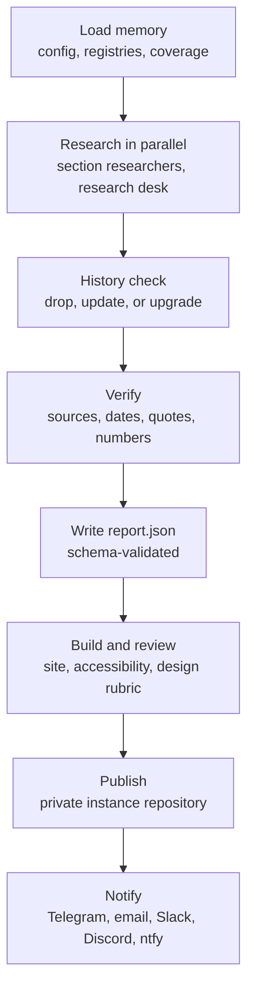

<div align="center">

<picture>
  <source media="(prefers-color-scheme: dark)" srcset="docs/assets/logo-dark.svg">
  
</picture>

### Your daily, verified, beautifully visualized AI and software briefing

An open-source [Claude Code](https://code.claude.com) routine that researches what changed in AI
and software every day, checks every claim against primary sources, and publishes one
consistently designed, chart-rich report.

[](https://github.com/Mordris/PulseAI/actions/workflows/ci.yml)
[](https://github.com/Mordris/PulseAI/actions/workflows/codeql.yml)
[](https://github.com/Mordris/PulseAI/actions/workflows/secret-scan.yml)
[](https://scorecard.dev/viewer/?uri=github.com/Mordris/PulseAI)
[](LICENSE)
[](https://www.python.org/)
[](https://www.conventionalcommits.org)
[](renovate.json)

[How it works](#how-it-works) · [Quick start](#quick-start) · [Configuration](#configuration) · [Extending](#extending-pulseai) · [Roadmap](#roadmap) · [Contributing](CONTRIBUTING.md)

</div>

> [!IMPORTANT]
> PulseAI is under active development. Milestone **M1 (foundation)** is being built now: schemas,
> registries, configuration, validation, CI, and security automation. The daily routine itself
> arrives in later milestones; see the [roadmap](#roadmap).

## Why PulseAI

AI models, agent tooling, and research change every day. Newsletters summarize; PulseAI verifies.
By design, every item in a report links to a primary source fetched during the run, every number in
a chart traces to a quoted span, and nothing is repeated from earlier reports unless something
changed.

## Highlights

Each capability is marked **available** (in the engine today) or **planned** (with the milestone
that delivers it; see the [roadmap](#roadmap)).

- **One report a day, on your schedule.** Runs as a Claude Code cloud routine, a GitHub Actions
  workflow, or a local systemd or launchd timer, all from the same configuration. *Available:
  per-host schedule settings (`pulse schedule print`). Planned (M4, M6): the daily run and host
  adapters.*
- **Verified, not summarized.** Primary-source requirement, date-window checks, quote-backed
  numbers, confidence labels (Confirmed, Reported, Rumor), and a recall check against expert
  curators. *Available: report schema and `pulse validate`. Planned (M4): the verifier.*
- **Remembers what it told you.** Coverage memory links follow-ups to earlier items and drops
  repeats. *Planned (M3).*
- **Deep-dives, not headlines.** Each item expands into a type-specific deep-dive: model releases,
  tool releases, papers, articles, repositories, security advisories, industry news, and
  leaderboard shifts. *Available: item-type registry and detail schemas. Planned (M4): generating
  the deep-dives.*
- **A research desk.** Papers from arXiv, OpenReview, and lab research pages, read in full and
  briefed the way a reviewer would. *Planned (M5).*
- **Designed, then checked.** A fixed visual frame with generative charts and diagrams, validated
  for accessibility and colorblind safety in light and dark themes. *Planned (M2 site and visual
  system, M4 design review).*
- **Nothing hardcoded.** Sections, item types, sources, languages, themes, models, and thresholds
  are schema-validated registries you can override without touching code. *Available.*
- **Open source first.** Built on Astro, Vega-Lite, Mermaid, Playwright, Apprise, MCP servers, and
  more; custom code is thin glue. See [Architecture](#architecture) for what exists today.

## How it works

The daily pipeline below is the target design; it lands across milestones M2 to M6 (see the
[roadmap](#roadmap)).



PulseAI ships as two pieces:

| Piece | What it is |
|---|---|
| **This repository (the engine)** | The Claude Code plugin (skills, agents, hooks), the `pulse` CLI, JSON Schemas, default registries, the report site, and host adapters |
| **Your `pulse-instance` (private)** | Your configuration and overrides, plus your daily reports, coverage state, and site |

Today the engine has the `pulse` CLI, JSON Schemas, default registries, and TypeScript contracts.
The plugin's skills and agents (M4), the report site (M2), and the host adapters (M6) are planned.

### What a report contains

The report format is defined by the report schema today; the site and the generation arrive in M2
and M4.

- A masthead with the **Pulse score**: how big the day was compared with your 7-day average
- KPI tiles, a TL;DR, a generative front-page dashboard, and an adoption radar (adopt, trial,
  assess, hold)
- Default sections: Models and labs, Agentic dev tooling, Research desk, Software and OSS
- Expandable deep-dives with charts, diagrams, and real figures, plus signals, corrections,
  methodology, and source health

## Quick start

> [!NOTE]
> Running a complete daily instance arrives with milestone M6. Today you can develop on the
> engine and validate configuration, registries, and reports.

**Requirements:** Python 3.12+, [uv](https://docs.astral.sh/uv/), Node.js LTS, pnpm,
Claude Code 2.1.259+, and Git. `pulse doctor` checks all of them.

### Develop on the engine

```bash
git clone https://github.com/Mordris/PulseAI.git
cd PulseAI
uv sync
pnpm install
uv run pre-commit install   # lint, secret scan, and commit-message hooks
uv run pulse doctor
uv run pytest && pnpm test
```

### Try the CLI

```bash
uv run pulse config show                                         # effective configuration
uv run pulse registry check                                      # registries and config agree
uv run pulse validate schema/examples/report/valid/minimal.json  # check a report
uv run pulse schedule print --host actions                       # scheduler settings per host
```

Exit codes are the same for every command: `0` when the input is fine, `1` when it loaded but has
validation problems, and `2` when it cannot be used at all (engine data, the registry catalog,
configuration, a registry that fails to load, or an unreadable report). Problems are printed to
stderr. `pulse doctor` is a report: it prints every finding to stdout and exits `1` if any check
fails, even when the cause is unusable input.

<details>
<summary><b>Install the Claude Code plugin</b></summary>

```text
/plugin marketplace add Mordris/PulseAI
/plugin install pulse@pulseai
```

The plugin's skills and agents arrive in milestone M4.

</details>

## Configuration

Your instance's `pulse.config.yaml` is merged over the [engine defaults](defaults/pulse.config.yaml),
and any value can be overridden at runtime with environment variables.

```yaml
schedule:
  time: "17:00"
  tz: Europe/Istanbul
language: en
sections:
  research: { enabled: true, max_items: 20 }
models_by_role:
  editor: claude-opus-5-5
```

```bash
PULSE__SCHEDULE__TIME=18:30 uv run pulse config show
```

| Registry | File | Purpose |
|---|---|---|
| Sections | [`taxonomy/sections.yaml`](taxonomy/sections.yaml) | Report sections, scoring rubrics, and sub-groups |
| Item types | [`taxonomy/item-types.yaml`](taxonomy/item-types.yaml) | Deep-dive types and their detail schemas |
| Roles | [`taxonomy/roles.yaml`](taxonomy/roles.yaml) | Agent roles that `models_by_role` assigns models to |
| Sources | [`sources/registry/`](sources/registry/) | Feeds, APIs, MCP tools, and searches |
| Locales | [`locales/`](locales/) | Interface text for each language; an instance can add a language with its own `locales/<language>.json` |
| Engine | [`defaults/engine.yaml`](defaults/engine.yaml) | Tool requirements checked by `pulse doctor` (engine-only: an instance cannot override it) |

Every contract lives in [`schema/`](schema/) as JSON Schema. Python models are generated from it,
and TypeScript validators are built from the same files.

## Extending PulseAI

Instances override registries by `id`, so you can add, change, or remove entries without writing
code:

```yaml
# pulse-instance/sources/registry/mine.yaml
schema_version: 1
sources:
  - id: my-team-blog
    name: My team's engineering blog
    tier: T2
    sections: [tooling]
    trust: 3
    enabled: true
    via: collector
    collector: { kind: rss, url: "https://example.org/feed.xml" }
  - id: simon-willison
    _remove: true
```

Then run `pulse registry check` to confirm everything still fits together. An id may appear only
once per file; to replace an entry completely, list `_remove: true` for its id and then the new
entry.

Tool requirements are the exception: the engine registry lists commands that `pulse doctor` runs,
so it is engine-only and an instance's `defaults/engine.yaml` is ignored.

## Architecture

<details>
<summary><b>Repository layout</b></summary>

```text
.claude-plugin/        plugin marketplace
plugins/pulse/         Claude Code plugin (manifest today; skills and agents planned, M4)
schema/                JSON Schemas: the single source of truth
defaults/              engine defaults and the registry catalog
taxonomy/              sections, item types, roles
sources/registry/      default research sources
locales/               interface text
packages/cli/          the pulse CLI (Python, uv)
packages/contracts/    Zod validators built from the schemas (TypeScript)
scripts/               maintainer tooling
docs/                  spec, plans, and architecture decisions
```

</details>

| Concern | Built on | Status |
|---|---|---|
| Report site | Astro, Pagefind, Style Dictionary | Planned (M2) |
| Charts and diagrams | Vega-Lite, Mermaid | Planned (M2) |
| Browser automation and QA | Playwright, axe-core | Planned (M2, M4) |
| Data access | MCP servers (GitHub, Hugging Face, arXiv, fetch, Exa, Brave), feedparser, httpx | Planned (M3) |
| Contracts | JSON Schema, generated Pydantic models, Zod | Available |
| Notifications | Apprise | Planned (M6) |
| Quality and supply chain | Ruff, Pyright, Biome, pytest, Vitest, CodeQL, OSV-Scanner, gitleaks, TruffleHog, zizmor, OpenSSF Scorecard, Renovate, release-please | Available |

## Security

The agents (M4) will treat fetched web content as untrusted data. Today the repository keeps
secrets out of git with pre-commit and CI secret scanning, pins every GitHub Action by commit SHA,
and audits CI network egress. To report a vulnerability, see [SECURITY.md](SECURITY.md).

## Roadmap

| Milestone | Scope | Status |
|---|---|---|
| M0 | Cloud routine spikes | Planned |
| M1 | Foundation: schemas, registries, config, validation, CI, security | In progress |
| M2 | Site and visual system | Planned |
| M3 | Data access: collector, MCP catalog, sources, coverage history | Planned |
| M4 | Agents and skills: daily orchestrator, verifier, design review | Planned |
| M5 | Research desk | Planned |
| M6 | Publish, notify, hosts, onboarding | Planned |

## Contributing

Contributions are welcome. Read [CONTRIBUTING.md](CONTRIBUTING.md); commits and pull request titles
follow [Conventional Commits](https://www.conventionalcommits.org). Want PulseAI to read a new
source? Open a [source request](https://github.com/Mordris/PulseAI/issues/new?template=source_request.yml).

## Community and support

- Questions and ideas: [GitHub Discussions](https://github.com/Mordris/PulseAI/discussions)
- Bugs and feature requests: [issues](https://github.com/Mordris/PulseAI/issues/new/choose)
- [Support](SUPPORT.md) · [Code of Conduct](CODE_OF_CONDUCT.md) · [Security policy](SECURITY.md)

## Citation

If you use PulseAI in research, cite it with the metadata in [CITATION.cff](CITATION.cff); GitHub
shows a "Cite this repository" button for it.

## License

[MIT](LICENSE) © PulseAI contributors
