# M1 Foundation Implementation Plan

> **For agentic workers:** REQUIRED SUB-SKILL: Use superpowers:subagent-driven-development (recommended) or superpowers:executing-plans to implement this plan task-by-task. Steps use checkbox (`- [ ]`) syntax for tracking.

**Goal:** Build the PulseAI engine foundation: a production-grade monorepo whose schemas, registries, and config are the single source of truth, plus the `pulse` CLI commands `config`, `registry check`, `validate`, `schedule print`, and `doctor`.

**Architecture:** JSON Schema files in `schema/` define every contract. Registries (`taxonomy/`, `sources/`, `locales/`, `defaults/`) are YAML/JSON data validated against those schemas; a generic loader merges engine defaults with per-instance overrides (by `id`) and validates the result. Python models are generated from the schemas (datamodel-code-generator); TypeScript builds Zod validators from the same files (`z.fromJSONSchema`). Custom code is thin glue: merge, cross-reference checks, schedule conversion, doctor.

**Tech Stack:** (security: gitleaks, TruffleHog, OSV-Scanner, zizmor, OpenSSF Scorecard, Harden-Runner, CodeQL, SBOM + provenance) Python ≥3.12 (CI: 3.12 and latest 3.15), uv workspace, Typer, Pydantic + pydantic-settings, jsonschema, PyYAML, jmespath, packaging, datamodel-code-generator, check-jsonschema, pytest, Ruff, Pyright; Node LTS (24), pnpm workspace, TypeScript, Zod 4, yaml, rfc6902, Vitest, Biome; pre-commit, actionlint, gitleaks, Renovate, release-please, CodeQL.

**Spec:** `docs/superpowers/specs/2026-10-11-pulseai-daily-research-routine-design.md` (v2). Read §3 (engineering standards), §6 (repositories), §7 (registries and config), §9 (data model), §20 (milestones).

**Scope note:** the spec lists design tokens among M1 registries; they move to M2 because Style Dictionary (which reads them) and the palette/contrast checks (ColorAide, axe-core) arrive there. `config.theme` and `config.quality` are already defined and validated here. The MCP server catalog stays in M3 as the spec says.

## Global Constraints

- **Latest versions:** add dependencies with `uv add` / `pnpm add` **without version pins** so the resolver picks the latest stable; lockfiles (`uv.lock`, `pnpm-lock.yaml`) record them. Versions current on 2026-10-11 are listed per task for reference only.
- **GitHub Actions are pinned by commit SHA** with the version in a trailing comment (values given in Tasks 12 and 13).
- **Workflow hardening (every workflow):** top-level `permissions: {}` with least-privilege per job; the first step of every job is `step-security/harden-runner` with `egress-policy: audit` (records outbound network calls so exfiltration and leaks are visible); every `actions/checkout` sets `persist-credentials: false`. `zizmor` (Task 13) enforces these rules in CI.
- **No hardcoding:** code must not embed section ids, item-type ids, source URLs, model ids, colors, UI strings, thresholds, limits, or schedules. They live in `schema/`, `defaults/`, `taxonomy/`, `sources/`, `locales/`. Code may contain rules (how to check) but not values (what to check against).
- **Schemas:** JSON Schema draft 2020-12; `$id` uses `urn:pulseai:schema:<name>`; every object has `"additionalProperties": false`; every object that should become a named model has a unique `title`; **never use `if`/`then`/`else`** (Zod's `fromJSONSchema` rejects them — use `oneOf` with `const` discriminators).
- **Ids:** registry ids match `^[a-z0-9]+(?:[_-][a-z0-9]+)*$`; report item ids match `^[a-z0-9]+(?:-[a-z0-9]+)*$` (max 64).
- **Generated code** lives in `packages/cli/src/pulseai/models/` and is never edited by hand; `scripts/generate_models.py --check` must pass in CI.
- **Python package name** `pulseai`, import package `pulseai`, CLI command `pulse`. Version comes from package metadata (no duplicated version literals in code).
- **Engine data in wheels** is bundled under `pulseai/_data/` via hatch `force-include`; publishing is wheel-only.
- **Python style:** Ruff (rules in root `pyproject.toml`), Pyright strict for `packages/cli/src/pulseai` (generated models ignored).
- **TypeScript style:** Biome recommended rules, TS strict with `noUncheckedIndexedAccess` and `exactOptionalPropertyTypes`.
- **Commits:** Conventional Commits; every commit message ends with `Co-Authored-By: Claude Opus 5.5 <noreply@anthropic.com>`.
- **CLI output:** plain lines (`<level> <where>: <message>`), errors to stderr, exit code 1 for validation errors, 2 for unusable input.
- **Lint steps:** always run `uv run ruff format .` before `uv run ruff check .` (the formatter wraps long call and literal lines; the plan's code blocks are not pre-wrapped to 100 columns). Pre-commit runs the same formatter.

## Review Focus

1. **Partial or wrong instance overrides** (a patch that removes a required field, a misspelled key, `_remove` on an id that does not exist) must fail with a message naming the **instance file** and the **JSON path**, not a stack trace. → Task 5 `test_invalid_instance_override_names_file_and_path`, `test_remove_unknown_id_is_ignored`.
2. **Environment overrides with wrong types or typos** (`PULSE__SCHEDULE__TIME=99:99`, `PULSE__SCHEDUL__TIME=…`) must fail with the variable name, or be reported by `doctor`. → Task 6 `test_env_override_invalid_value_names_variable`, `test_unknown_env_overrides`; Task 11 `test_doctor_warns_on_unknown_env`.
3. **Running from an installed wheel instead of a checkout** must find engine data inside the package, while a source checkout (including editable installs) must always use the live repo files. → Task 3 `test_wheel_bundles_engine_data`, `test_packaged_data_used_outside_a_checkout`, `test_engine_root_is_repo_root_in_a_checkout`.
4. **Empty files, UTF-8 BOM, unsupported extensions** in registries must give a clear error. → Task 5 `test_read_document_handles_bom`, `test_read_document_empty_file`, `test_read_document_unsupported_suffix`.
5. **A schema construct one language cannot handle** (e.g. `if`/`then`) must fail CI on both sides. → Task 4 `test_no_conditional_keywords`; Task 9 `compiles <schema>` tests.
6. **Time zones with DST** must produce both UTC crons, and times near midnight must wrap correctly. → Task 10 `test_new_york_two_crons`, `test_midnight_wrap`.

---

## File Structure

```
.claude-plugin/marketplace.json            # Task 1  plugin marketplace
plugins/pulse/.claude-plugin/plugin.json    # Task 1  plugin manifest (components added in M4)
pyproject.toml                              # Task 1  uv workspace root + Ruff/Pyright/pytest config
package.json, pnpm-workspace.yaml           # Task 1  pnpm workspace root
biome.json, tsconfig.base.json              # Task 1
.pre-commit-config.yaml, .editorconfig      # Task 1
README.md, LICENSE, CONTRIBUTING.md, SECURITY.md   # Task 1 / Task 12
packages/cli/pyproject.toml                 # Task 1 (+ force-include in Tasks 3, 4)
packages/cli/src/pulseai/__init__.py        # Task 1  version from metadata
packages/cli/src/pulseai/cli.py             # Task 1, extended in Tasks 6, 7, 8, 10, 11
packages/cli/src/pulseai/paths.py           # Task 3  engine data locator
packages/cli/src/pulseai/schemas.py         # Task 5  schema loading + validation
packages/cli/src/pulseai/issues.py          # Task 7  Issue type
packages/cli/src/pulseai/registry/merge.py  # Task 5  generic merge
packages/cli/src/pulseai/registry/loader.py # Task 5  registry loading
packages/cli/src/pulseai/registry/checks.py # Task 7  cross-registry rules
packages/cli/src/pulseai/config.py          # Task 6  config + env overrides
packages/cli/src/pulseai/report/validate.py # Task 8  report validation
packages/cli/src/pulseai/schedule.py        # Task 10
packages/cli/src/pulseai/doctor.py          # Task 11
packages/cli/src/pulseai/models/*.py        # generated (Tasks 2, 4, 8)
packages/cli/tests/...                      # tests per task
scripts/generate_models.py                  # Task 2
schema/*.schema.json                        # Tasks 2, 4, 8
schema/item-types/*.schema.json             # Task 4
schema/examples/report/*.json               # Task 8
defaults/{pulse.config.yaml,engine.yaml,registries.yaml}  # Tasks 2, 4
taxonomy/{sections,item-types,roles}.yaml   # Task 4
sources/registry/core.yaml                  # Task 4
locales/{en,tr}.json                        # Task 4
templates/instance/pulse.config.yaml        # Task 6
packages/contracts/                         # Task 9  TS Zod contracts
.github/workflows/{ci,codeql,dependency-review,release-please}.yml  # Task 12
.github/workflows/{secret-scan,vulnerability-scan,workflow-security,scorecard}.yml, .gitleaks.toml  # Task 13
.github/{ISSUE_TEMPLATE,DISCUSSION_TEMPLATE}/, pull_request_template.md, labels.yml, labeler.yml, release.yml, repository.yml  # Task 14
scripts/github/apply_repo_settings.py, CODE_OF_CONDUCT.md, SUPPORT.md, CITATION.cff, docs/assets/  # Task 14
renovate.json, release-please-config.json, .release-please-manifest.json, .github/CODEOWNERS  # Task 12
docs/adr/0001-oss-first-registry-driven-stack.md  # Task 12
```

---

### Task 1: Monorepo scaffold, toolchain, plugin manifests

**Files:**
- Create: `pyproject.toml`, `packages/cli/pyproject.toml`, `packages/cli/README.md`, `packages/cli/src/pulseai/__init__.py`, `packages/cli/src/pulseai/cli.py`, `packages/cli/tests/conftest.py`, `packages/cli/tests/test_cli.py`, `package.json`, `pnpm-workspace.yaml`, `biome.json`, `tsconfig.base.json`, `.editorconfig`, `.pre-commit-config.yaml`, `README.md`, `LICENSE`, `.claude-plugin/marketplace.json`, `plugins/pulse/.claude-plugin/plugin.json`
- Modify: `.gitignore`

**Interfaces:**
- Produces: `pulseai.__version__: str`; `pulseai.cli.app: typer.Typer` (entry point `pulse`); pytest fixture `repo_root() -> Path`.

- [ ] **Step 1: Write the root workspace files**

`pyproject.toml`:
```toml
[project]
name = "pulseai-workspace"
version = "0.0.0"
description = "PulseAI monorepo workspace root (not published)"
requires-python = ">=3.12"
dependencies = ["pulseai"]

[tool.uv]
package = false

[tool.uv.workspace]
members = ["packages/cli"]

[tool.uv.sources]
pulseai = { workspace = true }

[tool.ruff]
line-length = 100
target-version = "py312"
extend-exclude = ["packages/cli/src/pulseai/models"]

[tool.ruff.lint]
select = ["E", "W", "F", "I", "B", "UP", "SIM", "RUF", "PTH", "N", "S", "C4", "PIE", "RET"]

[tool.ruff.lint.per-file-ignores]
"**/tests/**" = ["S101", "S603", "S607"]
"scripts/**" = ["S603", "S607"]

[tool.pyright]
include = ["packages/cli/src", "packages/cli/tests", "scripts"]
ignore = ["packages/cli/src/pulseai/models"]
strict = ["packages/cli/src/pulseai"]
pythonVersion = "3.12"
venvPath = "."
venv = ".venv"

[tool.pytest.ini_options]
testpaths = ["packages/cli/tests"]
addopts = "-ra --strict-markers"
markers = ["slow: builds artifacts or spawns subprocesses"]
```

`packages/cli/pyproject.toml`:
```toml
[project]
name = "pulseai"
version = "0.1.0"
description = "PulseAI engine CLI: daily AI and software research routine for Claude Code"
readme = "README.md"
license = "MIT"
requires-python = ">=3.12"
authors = [{ name = "PulseAI contributors" }]
dependencies = []

[project.scripts]
pulse = "pulseai.cli:app"

[build-system]
requires = ["hatchling"]
build-backend = "hatchling.build"

[tool.hatch.build.targets.wheel]
packages = ["src/pulseai"]
```

`packages/cli/README.md`:
```markdown
# pulseai

The PulseAI engine CLI (`pulse`). See the repository README for setup.
```

`package.json`:
```json
{
  "name": "pulseai-workspace",
  "private": true,
  "type": "module",
  "packageManager": "pnpm@12.11.2",
  "engines": { "node": ">=24" },
  "scripts": {
    "lint": "biome check .",
    "format": "biome format --write .",
    "typecheck": "pnpm -r --if-present typecheck",
    "test": "pnpm -r --if-present test"
  }
}
```

`pnpm-workspace.yaml`:
```yaml
packages:
  - "packages/*"
```

`biome.json`:
```json
{
  "$schema": "./node_modules/@biomejs/biome/configuration_schema.json",
  "vcs": { "enabled": true, "clientKind": "git", "useIgnoreFile": true },
  "files": {
    "includes": ["**", "!**/node_modules", "!**/dist", "!.venv", "!packages/cli/src/pulseai/models"]
  },
  "formatter": { "enabled": true, "indentStyle": "space", "indentWidth": 2, "lineWidth": 100 },
  "linter": { "enabled": true, "rules": { "recommended": true } },
  "assist": { "enabled": true }
}
```

`tsconfig.base.json`:
```json
{
  "compilerOptions": {
    "target": "ES2024",
    "module": "NodeNext",
    "moduleResolution": "NodeNext",
    "strict": true,
    "noUncheckedIndexedAccess": true,
    "exactOptionalPropertyTypes": true,
    "resolveJsonModule": true,
    "allowImportingTsExtensions": true,
    "verbatimModuleSyntax": true,
    "isolatedModules": true,
    "skipLibCheck": true,
    "noEmit": true
  }
}
```

`.editorconfig`:
```ini
root = true

[*]
charset = utf-8
end_of_line = lf
insert_final_newline = true
indent_style = space
indent_size = 2
trim_trailing_whitespace = true

[*.py]
indent_size = 4
```

Replace `.gitignore` with:
```gitignore
archive-*/
.venv/
__pycache__/
*.pyc
.pytest_cache/
.coverage
coverage/
htmlcov/
dist/
build/
node_modules/
runs/
.env
```

- [ ] **Step 2: Write the license, README, and plugin manifests**

`LICENSE` (MIT):
```text
MIT License

Copyright (c) 2026 PulseAI contributors

Permission is hereby granted, free of charge, to any person obtaining a copy
of this software and associated documentation files (the "Software"), to deal
in the Software without restriction, including without limitation the rights
to use, copy, modify, merge, publish, distribute, sublicense, and/or sell
copies of the Software, and to permit persons to whom the Software is
furnished to do so, subject to the following conditions:

The above copyright notice and this permission notice shall be included in all
copies or substantial portions of the Software.

THE SOFTWARE IS PROVIDED "AS IS", WITHOUT WARRANTY OF ANY KIND, EXPRESS OR
IMPLIED, INCLUDING BUT NOT LIMITED TO THE WARRANTIES OF MERCHANTABILITY,
FITNESS FOR A PARTICULAR PURPOSE AND NONINFRINGEMENT. IN NO EVENT SHALL THE
AUTHORS OR COPYRIGHT HOLDERS BE LIABLE FOR ANY CLAIM, DAMAGES OR OTHER
LIABILITY, WHETHER IN AN ACTION OF CONTRACT, TORT OR OTHERWISE, ARISING FROM,
OUT OF OR IN CONNECTION WITH THE SOFTWARE OR THE USE OR OTHER DEALINGS IN THE
SOFTWARE.
```

`README.md`:
```markdown
# PulseAI

A Claude Code routine that researches AI and software every day, verifies what it finds against
primary sources, and publishes one visual, consistently designed report.

Status: under construction (milestone M1, foundation). See
`docs/superpowers/specs/2026-10-11-pulseai-daily-research-routine-design.md`.

## Development

Requirements: Python 3.12+, [uv](https://docs.astral.sh/uv/), Node.js LTS, pnpm (via Corepack).

    uv sync
    pnpm install
    uv run pytest
    pnpm test
    uv run pre-commit install
```

`.claude-plugin/marketplace.json`:
```json
{
  "name": "pulseai",
  "owner": { "name": "PulseAI contributors" },
  "plugins": [
    {
      "name": "pulse",
      "source": "./plugins/pulse",
      "description": "Research, verify, design, and publish one daily AI and software report"
    }
  ]
}
```

`plugins/pulse/.claude-plugin/plugin.json`:
```json
{
  "name": "pulse",
  "version": "0.1.0",
  "description": "Research, verify, design, and publish one daily AI and software report",
  "author": { "name": "PulseAI contributors" },
  "license": "MIT",
  "keywords": ["research", "news", "ai", "daily-report"]
}
```

- [ ] **Step 3: Write the failing CLI test**

`packages/cli/tests/conftest.py`:
```python
from pathlib import Path

import pytest

REPO_ROOT = Path(__file__).resolve().parents[3]


@pytest.fixture
def repo_root() -> Path:
    return REPO_ROOT
```

`packages/cli/tests/test_cli.py`:
```python
from typer.testing import CliRunner

from pulseai import __version__
from pulseai.cli import app

runner = CliRunner()


def test_version_option_prints_package_version() -> None:
    result = runner.invoke(app, ["--version"])
    assert result.exit_code == 0
    assert result.output.strip() == f"pulse {__version__}"


def test_version_comes_from_installed_metadata() -> None:
    assert not __version__.endswith("+unknown")
```

- [ ] **Step 4: Write the package root, install dependencies (latest), and confirm the test fails**

`packages/cli/src/pulseai/__init__.py` (needed so the workspace package can build):
```python
"""PulseAI engine."""

from importlib.metadata import PackageNotFoundError, version

try:
    __version__ = version("pulseai")
except PackageNotFoundError:  # running from a source tree without installation
    __version__ = "0.0.0+unknown"
```

Run:
```bash
uv add --package pulseai typer
uv add --dev ruff pyright pytest pytest-cov pre-commit
uv sync
uv run pytest packages/cli/tests/test_cli.py -v
```
Expected: FAIL — `ModuleNotFoundError: No module named 'pulseai.cli'`. Reference versions on 2026-10-11: typer 0.27.3, ruff 0.17.0, pyright 1.1.414, pytest 9.1.1, pytest-cov 7.1.0, pre-commit 4.6.2.

- [ ] **Step 5: Write the CLI**

`packages/cli/src/pulseai/cli.py`:
```python
"""Command-line interface for the PulseAI engine (`pulse`)."""

from __future__ import annotations

import typer

from pulseai import __version__

app = typer.Typer(
    name="pulse",
    no_args_is_help=True,
    add_completion=False,
    help="PulseAI engine: check configuration, registries, reports, and schedules.",
)


def _show_version(value: bool) -> None:
    if value:
        typer.echo(f"pulse {__version__}")
        raise typer.Exit


@app.callback()
def main(
    version: bool = typer.Option(
        False, "--version", callback=_show_version, is_eager=True, help="Show the version and exit."
    ),
) -> None:
    """PulseAI engine CLI."""


@app.command("version")
def version_command() -> None:
    """Show the version."""
    typer.echo(f"pulse {__version__}")
```

- [ ] **Step 6: Run the tests and linters**

Run:
```bash
uv sync
uv run pytest packages/cli/tests/test_cli.py -v
uv run ruff check . && uv run ruff format --check .
uv run pyright
```
Expected: 2 passed; Ruff and Pyright report no errors.

- [ ] **Step 7: Set up the Node workspace (latest) and Biome**

Run:
```bash
corepack enable pnpm
pnpm add -D -w @biomejs/biome typescript @types/node
pnpm lint
```
Expected: `pnpm lint` exits 0. Reference versions: @biomejs/biome 2.5.15, typescript 7.0.2, @types/node 26.6.5. If `pnpm` reports a newer `packageManager` version, keep the newer one.

- [ ] **Step 8: Validate the plugin manifests**

Run:
```bash
claude plugin validate .
claude plugin validate plugins/pulse
```
Expected: both report the manifest as valid (warnings about the plugin having no components yet are acceptable; components arrive in M4).

- [ ] **Step 9: Add pre-commit hooks and update them to the latest revisions**

`.pre-commit-config.yaml`:
```yaml
repos:
  - repo: https://github.com/pre-commit/pre-commit-hooks
    rev: v6.0.0
    hooks:
      - id: check-yaml
      - id: check-json
      - id: end-of-file-fixer
      - id: trailing-whitespace
      - id: check-merge-conflict
      - id: check-added-large-files
  - repo: https://github.com/astral-sh/ruff-pre-commit
    rev: v0.17.0
    hooks:
      - id: ruff-check
        args: [--fix]
      - id: ruff-format
  - repo: https://github.com/biomejs/pre-commit
    rev: v2.5.15
    hooks:
      - id: biome-check
        additional_dependencies: ["@biomejs/biome@2.5.15"]
  - repo: https://github.com/python-jsonschema/check-jsonschema
    rev: 0.38.2
    hooks:
      - id: check-github-workflows
      - id: check-renovate
  - repo: https://github.com/rhysd/actionlint
    rev: v1.7.12
    hooks:
      - id: actionlint
  - repo: https://github.com/gitleaks/gitleaks
    rev: v8.30.1
    hooks:
      - id: gitleaks
  - repo: local
    hooks:
      - id: pyright
        name: pyright
        entry: uv run pyright
        language: system
        types: [python]
        pass_filenames: false
```

Run:
```bash
uv run pre-commit autoupdate
uv run pre-commit install
uv run pre-commit run --all-files
```
Expected: every hook passes (fixers may modify files on the first run; run again until clean). If `autoupdate` bumped the Biome hook, set its `additional_dependencies` to the same version.

- [ ] **Step 10: Commit**

```bash
git add -A
git commit -m "chore: scaffold monorepo, toolchain, and plugin manifests

Co-Authored-By: Claude Opus 5.5 <noreply@anthropic.com>"
```

---

### Task 2: Config schema, engine defaults, and model generation

**Files:**
- Create: `schema/config.schema.json`, `defaults/pulse.config.yaml`, `scripts/generate_models.py`, `packages/cli/src/pulseai/models/__init__.py` (generated), `packages/cli/src/pulseai/models/config.py` (generated), `packages/cli/tests/test_config_schema.py`

**Interfaces:**
- Produces: generated `pulseai.models.config.PulseConfig` (fields: `engine`, `schedule`, `language`, `interests`, `sections`, `deep_dive`, `confidence`, `window`, `models_by_role`, `limits`, `quality`, `theme`, `visuals`, `mcp`, `site`, `publish`, `notify`, `telemetry`), `pulseai.models.config.ScheduleConfig` (`time: str`, `tz: str`, `cloud_offset_minutes_when_on_hour: int`); script `scripts/generate_models.py [--check]` (generates one module per `schema/*.schema.json`, module name = file name without `.schema.json`, `-` → `_`).

- [ ] **Step 1: Write the failing tests**

`packages/cli/tests/test_config_schema.py`:
```python
import json
import subprocess
import sys
from pathlib import Path
from typing import Any

import pytest
import yaml
from jsonschema import Draft202012Validator


def _validator(root: Path) -> Draft202012Validator:
    schema = json.loads((root / "schema/config.schema.json").read_text(encoding="utf-8"))
    Draft202012Validator.check_schema(schema)
    return Draft202012Validator(schema, format_checker=Draft202012Validator.FORMAT_CHECKER)


def _defaults(root: Path) -> dict[str, Any]:
    return yaml.safe_load((root / "defaults/pulse.config.yaml").read_text(encoding="utf-8"))


def test_defaults_validate(repo_root: Path) -> None:
    assert list(_validator(repo_root).iter_errors(_defaults(repo_root))) == []


@pytest.mark.parametrize(
    ("path", "value"),
    [
        (("schedule", "time"), "25:00"),
        (("language",), "english"),
        (("theme", "default"), "sepia"),
        (("publish", "repo"), "not a repo"),
        (("theme", "overrides", "accent"), "blue"),
        (("limits", "run_minutes"), 0),
    ],
)
def test_rejects_bad_values(repo_root: Path, path: tuple[str, ...], value: object) -> None:
    data = _defaults(repo_root)
    target = data
    for key in path[:-1]:
        target = target.setdefault(key, {})
    target[path[-1]] = value
    assert list(_validator(repo_root).iter_errors(data))


def test_rejects_unknown_keys(repo_root: Path) -> None:
    data = _defaults(repo_root)
    data["schedul"] = {}
    assert list(_validator(repo_root).iter_errors(data))


def test_generated_model_parses_defaults(repo_root: Path) -> None:
    from pulseai.models.config import PulseConfig

    cfg = PulseConfig.model_validate(_defaults(repo_root))
    assert cfg.schedule.time == "17:00"
    assert cfg.schedule.tz == "Europe/Istanbul"
    assert cfg.models_by_role["editor"] == "claude-opus-5-5"


@pytest.mark.slow
def test_generated_models_are_up_to_date(repo_root: Path) -> None:
    result = subprocess.run(
        [sys.executable, str(repo_root / "scripts/generate_models.py"), "--check"],
        capture_output=True,
        text=True,
        cwd=repo_root,
        check=False,
    )
    assert result.returncode == 0, result.stderr
```

- [ ] **Step 2: Run the tests to verify they fail**

Run: `uv run pytest packages/cli/tests/test_config_schema.py -v`
Expected: FAIL — `FileNotFoundError` for `schema/config.schema.json` (and `ModuleNotFoundError: yaml` until Step 3's dependencies are added).

- [ ] **Step 3: Add dependencies (latest)**

Run:
```bash
uv add --package pulseai pydantic pyyaml "jsonschema[format-nongpl]"
uv add --dev datamodel-code-generator types-PyYAML types-jsonschema
```
Reference versions: pydantic 2.14.0, PyYAML 6.0.3, jsonschema 4.26.0, datamodel-code-generator 0.83.0.

- [ ] **Step 4: Write the config schema**

`schema/config.schema.json`:
```json
{
  "$schema": "https://json-schema.org/draft/2020-12/schema",
  "$id": "urn:pulseai:schema:config",
  "title": "PulseConfig",
  "description": "Effective configuration: defaults/pulse.config.yaml merged with the instance pulse.config.yaml and PULSE__ environment overrides.",
  "type": "object",
  "additionalProperties": false,
  "required": [
    "engine", "schedule", "language", "interests", "sections", "deep_dive", "confidence",
    "window", "models_by_role", "limits", "quality", "theme", "visuals", "mcp", "site",
    "publish", "notify", "telemetry"
  ],
  "properties": {
    "engine": {
      "title": "EngineConfig",
      "type": "object",
      "additionalProperties": false,
      "required": ["version"],
      "properties": {
        "version": { "type": "string", "minLength": 1, "description": "Engine release (semver) or git ref." }
      }
    },
    "schedule": {
      "title": "ScheduleConfig",
      "type": "object",
      "additionalProperties": false,
      "required": ["time", "tz", "cloud_offset_minutes_when_on_hour"],
      "properties": {
        "time": { "type": "string", "pattern": "^([01]\\d|2[0-3]):[0-5]\\d$", "description": "Local start time, 24-hour HH:MM." },
        "tz": { "type": "string", "minLength": 1, "description": "IANA time zone, e.g. Europe/Istanbul." },
        "cloud_offset_minutes_when_on_hour": { "type": "integer", "minimum": 0, "maximum": 59, "description": "Cloud schedulers start late on the hour; shift on-the-hour times by this many minutes." }
      }
    },
    "language": { "$ref": "#/$defs/language" },
    "interests": {
      "title": "InterestsConfig",
      "type": "object",
      "additionalProperties": false,
      "required": ["high", "normal"],
      "properties": {
        "high": { "$ref": "#/$defs/terms" },
        "normal": { "$ref": "#/$defs/terms" }
      }
    },
    "sections": {
      "type": "object",
      "minProperties": 1,
      "propertyNames": { "$ref": "#/$defs/id" },
      "additionalProperties": { "$ref": "#/$defs/sectionToggle" }
    },
    "deep_dive": {
      "title": "DeepDiveConfig",
      "type": "object",
      "additionalProperties": false,
      "required": ["min_impact"],
      "properties": { "min_impact": { "$ref": "#/$defs/score" } }
    },
    "confidence": {
      "title": "ConfidenceConfig",
      "type": "object",
      "additionalProperties": false,
      "required": ["reported", "rumor"],
      "properties": {
        "reported": { "enum": ["main", "signals_box", "exclude"] },
        "rumor": { "enum": ["signals_box", "exclude"] }
      }
    },
    "window": {
      "title": "WindowConfig",
      "type": "object",
      "additionalProperties": false,
      "required": ["max_hours"],
      "properties": { "max_hours": { "type": "integer", "minimum": 24, "maximum": 336 } }
    },
    "models_by_role": {
      "type": "object",
      "minProperties": 1,
      "propertyNames": { "$ref": "#/$defs/id" },
      "additionalProperties": { "type": "string", "minLength": 1 }
    },
    "limits": {
      "title": "LimitsConfig",
      "type": "object",
      "additionalProperties": false,
      "required": ["run_minutes", "max_budget_usd", "design_fix_rounds", "agent_max_turns"],
      "properties": {
        "run_minutes": { "type": "integer", "minimum": 5, "maximum": 240 },
        "max_budget_usd": { "type": "number", "exclusiveMinimum": 0 },
        "design_fix_rounds": { "type": "integer", "minimum": 0, "maximum": 5 },
        "agent_max_turns": { "type": "integer", "minimum": 1, "maximum": 500 }
      }
    },
    "quality": {
      "title": "QualityConfig",
      "type": "object",
      "additionalProperties": false,
      "required": ["text_contrast_min", "section_delta_e_min", "section_cvd_fail", "section_cvd_target", "design_review_min_score"],
      "properties": {
        "text_contrast_min": { "type": "number", "minimum": 1, "maximum": 21 },
        "section_delta_e_min": { "type": "number", "minimum": 0 },
        "section_cvd_fail": { "type": "number", "minimum": 0 },
        "section_cvd_target": { "type": "number", "minimum": 0 },
        "design_review_min_score": { "type": "number", "minimum": 0, "maximum": 10 }
      }
    },
    "theme": {
      "title": "ThemeConfig",
      "type": "object",
      "additionalProperties": false,
      "required": ["default", "switcher", "preset", "overrides"],
      "properties": {
        "default": { "enum": ["auto", "light", "dark"] },
        "switcher": { "type": "boolean" },
        "preset": { "$ref": "#/$defs/id" },
        "overrides": {
          "title": "ThemeOverrides",
          "type": "object",
          "additionalProperties": false,
          "properties": {
            "accent": { "$ref": "#/$defs/hex" },
            "font_display": { "$ref": "#/$defs/font" },
            "font_body": { "$ref": "#/$defs/font" },
            "sections": {
              "type": "object",
              "propertyNames": { "$ref": "#/$defs/id" },
              "additionalProperties": { "$ref": "#/$defs/hex" }
            }
          }
        }
      }
    },
    "visuals": {
      "title": "VisualsConfig",
      "type": "object",
      "additionalProperties": false,
      "required": ["min_per_deep_dive", "motion", "notify_media"],
      "properties": {
        "min_per_deep_dive": { "type": "integer", "minimum": 0, "maximum": 10 },
        "motion": { "type": "boolean" },
        "notify_media": { "enum": ["png", "gif", "none"] }
      }
    },
    "mcp": {
      "title": "McpConfig",
      "type": "object",
      "additionalProperties": false,
      "required": ["enabled", "optional"],
      "properties": {
        "enabled": { "$ref": "#/$defs/ids" },
        "optional": { "$ref": "#/$defs/ids" }
      }
    },
    "site": {
      "title": "SiteConfig",
      "type": "object",
      "additionalProperties": false,
      "required": ["url", "search"],
      "properties": {
        "url": { "type": ["string", "null"], "format": "uri", "pattern": "^https://" },
        "search": { "type": "boolean" }
      }
    },
    "publish": {
      "title": "PublishConfig",
      "type": "object",
      "additionalProperties": false,
      "required": ["repo", "branch"],
      "properties": {
        "repo": { "type": ["string", "null"], "pattern": "^[A-Za-z0-9_.-]+/[A-Za-z0-9_.-]+$" },
        "branch": { "type": "string", "minLength": 1 }
      }
    },
    "notify": {
      "title": "NotifyConfig",
      "type": "object",
      "additionalProperties": false,
      "required": ["urls_env", "on_failure"],
      "properties": {
        "urls_env": { "$ref": "#/$defs/envName" },
        "on_failure": { "type": "boolean" }
      }
    },
    "telemetry": {
      "title": "TelemetryConfig",
      "type": "object",
      "additionalProperties": false,
      "required": ["otel_endpoint_env"],
      "properties": { "otel_endpoint_env": { "$ref": "#/$defs/envName" } }
    }
  },
  "$defs": {
    "id": { "type": "string", "pattern": "^[a-z0-9]+(?:[_-][a-z0-9]+)*$" },
    "ids": { "type": "array", "uniqueItems": true, "items": { "$ref": "#/$defs/id" } },
    "language": { "type": "string", "pattern": "^[a-z]{2,3}(-[A-Z]{2})?$" },
    "terms": { "type": "array", "uniqueItems": true, "items": { "type": "string", "minLength": 1 } },
    "score": { "type": "integer", "minimum": 1, "maximum": 5 },
    "hex": { "type": "string", "pattern": "^#[0-9a-fA-F]{6}$" },
    "font": { "type": "string", "minLength": 1, "pattern": "^[^<>{};]+$" },
    "envName": { "type": "string", "pattern": "^[A-Z][A-Z0-9_]*$" },
    "sectionToggle": {
      "title": "SectionToggle",
      "type": "object",
      "additionalProperties": false,
      "required": ["enabled", "max_items"],
      "properties": {
        "enabled": { "type": "boolean" },
        "max_items": { "type": "integer", "minimum": 1, "maximum": 100 },
        "options": { "type": "object" }
      }
    }
  }
}
```

- [ ] **Step 5: Write the engine defaults**

`defaults/pulse.config.yaml`:
```yaml
# Engine defaults. An instance's pulse.config.yaml overrides any key; PULSE__A__B env vars override both.
engine:
  version: "0.1.0"
schedule:
  time: "17:00"
  tz: Europe/Istanbul
  cloud_offset_minutes_when_on_hour: 7
language: en
interests:
  high: [claude code, agentic coding, mcp, skills, plugins, agent frameworks, llm reasoning, evals]
  normal: [frontier models, open-weights models, inference, ai security]
sections:
  models: { enabled: true, max_items: 8 }
  tooling: { enabled: true, max_items: 10 }
  research: { enabled: true, max_items: 20, options: { max_papers_deep: 6, max_long_reads: 4 } }
  oss: { enabled: true, max_items: 8 }
deep_dive:
  min_impact: 3
confidence:
  reported: signals_box
  rumor: exclude
window:
  max_hours: 72
models_by_role:
  editor: claude-opus-5-5
  paper-analyst: claude-opus-5-5
  verifier: claude-opus-5-5
  section-researcher: claude-sonnet-5-5
  paper-triage: claude-haiku-5-5
  design-reviewer: claude-sonnet-5-5
limits:
  run_minutes: 45
  max_budget_usd: 15
  design_fix_rounds: 2
  agent_max_turns: 60
quality:
  text_contrast_min: 4.5
  section_delta_e_min: 12
  section_cvd_fail: 6
  section_cvd_target: 8
  design_review_min_score: 7
theme:
  default: auto
  switcher: true
  preset: pulse
  overrides: {}
visuals:
  min_per_deep_dive: 1
  motion: true
  notify_media: png
mcp:
  enabled: [github, huggingface, arxiv, fetch, playwright]
  optional: [exa, brave]
site:
  url: null
  search: true
publish:
  repo: null
  branch: main
notify:
  urls_env: PULSE_NOTIFY_URLS
  on_failure: true
telemetry:
  otel_endpoint_env: OTEL_EXPORTER_OTLP_ENDPOINT
```

- [ ] **Step 6: Write the model generator**

`scripts/generate_models.py`:
```python
"""Generate Pydantic models from schema/*.schema.json, the single source of truth.

Usage:
    uv run python scripts/generate_models.py          # write models
    uv run python scripts/generate_models.py --check  # fail if models are stale
"""

from __future__ import annotations

import argparse
import subprocess
import sys
from pathlib import Path

ROOT = Path(__file__).resolve().parents[1]
SCHEMA_DIR = ROOT / "schema"
OUT_DIR = ROOT / "packages" / "cli" / "src" / "pulseai" / "models"
INIT_TEXT = (
    '"""Pydantic models generated from schema/*.schema.json. '
    'Do not edit; run scripts/generate_models.py."""\n'
)
FLAGS = [
    "--input-file-type", "jsonschema",
    "--output-model-type", "pydantic_v2.BaseModel",
    "--target-python-version", "3.12",
    "--use-standard-collections",
    "--use-union-operator",
    "--field-constraints",
    "--use-annotated",
    "--enum-field-as-literal", "all",
    "--use-double-quotes",
    "--disable-timestamp",
    "--use-title-as-name",
    "--use-schema-description",
    "--formatters", "builtin",
]  # fmt: skip


def module_name(schema: Path) -> str:
    return schema.name.removesuffix(".schema.json").replace("-", "_")


def generate(schema: Path, check: bool) -> str | None:
    out = OUT_DIR / f"{module_name(schema)}.py"
    cmd = [sys.executable, "-m", "datamodel_code_generator", "--input", str(schema)]
    cmd += ["--output", str(out), *FLAGS]
    if check:
        cmd.append("--check")
    result = subprocess.run(cmd, capture_output=True, text=True, check=False)
    if result.returncode != 0:
        return f"{schema.name}: {result.stderr.strip() or result.stdout.strip()}"
    return None


def main() -> int:
    parser = argparse.ArgumentParser(description=__doc__)
    parser.add_argument("--check", action="store_true", help="verify models are up to date")
    args = parser.parse_args()

    OUT_DIR.mkdir(parents=True, exist_ok=True)
    problems = [p for s in sorted(SCHEMA_DIR.glob("*.schema.json")) if (p := generate(s, args.check))]

    init = OUT_DIR / "__init__.py"
    if args.check:
        if not init.is_file() or init.read_text(encoding="utf-8") != INIT_TEXT:
            problems.append("models/__init__.py is out of date")
    else:
        init.write_text(INIT_TEXT, encoding="utf-8")

    for problem in problems:
        print(problem, file=sys.stderr)
    return 1 if problems else 0


if __name__ == "__main__":
    raise SystemExit(main())
```

- [ ] **Step 7: Generate models and run the tests**

Run:
```bash
uv run python scripts/generate_models.py
uv run pytest packages/cli/tests/test_config_schema.py -v
```
Expected: all tests PASS (including the slow `--check` test). `packages/cli/src/pulseai/models/config.py` contains `class PulseConfig(BaseModel)` and `class ScheduleConfig(BaseModel)`.

- [ ] **Step 8: Lint, type-check, commit**

Run: `uv run ruff check . && uv run ruff format --check . && uv run pyright`
Expected: no errors.

```bash
git add schema defaults scripts packages/cli pyproject.toml uv.lock
git commit -m "feat(schema): add config schema, engine defaults, and model generation

Co-Authored-By: Claude Opus 5.5 <noreply@anthropic.com>"
```

---

### Task 3: Engine data locator and wheel packaging

**Files:**
- Create: `packages/cli/src/pulseai/paths.py`, `packages/cli/tests/test_paths.py`
- Modify: `packages/cli/pyproject.toml` (force-include), `packages/cli/tests/conftest.py` (cache isolation)

**Interfaces:**
- Consumes: `schema/config.schema.json` (marker file) from Task 2.
- Produces: `pulseai.paths.ENGINE_DATA_ENV = "PULSE_ENGINE_DATA"`, `class EngineDataError(RuntimeError)`, `engine_root() -> Path` (cached; `engine_root.cache_clear()`; order: env override → checkout → wheel `_data`), `data_path(*parts: str) -> Path`, private seams `_checkout_root()` and `_packaged_data_dir()` (monkeypatched in tests).

- [ ] **Step 1: Write the failing tests**

`packages/cli/tests/test_paths.py`:
```python
import subprocess
import zipfile
from pathlib import Path

import pytest

from pulseai import paths
from pulseai.paths import ENGINE_DATA_ENV, EngineDataError, data_path, engine_root


def test_engine_root_is_repo_root_in_a_checkout(repo_root: Path) -> None:
    assert engine_root() == repo_root
    assert data_path("schema", "config.schema.json").is_file()


def test_env_override(tmp_path: Path, monkeypatch: pytest.MonkeyPatch) -> None:
    (tmp_path / "schema").mkdir()
    (tmp_path / "schema" / "config.schema.json").write_text("{}", encoding="utf-8")
    monkeypatch.setenv(ENGINE_DATA_ENV, str(tmp_path))
    assert engine_root() == tmp_path.resolve()


def test_bad_override_is_rejected(tmp_path: Path, monkeypatch: pytest.MonkeyPatch) -> None:
    monkeypatch.setenv(ENGINE_DATA_ENV, str(tmp_path))
    with pytest.raises(EngineDataError, match="does not contain"):
        engine_root()


def test_packaged_data_used_outside_a_checkout(
    tmp_path: Path, monkeypatch: pytest.MonkeyPatch
) -> None:
    packaged = tmp_path / "_data"
    (packaged / "schema").mkdir(parents=True)
    (packaged / "schema" / "config.schema.json").write_text("{}", encoding="utf-8")
    monkeypatch.setattr(paths, "_checkout_root", lambda: None)
    monkeypatch.setattr(paths, "_packaged_data_dir", lambda: packaged)
    assert engine_root() == packaged


def test_no_data_anywhere_is_an_error(tmp_path: Path, monkeypatch: pytest.MonkeyPatch) -> None:
    monkeypatch.setattr(paths, "_checkout_root", lambda: None)
    monkeypatch.setattr(paths, "_packaged_data_dir", lambda: tmp_path / "missing")
    with pytest.raises(EngineDataError, match="engine data not found"):
        engine_root()


@pytest.mark.slow
def test_wheel_bundles_engine_data(repo_root: Path, tmp_path: Path) -> None:
    subprocess.run(
        ["uv", "build", "--wheel", "--package", "pulseai", "--out-dir", str(tmp_path)],
        cwd=repo_root,
        check=True,
        capture_output=True,
    )
    wheel = next(tmp_path.glob("pulseai-*.whl"))
    names = set(zipfile.ZipFile(wheel).namelist())
    for rel in ("schema/config.schema.json", "defaults/pulse.config.yaml"):
        assert f"pulseai/_data/{rel}" in names
```

Append to `packages/cli/tests/conftest.py`:
```python
import os
from collections.abc import Iterator

from pulseai.paths import ENGINE_DATA_ENV, engine_root


@pytest.fixture(autouse=True)
def _isolate_environment(monkeypatch: pytest.MonkeyPatch) -> Iterator[None]:
    for name in list(os.environ):
        if name.startswith("PULSE__") or name == ENGINE_DATA_ENV:
            monkeypatch.delenv(name)
    engine_root.cache_clear()
    yield
    engine_root.cache_clear()
```
(Move the new imports to the top of the file so Ruff's import rules pass.)

- [ ] **Step 2: Run the tests to verify they fail**

Run: `uv run pytest packages/cli/tests/test_paths.py -v`
Expected: FAIL — `ModuleNotFoundError: No module named 'pulseai.paths'`.

- [ ] **Step 3: Implement the locator**

`packages/cli/src/pulseai/paths.py`:
```python
"""Locate engine data (schemas, registries, defaults) in installed wheels and source checkouts."""

from __future__ import annotations

import os
from functools import cache
from importlib.resources import files
from pathlib import Path

ENGINE_DATA_ENV = "PULSE_ENGINE_DATA"
MARKER = Path("schema") / "config.schema.json"


class EngineDataError(RuntimeError):
    """Engine data could not be located."""


def _checkout_root() -> Path | None:
    """Nearest parent of this file holding the marker: a source checkout or editable install."""
    for parent in Path(__file__).resolve().parents:
        if (parent / MARKER).is_file():
            return parent
    return None


def _packaged_data_dir() -> Path:
    return Path(str(files("pulseai"))) / "_data"


@cache
def engine_root() -> Path:
    """Return the directory that holds schema/, defaults/, taxonomy/, sources/ and locales/.

    Lookup order: the PULSE_ENGINE_DATA override, a source checkout (so editable installs always
    use live files), then data bundled in the installed wheel.
    """
    override = os.environ.get(ENGINE_DATA_ENV)
    if override:
        root = Path(override).expanduser().resolve()
        if not (root / MARKER).is_file():
            msg = f"{ENGINE_DATA_ENV}={override} does not contain {MARKER}"
            raise EngineDataError(msg)
        return root
    checkout = _checkout_root()
    if checkout is not None:
        return checkout
    packaged = _packaged_data_dir()
    if (packaged / MARKER).is_file():
        return packaged
    msg = f"engine data not found; reinstall pulseai or set {ENGINE_DATA_ENV}"
    raise EngineDataError(msg)


def data_path(*parts: str) -> Path:
    """Path inside the engine data directory."""
    return engine_root().joinpath(*parts)
```

- [ ] **Step 4: Bundle engine data into the wheel**

Append to `packages/cli/pyproject.toml`:
```toml
[tool.hatch.build.targets.wheel.force-include]
"../../schema" = "pulseai/_data/schema"
"../../defaults" = "pulseai/_data/defaults"
```

- [ ] **Step 5: Run the tests**

Run: `uv sync && uv run pytest packages/cli/tests -v`
Expected: all PASS, including `test_wheel_bundles_engine_data`.

- [ ] **Step 6: Lint, type-check, commit**

Run: `uv run ruff check . && uv run ruff format --check . && uv run pyright`

```bash
git add packages/cli
git commit -m "feat(cli): locate engine data in checkouts and wheels

Co-Authored-By: Claude Opus 5.5 <noreply@anthropic.com>"
```

---

### Task 4: Registry schemas and default registry data

**Files:**
- Create: `schema/registries.schema.json`, `schema/engine.schema.json`, `schema/sections.schema.json`, `schema/item-types.schema.json`, `schema/roles.schema.json`, `schema/sources.schema.json`, `schema/locale.schema.json`, `schema/item-types/{model_release,release,paper,article,repo,security_advisory,industry,leaderboard_shift}.schema.json`, `schema/README.md`, `defaults/registries.yaml`, `defaults/engine.yaml`, `taxonomy/sections.yaml`, `taxonomy/item-types.yaml`, `taxonomy/roles.yaml`, `sources/registry/core.yaml`, `locales/en.json`, `locales/tr.json`, `packages/cli/tests/test_registry_files.py`
- Modify: `packages/cli/pyproject.toml` (force-include taxonomy, sources, locales), `packages/cli/tests/test_paths.py` (wheel asserts)
- Generated: `packages/cli/src/pulseai/models/{registries,engine,sections,item_types,roles,sources,locale}.py`

**Interfaces:**
- Produces (generated): `pulseai.models.registries.RegistriesCatalog` (`template_variables: list[str]`, `registries: list[RegistrySpec]`), `RegistrySpec` (`id: str`, `schema_: str` aliased `schema` — see Step 9 note, `paths: list[str]`, `instance_paths: list[str] | None`, `list_key: str | None`); `pulseai.models.engine.EngineRegistry` (`tools: list[Tool]`), `Tool` (`id`, `command: list[str]`, `version_regex`, `specifier`, `required: bool`, `hint`); `pulseai.models.sections.SectionsRegistry`, `Section`, `SectionGroup`, `GroupMatch`; `pulseai.models.item_types.ItemTypesRegistry`, `ItemType`; `pulseai.models.roles.RolesRegistry`, `Role`; `pulseai.models.locale.Locale`.
- Registry ids used by later tasks: `config`, `engine`, `sections`, `item-types`, `roles`, `sources`, `locale`.

- [ ] **Step 1: Write the failing tests**

`packages/cli/tests/test_registry_files.py`:
```python
import json
from pathlib import Path
from typing import Any

import pytest
import yaml
from jsonschema import Draft202012Validator

CONDITIONAL_KEYWORDS = frozenset({"if", "then", "else"})


def _load(path: Path) -> Any:
    text = path.read_text(encoding="utf-8")
    return json.loads(text) if path.suffix == ".json" else yaml.safe_load(text)


def _validator(root: Path, name: str) -> Draft202012Validator:
    schema = _load(root / "schema" / name)
    return Draft202012Validator(schema, format_checker=Draft202012Validator.FORMAT_CHECKER)


def _schema_files(root: Path) -> list[Path]:
    return sorted((root / "schema").rglob("*.schema.json"))


def _walk_keys(node: Any) -> set[str]:
    if isinstance(node, dict):
        keys = set(node)
        for value in node.values():
            keys |= _walk_keys(value)
        return keys
    if isinstance(node, list):
        return set().union(*(_walk_keys(v) for v in node)) if node else set()
    return set()


def test_every_schema_is_valid_2020_12(repo_root: Path) -> None:
    files = _schema_files(repo_root)
    assert files
    for path in files:
        Draft202012Validator.check_schema(_load(path))


def test_no_conditional_keywords(repo_root: Path) -> None:
    for path in _schema_files(repo_root):
        used = CONDITIONAL_KEYWORDS & _walk_keys(_load(path))
        assert not used, f"{path.name} uses {sorted(used)}; Zod cannot convert if/then/else"


def test_catalog_lists_every_registry_file(repo_root: Path) -> None:
    catalog = _load(repo_root / "defaults/registries.yaml")
    assert list(_validator(repo_root, "registries.schema.json").iter_errors(catalog)) == []
    for spec in catalog["registries"]:
        pattern = spec["paths"][0].replace("{language}", "*")
        matches = sorted(repo_root.glob(pattern))
        assert matches, f"{spec['id']}: nothing matches {pattern}"
        validator = _validator(repo_root, spec["schema"])
        for path in matches:
            errors = [e.message for e in validator.iter_errors(_load(path))]
            assert errors == [], f"{path}: {errors}"


@pytest.mark.parametrize(
    "module",
    ["registries", "engine", "sections", "item_types", "roles", "sources", "locale"],
)
def test_generated_registry_models_import(module: str) -> None:
    __import__(f"pulseai.models.{module}")
```

- [ ] **Step 2: Run the tests to verify they fail**

Run: `uv run pytest packages/cli/tests/test_registry_files.py -v`
Expected: FAIL — `FileNotFoundError` for `defaults/registries.yaml` and import errors for the generated modules.

- [ ] **Step 3: Write the catalog and engine schemas**

`schema/registries.schema.json`:
```json
{
  "$schema": "https://json-schema.org/draft/2020-12/schema",
  "$id": "urn:pulseai:schema:registries",
  "title": "RegistriesCatalog",
  "description": "Which registries exist, where their files live, and which schema validates them.",
  "type": "object",
  "additionalProperties": false,
  "required": ["schema_version", "template_variables", "registries"],
  "properties": {
    "schema_version": { "const": 1 },
    "template_variables": {
      "type": "array",
      "uniqueItems": true,
      "items": { "type": "string", "pattern": "^[a-z_]+$" },
      "description": "Variables allowed in source URL and query templates, e.g. {date}."
    },
    "registries": { "type": "array", "minItems": 1, "items": { "$ref": "#/$defs/registry" } }
  },
  "$defs": {
    "id": { "type": "string", "pattern": "^[a-z0-9]+(?:[_-][a-z0-9]+)*$" },
    "path": { "type": "string", "pattern": "^[A-Za-z0-9_./*{}-]+$" },
    "registry": {
      "title": "RegistrySpec",
      "type": "object",
      "additionalProperties": false,
      "required": ["id", "schema", "paths"],
      "properties": {
        "id": { "$ref": "#/$defs/id" },
        "schema": { "type": "string", "pattern": "^[a-z0-9_-]+\\.schema\\.json$" },
        "paths": { "type": "array", "minItems": 1, "items": { "$ref": "#/$defs/path" }, "description": "Engine files, relative to the engine root. Globs and {variables} allowed." },
        "instance_paths": { "type": "array", "minItems": 1, "items": { "$ref": "#/$defs/path" }, "description": "Instance override files; defaults to paths." },
        "list_key": { "type": "string", "pattern": "^[a-z_]+$", "description": "Key holding the id-keyed list when several engine files are combined." }
      }
    }
  }
}
```

`schema/engine.schema.json`:
```json
{
  "$schema": "https://json-schema.org/draft/2020-12/schema",
  "$id": "urn:pulseai:schema:engine",
  "title": "EngineRegistry",
  "description": "Engine requirements checked by pulse doctor.",
  "type": "object",
  "additionalProperties": false,
  "required": ["schema_version", "tools"],
  "properties": {
    "schema_version": { "const": 1 },
    "tools": { "type": "array", "minItems": 1, "items": { "$ref": "#/$defs/tool" } }
  },
  "$defs": {
    "id": { "type": "string", "pattern": "^[a-z0-9]+(?:[_-][a-z0-9]+)*$" },
    "tool": {
      "title": "Tool",
      "type": "object",
      "additionalProperties": false,
      "required": ["id", "command", "version_regex", "specifier", "required", "hint"],
      "properties": {
        "id": { "$ref": "#/$defs/id" },
        "command": { "type": "array", "minItems": 1, "items": { "type": "string", "minLength": 1 }, "description": "Prints the version. The token {python} means the running interpreter." },
        "version_regex": { "type": "string", "minLength": 1, "description": "First capture group is the version." },
        "specifier": { "type": "string", "minLength": 1, "description": "PEP 440 specifier, e.g. >=3.12." },
        "required": { "type": "boolean" },
        "hint": { "type": "string", "minLength": 1 }
      }
    }
  }
}
```

- [ ] **Step 4: Write the taxonomy schemas**

`schema/sections.schema.json`:
```json
{
  "$schema": "https://json-schema.org/draft/2020-12/schema",
  "$id": "urn:pulseai:schema:sections",
  "title": "SectionsRegistry",
  "description": "Report sections (taxonomy/sections.yaml).",
  "type": "object",
  "additionalProperties": false,
  "required": ["schema_version", "sections"],
  "properties": {
    "schema_version": { "const": 1 },
    "sections": { "type": "array", "minItems": 1, "items": { "$ref": "#/$defs/section" } }
  },
  "$defs": {
    "id": { "type": "string", "pattern": "^[a-z0-9]+(?:[_-][a-z0-9]+)*$" },
    "localeKey": { "type": "string", "pattern": "^[a-z0-9_]+(?:\\.[a-z0-9_-]+)+$" },
    "section": {
      "title": "Section",
      "type": "object",
      "additionalProperties": false,
      "required": ["id", "label", "color_token", "order", "rubric", "default_item_types", "researcher_brief", "groups"],
      "properties": {
        "id": { "$ref": "#/$defs/id" },
        "label": { "$ref": "#/$defs/localeKey" },
        "color_token": { "type": "string", "pattern": "^[a-z0-9]+(?:[.-][a-z0-9]+)*$" },
        "order": { "type": "integer", "minimum": 0 },
        "rubric": { "type": "array", "minItems": 5, "maxItems": 5, "items": { "type": "string", "minLength": 1 }, "description": "Impact definitions for scores 1 to 5, in order." },
        "default_item_types": { "type": "array", "minItems": 1, "uniqueItems": true, "items": { "$ref": "#/$defs/id" } },
        "researcher_brief": { "type": "string", "minLength": 1 },
        "groups": { "type": "array", "items": { "$ref": "#/$defs/group" } }
      }
    },
    "group": {
      "title": "SectionGroup",
      "type": "object",
      "additionalProperties": false,
      "required": ["id", "label", "match"],
      "properties": {
        "id": { "$ref": "#/$defs/id" },
        "label": { "$ref": "#/$defs/localeKey" },
        "match": {
          "title": "GroupMatch",
          "type": "object",
          "additionalProperties": false,
          "minProperties": 1,
          "properties": {
            "featured": { "$ref": "#/$defs/id" },
            "types": { "type": "array", "minItems": 1, "uniqueItems": true, "items": { "$ref": "#/$defs/id" } },
            "depth": { "enum": ["deep", "brief"] }
          }
        }
      }
    }
  }
}
```

`schema/item-types.schema.json`:
```json
{
  "$schema": "https://json-schema.org/draft/2020-12/schema",
  "$id": "urn:pulseai:schema:item-types",
  "title": "ItemTypesRegistry",
  "description": "Item types (taxonomy/item-types.yaml). Each type's detail object is validated by its schema in schema/item-types/.",
  "type": "object",
  "additionalProperties": false,
  "required": ["schema_version", "item_types"],
  "properties": {
    "schema_version": { "const": 1 },
    "item_types": { "type": "array", "minItems": 1, "items": { "$ref": "#/$defs/itemType" } }
  },
  "$defs": {
    "id": { "type": "string", "pattern": "^[a-z0-9]+(?:[_-][a-z0-9]+)*$" },
    "localeKey": { "type": "string", "pattern": "^[a-z0-9_]+(?:\\.[a-z0-9_-]+)+$" },
    "field": { "type": "string", "pattern": "^[a-z0-9_]+$" },
    "itemType": {
      "title": "ItemType",
      "type": "object",
      "additionalProperties": false,
      "required": ["id", "label", "schema", "component", "blocks", "brief_fields", "markdown_fields"],
      "properties": {
        "id": { "$ref": "#/$defs/id" },
        "label": { "$ref": "#/$defs/localeKey" },
        "schema": { "type": "string", "pattern": "^[a-z0-9_-]+\\.schema\\.json$" },
        "component": { "type": "string", "pattern": "^[A-Z][A-Za-z0-9]*$" },
        "blocks": { "type": "array", "minItems": 1, "uniqueItems": true, "items": { "$ref": "#/$defs/id" } },
        "brief_fields": { "type": "array", "uniqueItems": true, "items": { "$ref": "#/$defs/field" } },
        "markdown_fields": { "type": "array", "uniqueItems": true, "items": { "$ref": "#/$defs/field" } }
      }
    }
  }
}
```

`schema/roles.schema.json`:
```json
{
  "$schema": "https://json-schema.org/draft/2020-12/schema",
  "$id": "urn:pulseai:schema:roles",
  "title": "RolesRegistry",
  "description": "Agent roles (taxonomy/roles.yaml); config.models_by_role assigns a model to each.",
  "type": "object",
  "additionalProperties": false,
  "required": ["schema_version", "roles"],
  "properties": {
    "schema_version": { "const": 1 },
    "roles": {
      "type": "array",
      "minItems": 1,
      "items": {
        "title": "Role",
        "type": "object",
        "additionalProperties": false,
        "required": ["id", "description"],
        "properties": {
          "id": { "type": "string", "pattern": "^[a-z0-9]+(?:[_-][a-z0-9]+)*$" },
          "description": { "type": "string", "minLength": 1 }
        }
      }
    }
  }
}
```

`schema/locale.schema.json`:
```json
{
  "$schema": "https://json-schema.org/draft/2020-12/schema",
  "$id": "urn:pulseai:schema:locale",
  "title": "Locale",
  "description": "UI strings for one language (locales/<language>.json).",
  "type": "object",
  "additionalProperties": false,
  "required": ["schema_version", "language", "fallback", "strings"],
  "properties": {
    "schema_version": { "const": 1 },
    "language": { "type": "string", "pattern": "^[a-z]{2,3}(-[A-Z]{2})?$" },
    "fallback": { "type": ["string", "null"], "pattern": "^[a-z]{2,3}(-[A-Z]{2})?$" },
    "strings": {
      "type": "object",
      "propertyNames": { "pattern": "^[a-z0-9_]+(?:\\.[a-z0-9_-]+)+$" },
      "additionalProperties": { "type": "string", "minLength": 1 }
    }
  }
}
```

- [ ] **Step 5: Write the source registry schema**

`schema/sources.schema.json`:
```json
{
  "$schema": "https://json-schema.org/draft/2020-12/schema",
  "$id": "urn:pulseai:schema:sources",
  "title": "SourcesRegistry",
  "description": "Research sources (sources/registry/*.yaml). Each source is read by the generic collector, an MCP tool, or web search.",
  "type": "object",
  "additionalProperties": false,
  "required": ["schema_version", "sources"],
  "properties": {
    "schema_version": { "const": 1 },
    "sources": { "type": "array", "items": { "$ref": "#/$defs/source" } }
  },
  "$defs": {
    "id": { "type": "string", "pattern": "^[a-z0-9]+(?:[_-][a-z0-9]+)*$" },
    "text": { "type": "string", "minLength": 1 },
    "url": { "type": "string", "format": "uri", "pattern": "^https://" },
    "urlTemplate": { "type": "string", "pattern": "^https://\\S+$" },
    "jmespath": { "type": "string", "minLength": 1 },
    "envName": { "type": "string", "pattern": "^[A-Z][A-Z0-9_]*$" },
    "tier": { "enum": ["T1", "T1-data", "T2", "T3"] },
    "trust": { "type": "integer", "minimum": 1, "maximum": 5 },
    "sectionIds": { "type": "array", "minItems": 1, "uniqueItems": true, "items": { "$ref": "#/$defs/id" } },
    "source": {
      "oneOf": [
        { "$ref": "#/$defs/collectorSource" },
        { "$ref": "#/$defs/mcpSource" },
        { "$ref": "#/$defs/searchSource" }
      ]
    },
    "collectorSource": {
      "title": "CollectorSource",
      "type": "object",
      "additionalProperties": false,
      "required": ["id", "name", "tier", "sections", "trust", "enabled", "via", "collector"],
      "properties": {
        "id": { "$ref": "#/$defs/id" },
        "name": { "$ref": "#/$defs/text" },
        "homepage": { "$ref": "#/$defs/url" },
        "tier": { "$ref": "#/$defs/tier" },
        "sections": { "$ref": "#/$defs/sectionIds" },
        "trust": { "$ref": "#/$defs/trust" },
        "enabled": { "type": "boolean" },
        "notes": { "type": "string" },
        "via": { "const": "collector" },
        "collector": { "$ref": "#/$defs/collector" }
      }
    },
    "mcpSource": {
      "title": "McpSource",
      "type": "object",
      "additionalProperties": false,
      "required": ["id", "name", "tier", "sections", "trust", "enabled", "via", "mcp"],
      "properties": {
        "id": { "$ref": "#/$defs/id" },
        "name": { "$ref": "#/$defs/text" },
        "homepage": { "$ref": "#/$defs/url" },
        "tier": { "$ref": "#/$defs/tier" },
        "sections": { "$ref": "#/$defs/sectionIds" },
        "trust": { "$ref": "#/$defs/trust" },
        "enabled": { "type": "boolean" },
        "notes": { "type": "string" },
        "via": { "const": "mcp" },
        "mcp": {
          "title": "McpCall",
          "type": "object",
          "additionalProperties": false,
          "required": ["server", "tool"],
          "properties": {
            "server": { "$ref": "#/$defs/id" },
            "tool": { "type": "string", "pattern": "^[A-Za-z0-9_.-]+$" },
            "args": { "type": "object" }
          }
        }
      }
    },
    "searchSource": {
      "title": "SearchSource",
      "type": "object",
      "additionalProperties": false,
      "required": ["id", "name", "tier", "sections", "trust", "enabled", "via", "search"],
      "properties": {
        "id": { "$ref": "#/$defs/id" },
        "name": { "$ref": "#/$defs/text" },
        "homepage": { "$ref": "#/$defs/url" },
        "tier": { "$ref": "#/$defs/tier" },
        "sections": { "$ref": "#/$defs/sectionIds" },
        "trust": { "$ref": "#/$defs/trust" },
        "enabled": { "type": "boolean" },
        "notes": { "type": "string" },
        "via": { "const": "search" },
        "search": {
          "title": "SearchSpec",
          "type": "object",
          "additionalProperties": false,
          "required": ["queries"],
          "properties": {
            "queries": { "type": "array", "minItems": 1, "items": { "$ref": "#/$defs/text" } },
            "domains": { "type": "array", "items": { "type": "string", "pattern": "^[a-z0-9.-]+\\.[a-z]{2,}$" } }
          }
        }
      }
    },
    "collector": {
      "oneOf": [
        { "$ref": "#/$defs/feedCollector" },
        { "$ref": "#/$defs/jsonCollector" },
        { "$ref": "#/$defs/snapshotCollector" }
      ]
    },
    "http": {
      "title": "HttpOptions",
      "type": "object",
      "additionalProperties": false,
      "properties": {
        "auth_header": { "type": "string", "minLength": 1 },
        "auth_env": { "$ref": "#/$defs/envName" },
        "auth_prefix": { "type": "string" },
        "timeout_seconds": { "type": "number", "exclusiveMinimum": 0, "maximum": 300 },
        "rate_limit_per_minute": { "type": "integer", "minimum": 1 },
        "retries": { "type": "integer", "minimum": 0, "maximum": 10 }
      }
    },
    "fieldMap": {
      "title": "FieldMap",
      "type": "object",
      "additionalProperties": false,
      "required": ["title", "url"],
      "properties": {
        "id": { "$ref": "#/$defs/jmespath" },
        "title": { "$ref": "#/$defs/jmespath" },
        "url": { "$ref": "#/$defs/jmespath" },
        "published": { "$ref": "#/$defs/jmespath" },
        "summary": { "$ref": "#/$defs/jmespath" },
        "signal": { "$ref": "#/$defs/jmespath" }
      }
    },
    "feedCollector": {
      "title": "FeedCollector",
      "type": "object",
      "additionalProperties": false,
      "required": ["kind", "url"],
      "properties": {
        "kind": { "enum": ["rss", "atom"] },
        "url": { "$ref": "#/$defs/urlTemplate" },
        "http": { "$ref": "#/$defs/http" }
      }
    },
    "jsonCollector": {
      "title": "JsonCollector",
      "type": "object",
      "additionalProperties": false,
      "required": ["kind", "url", "items", "fields"],
      "properties": {
        "kind": { "const": "json" },
        "url": { "$ref": "#/$defs/urlTemplate" },
        "items": { "$ref": "#/$defs/jmespath" },
        "fields": { "$ref": "#/$defs/fieldMap" },
        "http": { "$ref": "#/$defs/http" }
      }
    },
    "snapshotCollector": {
      "title": "SnapshotCollector",
      "type": "object",
      "additionalProperties": false,
      "required": ["kind", "url", "items", "key", "fields"],
      "properties": {
        "kind": { "const": "json-snapshot-diff" },
        "url": { "$ref": "#/$defs/urlTemplate" },
        "items": { "$ref": "#/$defs/jmespath" },
        "key": { "$ref": "#/$defs/jmespath" },
        "track": { "type": "array", "items": { "$ref": "#/$defs/jmespath" } },
        "fields": { "$ref": "#/$defs/fieldMap" },
        "http": { "$ref": "#/$defs/http" }
      }
    }
  }
}
```

- [ ] **Step 6: Write the item-type detail schemas**

`schema/item-types/model_release.schema.json`:
```json
{
  "$schema": "https://json-schema.org/draft/2020-12/schema",
  "$id": "urn:pulseai:schema:item-types:model_release",
  "title": "ModelReleaseDetail",
  "type": "object",
  "additionalProperties": false,
  "required": ["org", "model", "weights"],
  "properties": {
    "org": { "type": "string", "minLength": 1 },
    "model": { "type": "string", "minLength": 1 },
    "context_tokens": { "type": "integer", "minimum": 1 },
    "price_in_per_mtok": { "type": "number", "minimum": 0 },
    "price_out_per_mtok": { "type": "number", "minimum": 0 },
    "modalities": { "type": "array", "uniqueItems": true, "items": { "type": "string", "minLength": 1 } },
    "availability": { "type": "array", "uniqueItems": true, "items": { "type": "string", "minLength": 1 } },
    "weights": { "enum": ["open", "closed", "partial"] },
    "license": { "type": "string", "minLength": 1 },
    "try_it": { "type": "string", "minLength": 1 }
  }
}
```

`schema/item-types/release.schema.json`:
```json
{
  "$schema": "https://json-schema.org/draft/2020-12/schema",
  "$id": "urn:pulseai:schema:item-types:release",
  "title": "ReleaseDetail",
  "type": "object",
  "additionalProperties": false,
  "required": ["product", "version", "changelog", "verdict"],
  "properties": {
    "product": { "type": "string", "minLength": 1 },
    "version": { "type": "string", "minLength": 1 },
    "previous_version": { "type": "string", "minLength": 1 },
    "changelog": {
      "type": "array",
      "minItems": 1,
      "items": {
        "title": "ChangelogEntry",
        "type": "object",
        "additionalProperties": false,
        "required": ["tag", "text"],
        "properties": {
          "tag": { "enum": ["new", "fix", "breaking", "perf", "deprecation", "security"] },
          "text": { "type": "string", "minLength": 1, "maxLength": 300 }
        }
      }
    },
    "verdict": { "enum": ["adopt", "trial", "assess", "hold"] },
    "snippet": { "type": "string", "minLength": 1 },
    "migration_notes": { "type": "string", "minLength": 1 }
  }
}
```

`schema/item-types/paper.schema.json`:
```json
{
  "$schema": "https://json-schema.org/draft/2020-12/schema",
  "$id": "urn:pulseai:schema:item-types:paper",
  "title": "PaperDetail",
  "type": "object",
  "additionalProperties": false,
  "required": ["peer_reviewed", "authors", "tldr", "plain_explanation", "problem", "key_idea", "method_steps", "critical_review", "reproducibility", "takeaway", "reading_guide"],
  "properties": {
    "arxiv_id": { "type": "string", "pattern": "^\\d{4}\\.\\d{4,5}$" },
    "venue": { "type": "string", "minLength": 1 },
    "peer_reviewed": { "type": "boolean" },
    "authors": { "type": "array", "minItems": 1, "items": { "type": "string", "minLength": 1 } },
    "affiliations": { "type": "array", "items": { "type": "string", "minLength": 1 } },
    "tldr": { "type": "string", "minLength": 1, "maxLength": 300 },
    "plain_explanation": { "type": "string", "minLength": 1 },
    "problem": { "type": "string", "minLength": 1 },
    "key_idea": { "type": "string", "minLength": 1 },
    "method_steps": { "type": "array", "minItems": 1, "maxItems": 8, "items": { "type": "string", "minLength": 1 } },
    "critical_review": { "type": "array", "minItems": 1, "items": { "type": "string", "minLength": 1 } },
    "reproducibility": {
      "title": "Reproducibility",
      "type": "object",
      "additionalProperties": false,
      "properties": {
        "code_url": { "type": "string", "format": "uri", "pattern": "^https?://" },
        "data_url": { "type": "string", "format": "uri", "pattern": "^https?://" },
        "weights_url": { "type": "string", "format": "uri", "pattern": "^https?://" },
        "license": { "type": "string", "minLength": 1 }
      }
    },
    "takeaway": { "type": "string", "minLength": 1 },
    "reading_guide": {
      "title": "ReadingGuide",
      "type": "object",
      "additionalProperties": false,
      "required": ["sections", "glossary", "reading_minutes", "difficulty"],
      "properties": {
        "sections": { "type": "array", "items": { "type": "string", "minLength": 1 } },
        "glossary": { "type": "object", "additionalProperties": { "type": "string", "minLength": 1 } },
        "reading_minutes": { "type": "integer", "minimum": 1 },
        "difficulty": { "enum": ["intro", "intermediate", "advanced"] }
      }
    }
  }
}
```

`schema/item-types/article.schema.json`:
```json
{
  "$schema": "https://json-schema.org/draft/2020-12/schema",
  "$id": "urn:pulseai:schema:item-types:article",
  "title": "ArticleDetail",
  "type": "object",
  "additionalProperties": false,
  "required": ["author", "publication", "key_points", "reading_minutes", "worth_full_read", "worth_reason"],
  "properties": {
    "author": { "type": "string", "minLength": 1 },
    "publication": { "type": "string", "minLength": 1 },
    "key_points": { "type": "array", "minItems": 1, "items": { "type": "string", "minLength": 1 } },
    "reading_minutes": { "type": "integer", "minimum": 1 },
    "worth_full_read": { "type": "boolean" },
    "worth_reason": { "type": "string", "minLength": 1 }
  }
}
```

`schema/item-types/repo.schema.json`:
```json
{
  "$schema": "https://json-schema.org/draft/2020-12/schema",
  "$id": "urn:pulseai:schema:item-types:repo",
  "title": "RepoDetail",
  "type": "object",
  "additionalProperties": false,
  "required": ["full_name", "stars"],
  "properties": {
    "full_name": { "type": "string", "pattern": "^[A-Za-z0-9_.-]+/[A-Za-z0-9_.-]+$" },
    "language": { "type": "string", "minLength": 1 },
    "license": { "type": "string", "minLength": 1 },
    "stars": { "type": "integer", "minimum": 0 },
    "stars_delta_7d": { "type": "integer" },
    "last_commit": { "type": "string", "format": "date" },
    "alternatives": { "type": "array", "items": { "type": "string", "minLength": 1 } },
    "quickstart": { "type": "string", "minLength": 1 }
  }
}
```

`schema/item-types/security_advisory.schema.json`:
```json
{
  "$schema": "https://json-schema.org/draft/2020-12/schema",
  "$id": "urn:pulseai:schema:item-types:security_advisory",
  "title": "SecurityAdvisoryDetail",
  "type": "object",
  "additionalProperties": false,
  "required": ["advisory_id", "severity", "affected", "exploited_in_wild"],
  "properties": {
    "advisory_id": { "type": "string", "minLength": 1 },
    "cvss": { "type": "number", "minimum": 0, "maximum": 10 },
    "severity": { "enum": ["low", "medium", "high", "critical"] },
    "affected": { "type": "string", "minLength": 1 },
    "fixed_in": { "type": "string", "minLength": 1 },
    "exploited_in_wild": { "type": "boolean" },
    "fix_command": { "type": "string", "minLength": 1 }
  }
}
```

`schema/item-types/industry.schema.json`:
```json
{
  "$schema": "https://json-schema.org/draft/2020-12/schema",
  "$id": "urn:pulseai:schema:item-types:industry",
  "title": "IndustryDetail",
  "type": "object",
  "additionalProperties": false,
  "required": ["who", "what", "builder_impact"],
  "properties": {
    "who": { "type": "string", "minLength": 1 },
    "what": { "type": "string", "minLength": 1 },
    "amount": { "type": "string", "minLength": 1 },
    "builder_impact": { "type": "string", "minLength": 1 }
  }
}
```

`schema/item-types/leaderboard_shift.schema.json`:
```json
{
  "$schema": "https://json-schema.org/draft/2020-12/schema",
  "$id": "urn:pulseai:schema:item-types:leaderboard_shift",
  "title": "LeaderboardShiftDetail",
  "type": "object",
  "additionalProperties": false,
  "required": ["board", "movers", "reliability_note"],
  "properties": {
    "board": { "type": "string", "minLength": 1 },
    "movers": {
      "type": "array",
      "minItems": 1,
      "items": {
        "title": "RankMove",
        "type": "object",
        "additionalProperties": false,
        "required": ["name", "after"],
        "properties": {
          "name": { "type": "string", "minLength": 1 },
          "before": { "type": "integer", "minimum": 1 },
          "after": { "type": "integer", "minimum": 1 }
        }
      }
    },
    "reliability_note": { "type": "string", "minLength": 1 }
  }
}
```

`schema/README.md`:
```markdown
# Schemas

JSON Schema (draft 2020-12) files here are the single source of truth for every PulseAI contract.
Python models are generated from the top-level `*.schema.json` files (`scripts/generate_models.py`);
TypeScript builds Zod validators from the same files (`packages/contracts`).

Rules:
- `$id` is `urn:pulseai:schema:<name>`; objects use `additionalProperties: false`.
- Give every object that should become a named model a unique `title`.
- Do not use `if`/`then`/`else`; use `oneOf` with `const` discriminators (Zod requirement).
- `item-types/*.schema.json` validate an item's `detail` object; the type registry
  (`taxonomy/item-types.yaml`) names the schema file for each type.
```

- [ ] **Step 7: Write the default registry data**

`defaults/registries.yaml`:
```yaml
schema_version: 1
template_variables: [date, since, until]
registries:
  - id: config
    schema: config.schema.json
    paths: [defaults/pulse.config.yaml]
    instance_paths: [pulse.config.yaml]
  - id: engine
    schema: engine.schema.json
    paths: [defaults/engine.yaml]
    list_key: tools
  - id: sections
    schema: sections.schema.json
    paths: [taxonomy/sections.yaml]
    list_key: sections
  - id: item-types
    schema: item-types.schema.json
    paths: [taxonomy/item-types.yaml]
    list_key: item_types
  - id: roles
    schema: roles.schema.json
    paths: [taxonomy/roles.yaml]
    list_key: roles
  - id: sources
    schema: sources.schema.json
    paths: ["sources/registry/*.yaml"]
    list_key: sources
  - id: locale
    schema: locale.schema.json
    paths: ["locales/{language}.json"]
```

`defaults/engine.yaml`:
```yaml
schema_version: 1
tools:
  - id: python
    command: ["{python}", "--version"]
    version_regex: 'Python (\d+\.\d+\.\d+)'
    specifier: ">=3.12"
    required: true
    hint: Install Python 3.12 or newer from https://www.python.org/downloads/
  - id: uv
    command: [uv, --version]
    version_regex: 'uv (\d+\.\d+\.\d+)'
    specifier: ">=0.11"
    required: true
    hint: Install uv from https://docs.astral.sh/uv/getting-started/installation/
  - id: node
    command: [node, --version]
    version_regex: 'v(\d+\.\d+\.\d+)'
    specifier: ">=24"
    required: true
    hint: Install the current Node.js LTS from https://nodejs.org/
  - id: pnpm
    command: [pnpm, --version]
    version_regex: '(\d+\.\d+\.\d+)'
    specifier: ">=12"
    required: true
    hint: Enable pnpm with "corepack enable pnpm"
  - id: claude
    command: [claude, --version]
    version_regex: '(\d+\.\d+\.\d+)'
    specifier: ">=2.1.259"
    required: true
    hint: Update Claude Code with "claude update"
  - id: git
    command: [git, --version]
    version_regex: 'git version (\d+\.\d+\.\d+)'
    specifier: ">=2.40"
    required: true
    hint: Install Git from https://git-scm.com/downloads
```

`taxonomy/sections.yaml`:
```yaml
schema_version: 1
sections:
  - id: models
    label: sections.models
    color_token: color.section.models
    order: 10
    rubric:
      - Minor update, docs-only change, or niche model.
      - Notable release from a known lab, or a useful open-weights model with small gains.
      - Solid release with clear capability, price, or context gains, or a strong open-weights model.
      - Major release, a new frontier-class model, or a large price or capability shift.
      - Landmark launch that sets a new state of the art or changes the industry.
    default_item_types: [model_release, industry, leaderboard_shift]
    researcher_brief: |
      Cover new and updated models from frontier and open-weights labs: capabilities, benchmarks,
      pricing, context, availability, and licenses. Prefer official announcements, model cards,
      and API changelogs. Use the OpenRouter model diff to catch quiet launches and price changes.
    groups: []
  - id: tooling
    label: sections.tooling
    color_token: color.section.tooling
    order: 20
    rubric:
      - Patch release with small fixes.
      - Minor release with a few useful additions.
      - Release that changes how builders work day to day.
      - Major release or new capability worth adopting this week.
      - Category-defining launch for agentic development.
    default_item_types: [tool_release, framework_release, repo]
    researcher_brief: |
      Cover agentic development tools (Claude Code, Codex, Cursor, Gemini CLI, opencode and similar),
      skills, plugins, MCP servers, and agent frameworks and SDKs. Read release notes in full and give
      every tool an adoption verdict with a concrete next step.
    groups: []
  - id: research
    label: sections.research
    color_token: color.section.research
    order: 30
    rubric:
      - Incremental result of narrow interest.
      - Solid paper with limited practical impact.
      - Strong paper with results builders can apply.
      - Important paper likely to change practice in its area.
      - Breakthrough result with broad impact.
    default_item_types: [paper, article]
    researcher_brief: |
      Triage new papers from preprint servers, peer-reviewed venues, and lab research pages; read the
      top candidates in full and write reviewer-grade briefs. Add long-form technical articles from
      expert writers and engineering blogs.
    groups:
      - id: paper_of_the_day
        label: groups.paper_of_the_day
        match: { featured: paper_of_the_day, types: [paper] }
      - id: top_papers
        label: groups.top_papers
        match: { types: [paper], depth: deep }
      - id: also_notable
        label: groups.also_notable
        match: { types: [paper], depth: brief }
      - id: long_reads
        label: groups.long_reads
        match: { types: [article] }
  - id: oss
    label: sections.oss
    color_token: color.section.oss
    order: 40
    rubric:
      - Small project or minor release.
      - Useful project gaining attention.
      - Project or release many builders should know about.
      - Major release of core infrastructure, or a high-severity advisory.
      - Critical advisory under active exploitation, or an ecosystem-changing release.
    default_item_types: [repo, security_advisory, framework_release]
    researcher_brief: |
      Cover rising open-source repositories, major releases of languages, frameworks, and
      infrastructure, and security advisories affecting the AI and developer toolchain.
    groups: []
```

`taxonomy/item-types.yaml`:
```yaml
schema_version: 1
item_types:
  - id: model_release
    label: item_types.model_release
    schema: model_release.schema.json
    component: ModelRelease
    blocks: [key_facts, benchmarks, price_comparison, try_it, archive_history]
    brief_fields: [org, model]
    markdown_fields: [org, model, context_tokens, price_in_per_mtok, price_out_per_mtok, weights]
  - id: tool_release
    label: item_types.tool_release
    schema: release.schema.json
    component: Release
    blocks: [changelog, cadence, verdict, snippet, migration_notes]
    brief_fields: [product, version]
    markdown_fields: [product, version, previous_version, verdict]
  - id: framework_release
    label: item_types.framework_release
    schema: release.schema.json
    component: Release
    blocks: [changelog, cadence, verdict, snippet, migration_notes]
    brief_fields: [product, version]
    markdown_fields: [product, version, previous_version, verdict]
  - id: paper
    label: item_types.paper
    schema: paper.schema.json
    component: Paper
    blocks: [tldr, plain_explanation, problem_and_idea, method, results, critical_review, reproducibility, takeaway, reading_guide, figures, related]
    brief_fields: [tldr]
    markdown_fields: [tldr, method_steps, takeaway]
  - id: article
    label: item_types.article
    schema: article.schema.json
    component: Article
    blocks: [key_points, reading_time, verdict]
    brief_fields: [publication, reading_minutes]
    markdown_fields: [author, publication, key_points, worth_full_read]
  - id: repo
    label: item_types.repo
    schema: repo.schema.json
    component: Repo
    blocks: [stars_trend, facts, alternatives, quickstart]
    brief_fields: [full_name, stars]
    markdown_fields: [full_name, language, license, stars, stars_delta_7d]
  - id: security_advisory
    label: item_types.security_advisory
    schema: security_advisory.schema.json
    component: SecurityAdvisory
    blocks: [severity, versions, exploitation, fix]
    brief_fields: [advisory_id, severity]
    markdown_fields: [advisory_id, severity, cvss, affected, fixed_in, exploited_in_wild]
  - id: industry
    label: item_types.industry
    schema: industry.schema.json
    component: Industry
    blocks: [summary_facts, timeline, builder_impact]
    brief_fields: [who]
    markdown_fields: [who, what, amount]
  - id: leaderboard_shift
    label: item_types.leaderboard_shift
    schema: leaderboard_shift.schema.json
    component: LeaderboardShift
    blocks: [rank_changes, reliability]
    brief_fields: [board]
    markdown_fields: [board, reliability_note]
```

`taxonomy/roles.yaml`:
```yaml
schema_version: 1
roles:
  - id: editor
    description: Main session. Plans the run, writes report.json, runs the gates, publishes, and notifies.
  - id: section-researcher
    description: Researches one section from its registry sources and returns verified candidates.
  - id: paper-triage
    description: Scores hundreds of new papers by title and abstract and shortlists the best.
  - id: paper-analyst
    description: Reads shortlisted papers in full and writes reviewer-grade paper briefs.
  - id: verifier
    description: Checks sources, dates, quotes, and numbers for every candidate before publishing.
  - id: design-reviewer
    description: Reviews rendered screenshots against the design rubric and requests fixes.
```

`sources/registry/core.yaml`:
```yaml
# Starter sources for M1 validation. M3 expands the default registry.
schema_version: 1
sources:
  - id: claude-code-releases
    name: Claude Code releases
    homepage: https://github.com/anthropics/claude-code/releases
    tier: T1
    sections: [tooling]
    trust: 5
    enabled: true
    via: mcp
    mcp:
      server: github
      tool: list_releases
      args: { owner: anthropics, repo: claude-code, perPage: 5 }
  - id: hf-daily-papers
    name: Hugging Face Daily Papers
    homepage: https://huggingface.co/papers
    tier: T1-data
    sections: [research]
    trust: 4
    enabled: true
    via: collector
    collector:
      kind: json
      url: "https://huggingface.co/api/daily_papers?date={date}"
      items: "[*]"
      fields:
        id: paper.id
        title: paper.title
        url: "join('', ['https://huggingface.co/papers/', paper.id])"
        published: publishedAt
        summary: paper.summary
        signal: paper.upvotes
  - id: arxiv-cs-ai
    name: arXiv cs.AI new submissions
    homepage: https://arxiv.org/list/cs.AI/new
    tier: T1
    sections: [research]
    trust: 4
    enabled: true
    via: collector
    collector: { kind: rss, url: "https://rss.arxiv.org/rss/cs.AI" }
  - id: openrouter-models
    name: OpenRouter model catalog
    homepage: https://openrouter.ai/models
    tier: T1-data
    sections: [models]
    trust: 4
    enabled: true
    via: collector
    collector:
      kind: json-snapshot-diff
      url: "https://openrouter.ai/api/v1/models"
      items: "data[*]"
      key: id
      track: [pricing, context_length]
      fields:
        id: id
        title: name
        url: "join('', ['https://openrouter.ai/', id])"
        published: created
        summary: description
  - id: hn-front-page
    name: Hacker News front page
    homepage: https://news.ycombinator.com/
    tier: T2
    sections: [models, tooling, research, oss]
    trust: 3
    enabled: true
    via: collector
    collector:
      kind: json
      url: "https://hn.algolia.com/api/v1/search?tags=front_page&hitsPerPage=50"
      items: "hits[*]"
      fields:
        id: objectID
        title: title
        url: "url || join('', ['https://news.ycombinator.com/item?id=', objectID])"
        published: created_at
        signal: points
  - id: simon-willison
    name: Simon Willison's Weblog
    homepage: https://simonwillison.net/
    tier: T2
    sections: [models, tooling]
    trust: 4
    enabled: true
    via: collector
    collector: { kind: atom, url: "https://simonwillison.net/atom/everything/" }
  - id: discovery-search
    name: Web discovery searches
    tier: T3
    sections: [models, tooling, research, oss]
    trust: 2
    enabled: true
    via: search
    search:
      queries:
        - "new AI model release {date}"
        - "Claude Code new feature {date}"
        - "new MCP server release {date}"
```

`locales/en.json`:
```json
{
  "schema_version": 1,
  "language": "en",
  "fallback": null,
  "strings": {
    "sections.models": "Models and labs",
    "sections.tooling": "Agentic dev tooling",
    "sections.research": "Research desk",
    "sections.oss": "Software and OSS",
    "groups.paper_of_the_day": "Paper of the day",
    "groups.top_papers": "Top papers",
    "groups.also_notable": "Also notable",
    "groups.long_reads": "Long reads",
    "item_types.model_release": "Model release",
    "item_types.tool_release": "Release",
    "item_types.framework_release": "Framework release",
    "item_types.paper": "Paper",
    "item_types.article": "Article",
    "item_types.repo": "Repository",
    "item_types.security_advisory": "Security advisory",
    "item_types.industry": "Industry",
    "item_types.leaderboard_shift": "Leaderboard shift"
  }
}
```

`locales/tr.json`:
```json
{
  "schema_version": 1,
  "language": "tr",
  "fallback": "en",
  "strings": {
    "sections.models": "Modeller ve laboratuvarlar",
    "sections.tooling": "Ajan tabanlı geliştirme araçları",
    "sections.research": "Araştırma masası",
    "sections.oss": "Yazılım ve açık kaynak",
    "groups.paper_of_the_day": "Günün makalesi",
    "groups.top_papers": "Öne çıkan makaleler",
    "groups.also_notable": "Ayrıca dikkat çekenler",
    "groups.long_reads": "Uzun okumalar",
    "item_types.model_release": "Model sürümü",
    "item_types.tool_release": "Sürüm",
    "item_types.framework_release": "Çatı sürümü",
    "item_types.paper": "Makale",
    "item_types.article": "Yazı",
    "item_types.repo": "Depo",
    "item_types.security_advisory": "Güvenlik bildirimi",
    "item_types.industry": "Sektör",
    "item_types.leaderboard_shift": "Sıralama değişimi"
  }
}
```

- [ ] **Step 8: Bundle the new data directories in the wheel**

Replace the force-include table in `packages/cli/pyproject.toml` with:
```toml
[tool.hatch.build.targets.wheel.force-include]
"../../schema" = "pulseai/_data/schema"
"../../defaults" = "pulseai/_data/defaults"
"../../taxonomy" = "pulseai/_data/taxonomy"
"../../sources" = "pulseai/_data/sources"
"../../locales" = "pulseai/_data/locales"
```
In `packages/cli/tests/test_paths.py`, extend the tuple in `test_wheel_bundles_engine_data` to:
```python
    for rel in (
        "schema/config.schema.json",
        "schema/item-types/paper.schema.json",
        "defaults/pulse.config.yaml",
        "defaults/registries.yaml",
        "taxonomy/sections.yaml",
        "sources/registry/core.yaml",
        "locales/en.json",
    ):
```

- [ ] **Step 9: Generate models and run the tests**

Run:
```bash
uv run python scripts/generate_models.py
uv run pytest packages/cli/tests -v
```
Expected: all PASS. Note: datamodel-codegen renames fields that shadow `BaseModel` attributes; in `models/registries.py` the `schema` property becomes `schema_: str = Field(..., alias="schema")`. Later tasks read it as `spec.schema_`. Confirm with `grep -n "alias=\"schema\"" packages/cli/src/pulseai/models/registries.py`; if the generator chose a different attribute name, use that name in Tasks 5 and 7.

- [ ] **Step 10: Lint, type-check, commit**

Run: `uv run ruff check . && uv run ruff format --check . && uv run pyright && uv run pre-commit run --all-files`

```bash
git add schema defaults taxonomy sources locales packages/cli
git commit -m "feat(registry): add registry schemas and default registries

Co-Authored-By: Claude Opus 5.5 <noreply@anthropic.com>"
```

---

### Task 5: Schema validation helper, generic merge, and registry loader

**Files:**
- Create: `packages/cli/src/pulseai/schemas.py`, `packages/cli/src/pulseai/registry/__init__.py`, `packages/cli/src/pulseai/registry/merge.py`, `packages/cli/src/pulseai/registry/loader.py`, `packages/cli/tests/test_merge.py`, `packages/cli/tests/test_loader.py`
- Modify: `packages/cli/tests/conftest.py` (cache clearing, `engine_copy` fixture)

**Interfaces:**
- Consumes: `pulseai.paths.data_path`, `engine_root`; generated `RegistriesCatalog`, `RegistrySpec`.
- Produces:
  - `pulseai.schemas.SchemaNotFoundError(FileNotFoundError)`, `schema_file(name: str, instance_dir: Path | None = None) -> Path`, `load_schema(name: str, instance_dir: Path | None = None) -> dict[str, Any]`, `validate_document(data: Any, schema_name: str, instance_dir: Path | None = None) -> list[str]` (sorted `"<json/pointer>: <message>"`), `clear_schema_cache() -> None`.
  - `pulseai.registry.merge.REMOVE_KEY = "_remove"`, `merge(base: Any, override: Any) -> Any`.
  - `pulseai.registry.loader.RegistryError(Exception)`, `LoadedRegistry(id: str, data: dict[str, Any], files: tuple[Path, ...])`, `read_document(path: Path) -> Any`, `load_catalog() -> RegistriesCatalog` (cached; `load_catalog.cache_clear()`), `registry_spec(registry_id: str) -> RegistrySpec`, `load_registry(registry_id: str, instance_dir: Path | None = None, variables: Mapping[str, str] | None = None) -> LoadedRegistry`, `load_locale(language: str, instance_dir: Path | None = None) -> dict[str, str]`.

- [ ] **Step 1: Write the failing merge tests**

`packages/cli/tests/test_merge.py`:
```python
from pulseai.registry.merge import REMOVE_KEY, merge


def test_dicts_merge_recursively() -> None:
    base = {"a": {"x": 1, "y": 2}, "b": 1}
    assert merge(base, {"a": {"y": 3}}) == {"a": {"x": 1, "y": 3}, "b": 1}


def test_scalars_and_plain_lists_are_replaced() -> None:
    assert merge({"a": [1, 2], "b": "x"}, {"a": [3], "b": "y"}) == {"a": [3], "b": "y"}


def test_id_lists_merge_by_id_and_keep_order() -> None:
    base = {"items": [{"id": "a", "v": 1}, {"id": "b", "v": 2}]}
    override = {"items": [{"id": "b", "v": 20}, {"id": "c", "v": 3}]}
    assert merge(base, override) == {
        "items": [{"id": "a", "v": 1}, {"id": "b", "v": 20}, {"id": "c", "v": 3}]
    }


def test_remove_flag_deletes_item() -> None:
    base = {"items": [{"id": "a"}, {"id": "b"}]}
    assert merge(base, {"items": [{"id": "a", REMOVE_KEY: True}]}) == {"items": [{"id": "b"}]}


def test_remove_unknown_id_is_ignored() -> None:
    base = {"items": [{"id": "a"}]}
    assert merge(base, {"items": [{"id": "zzz", REMOVE_KEY: True}]}) == base


def test_empty_list_override_clears() -> None:
    assert merge({"items": [{"id": "a"}]}, {"items": []}) == {"items": []}


def test_remove_flags_never_leak_into_results() -> None:
    result = merge({}, {"items": [{"id": "a", "nested": {"x": 1}}, {"id": "b", REMOVE_KEY: True}]})
    assert result == {"items": [{"id": "a", "nested": {"x": 1}}]}


def test_inputs_are_not_mutated() -> None:
    base = {"a": {"x": 1}, "items": [{"id": "a", "v": 1}]}
    override = {"a": {"y": 2}, "items": [{"id": "a", "v": 2}]}
    merge(base, override)
    assert base == {"a": {"x": 1}, "items": [{"id": "a", "v": 1}]}
```

- [ ] **Step 2: Run them to verify they fail**

Run: `uv run pytest packages/cli/tests/test_merge.py -v`
Expected: FAIL — `ModuleNotFoundError: No module named 'pulseai.registry'`.

- [ ] **Step 3: Implement merge**

`packages/cli/src/pulseai/registry/__init__.py`:
```python
"""Registries: schema-validated data that drives the engine."""
```

`packages/cli/src/pulseai/registry/merge.py`:
```python
"""Generic deep merge for registry and config documents.

Rules:
- mappings merge key by key, recursively;
- lists whose items are all mappings with an ``id`` merge by id (base order kept, new ids appended);
  an override item with ``_remove: true`` deletes the base item with that id;
- every other value (scalars, plain lists, empty lists) is replaced by the override.
"""

from __future__ import annotations

from typing import Any

REMOVE_KEY = "_remove"
ID_KEY = "id"


def _is_id_list(value: Any) -> bool:
    return (
        isinstance(value, list)
        and len(value) > 0
        and all(isinstance(item, dict) and ID_KEY in item for item in value)
    )


def _strip(value: Any) -> Any:
    if isinstance(value, dict):
        return {k: _strip(v) for k, v in value.items() if k != REMOVE_KEY}
    if isinstance(value, list):
        return [
            _strip(item)
            for item in value
            if not (isinstance(item, dict) and item.get(REMOVE_KEY) is True)
        ]
    return value


def _merge_by_id(base: list[Any], override: list[Any]) -> list[Any]:
    merged: dict[str, Any] = {str(item[ID_KEY]): item for item in base}
    order = [str(item[ID_KEY]) for item in base]
    for item in override:
        key = str(item[ID_KEY])
        if item.get(REMOVE_KEY) is True:
            merged.pop(key, None)
        elif key in merged:
            merged[key] = merge(merged[key], item)
        else:
            merged[key] = _strip(item)
            order.append(key)
    return [merged[key] for key in order if key in merged]


def merge(base: Any, override: Any) -> Any:
    """Return a new document with ``override`` merged over ``base``; inputs are not mutated."""
    if isinstance(base, dict) and isinstance(override, dict):
        result: dict[str, Any] = {k: _strip(v) for k, v in base.items()}
        for key, value in override.items():
            result[key] = merge(base[key], value) if key in base else _strip(value)
        return result
    if _is_id_list(base) and _is_id_list(override):
        return _merge_by_id(base, override)
    return _strip(override)
```

- [ ] **Step 4: Run the merge tests**

Run: `uv run pytest packages/cli/tests/test_merge.py -v`
Expected: 8 passed.

- [ ] **Step 5: Write the failing loader tests**

Add to `packages/cli/tests/conftest.py` (imports at the top of the file):
```python
import shutil

from pulseai.registry.loader import load_catalog
from pulseai.schemas import clear_schema_cache

ENGINE_DIRS = ("schema", "defaults", "taxonomy", "sources", "locales")


def _clear_caches() -> None:
    engine_root.cache_clear()
    load_catalog.cache_clear()
    clear_schema_cache()


@pytest.fixture
def engine_copy(repo_root: Path, tmp_path: Path, monkeypatch: pytest.MonkeyPatch) -> Path:
    """A writable copy of the engine data, selected through PULSE_ENGINE_DATA."""
    root = tmp_path / "engine"
    for name in ENGINE_DIRS:
        shutil.copytree(repo_root / name, root / name)
    monkeypatch.setenv(ENGINE_DATA_ENV, str(root))
    _clear_caches()
    return root
```
and change `_isolate_environment` to call `_clear_caches()` before and after `yield` instead of `engine_root.cache_clear()`.

`packages/cli/tests/test_loader.py`:
```python
from pathlib import Path

import pytest
import yaml

from pulseai.registry.loader import (
    RegistryError,
    load_locale,
    load_registry,
    read_document,
    registry_spec,
)


def _write(path: Path, data: object) -> Path:
    path.parent.mkdir(parents=True, exist_ok=True)
    path.write_text(yaml.safe_dump(data, sort_keys=False), encoding="utf-8")
    return path


def test_loads_engine_sections() -> None:
    reg = load_registry("sections")
    assert [s["id"] for s in reg.data["sections"]][:1] == ["models"]
    assert reg.files and reg.files[0].name == "sections.yaml"


def test_unknown_registry_lists_known_ids() -> None:
    with pytest.raises(RegistryError, match="known: config"):
        registry_spec("nope")


def test_instance_override_patches_by_id(tmp_path: Path) -> None:
    _write(
        tmp_path / "taxonomy/sections.yaml",
        {"schema_version": 1, "sections": [{"id": "models", "order": 99}]},
    )
    reg = load_registry("sections", tmp_path)
    models = next(s for s in reg.data["sections"] if s["id"] == "models")
    assert models["order"] == 99
    assert models["label"] == "sections.models"


def test_instance_can_add_and_remove_sources(tmp_path: Path) -> None:
    _write(
        tmp_path / "sources/registry/mine.yaml",
        {
            "schema_version": 1,
            "sources": [
                {"id": "simon-willison", "_remove": True},
                {
                    "id": "my-blog",
                    "name": "My blog",
                    "tier": "T2",
                    "sections": ["tooling"],
                    "trust": 3,
                    "enabled": True,
                    "via": "collector",
                    "collector": {"kind": "rss", "url": "https://example.org/feed.xml"},
                },
            ],
        },
    )
    ids = [s["id"] for s in load_registry("sources", tmp_path).data["sources"]]
    assert "my-blog" in ids
    assert "simon-willison" not in ids


def test_invalid_instance_override_names_file_and_path(tmp_path: Path) -> None:
    bad = _write(
        tmp_path / "taxonomy/sections.yaml",
        {"schema_version": 1, "sections": [{"id": "models", "order": "first"}]},
    )
    with pytest.raises(RegistryError) as info:
        load_registry("sections", tmp_path)
    message = str(info.value)
    assert str(bad) in message
    assert "sections/0/order" in message


def test_duplicate_ids_across_engine_files_are_rejected(engine_copy: Path) -> None:
    core = yaml.safe_load((engine_copy / "sources/registry/core.yaml").read_text(encoding="utf-8"))
    _write(engine_copy / "sources/registry/extra.yaml", {"schema_version": 1, "sources": core["sources"][:1]})
    with pytest.raises(RegistryError, match="duplicate id"):
        load_registry("sources")


def test_read_document_handles_bom(tmp_path: Path) -> None:
    path = tmp_path / "x.yaml"
    path.write_bytes("a: 1\n".encode())
    assert read_document(path) == {"a": 1}


def test_read_document_empty_file(tmp_path: Path) -> None:
    path = tmp_path / "x.yaml"
    path.write_text("  \n", encoding="utf-8")
    with pytest.raises(RegistryError, match="empty"):
        read_document(path)


def test_read_document_unsupported_suffix(tmp_path: Path) -> None:
    path = tmp_path / "x.toml"
    path.write_text("a = 1", encoding="utf-8")
    with pytest.raises(RegistryError, match="unsupported file type"):
        read_document(path)


def test_locale_falls_back() -> None:
    tr = load_locale("tr")
    en = load_locale("en")
    assert tr["sections.models"] == "Modeller ve laboratuvarlar"
    assert set(en) <= set(tr)


def test_missing_locale_is_an_error() -> None:
    with pytest.raises(RegistryError, match="no engine files"):
        load_locale("xx")
```

- [ ] **Step 6: Run them to verify they fail**

Run: `uv run pytest packages/cli/tests/test_loader.py -v`
Expected: FAIL — `ModuleNotFoundError: No module named 'pulseai.schemas'`.

- [ ] **Step 7: Implement schema helpers and the loader**

`packages/cli/src/pulseai/schemas.py`:
```python
"""Load JSON Schemas (engine or instance) and validate documents against them."""

from __future__ import annotations

import json
from functools import cache
from pathlib import Path
from typing import Any

from jsonschema import Draft202012Validator
from jsonschema.exceptions import ValidationError, best_match

from pulseai.paths import data_path

SCHEMA_DIR = "schema"


class SchemaNotFoundError(FileNotFoundError):
    """No schema with this name exists in the instance or the engine."""


def schema_file(name: str, instance_dir: Path | None = None) -> Path:
    candidates = [instance_dir / SCHEMA_DIR / name] if instance_dir else []
    candidates.append(data_path(SCHEMA_DIR, name))
    for candidate in candidates:
        if candidate.is_file():
            return candidate
    searched = ", ".join(str(c.parent) for c in candidates)
    msg = f"schema {name!r} not found in {searched}"
    raise SchemaNotFoundError(msg)


@cache
def _validator(path: Path) -> Draft202012Validator:
    schema = json.loads(path.read_text(encoding="utf-8"))
    Draft202012Validator.check_schema(schema)
    return Draft202012Validator(schema, format_checker=Draft202012Validator.FORMAT_CHECKER)


def clear_schema_cache() -> None:
    _validator.cache_clear()


def load_schema(name: str, instance_dir: Path | None = None) -> dict[str, Any]:
    schema: dict[str, Any] = _validator(schema_file(name, instance_dir)).schema
    return schema


def _pointer(error: ValidationError) -> str:
    return "/".join(str(part) for part in error.absolute_path) or "<root>"


def validate_document(data: Any, schema_name: str, instance_dir: Path | None = None) -> list[str]:
    """Return sorted '<path>: <message>' strings; empty when the document is valid."""
    validator = _validator(schema_file(schema_name, instance_dir))
    messages: set[str] = set()
    for error in validator.iter_errors(data):
        detail = best_match(error.context) if error.context else error
        messages.add(f"{_pointer(detail)}: {detail.message}")
    return sorted(messages)
```

`packages/cli/src/pulseai/registry/loader.py`:
```python
"""Load registries: engine defaults combined, instance overrides merged, result validated."""

from __future__ import annotations

import json
from collections.abc import Mapping, Sequence
from dataclasses import dataclass
from functools import cache
from pathlib import Path
from typing import Any

import yaml

from pulseai.models.registries import RegistriesCatalog, RegistrySpec
from pulseai.paths import data_path, engine_root
from pulseai.registry.merge import ID_KEY, merge
from pulseai.schemas import validate_document

CATALOG_PARTS = ("defaults", "registries.yaml")
CATALOG_SCHEMA = "registries.schema.json"
YAML_SUFFIXES = frozenset({".yaml", ".yml"})
GLOB_CHARS = frozenset("*?[")
LOCALE_REGISTRY = "locale"
LOCALE_VARIABLE = "language"


class RegistryError(Exception):
    """A registry could not be loaded or is invalid."""


@dataclass(frozen=True)
class LoadedRegistry:
    id: str
    data: dict[str, Any]
    files: tuple[Path, ...]


def _bullets(lines: Sequence[str]) -> str:
    return "\n".join(f"  - {line}" for line in lines)


def read_document(path: Path) -> Any:
    try:
        text = path.read_text(encoding="utf-8-sig")
    except OSError as exc:
        msg = f"{path}: cannot read ({exc.strerror})"
        raise RegistryError(msg) from None
    if not text.strip():
        msg = f"{path}: file is empty"
        raise RegistryError(msg)
    try:
        if path.suffix in YAML_SUFFIXES:
            return yaml.safe_load(text)
        if path.suffix == ".json":
            return json.loads(text)
    except (yaml.YAMLError, json.JSONDecodeError) as exc:
        msg = f"{path}: cannot parse ({exc})"
        raise RegistryError(msg) from None
    msg = f"{path}: unsupported file type {path.suffix!r}; use .yaml, .yml or .json"
    raise RegistryError(msg)


@cache
def load_catalog() -> RegistriesCatalog:
    path = data_path(*CATALOG_PARTS)
    doc = read_document(path)
    errors = validate_document(doc, CATALOG_SCHEMA)
    if errors:
        msg = f"{path}: invalid registry catalog\n{_bullets(errors)}"
        raise RegistryError(msg)
    return RegistriesCatalog.model_validate(doc)


def registry_spec(registry_id: str) -> RegistrySpec:
    catalog = load_catalog()
    for spec in catalog.registries:
        if spec.id == registry_id:
            return spec
    known = ", ".join(spec.id for spec in catalog.registries)
    msg = f"unknown registry {registry_id!r}; known: {known}"
    raise RegistryError(msg)


def _expand(root: Path, patterns: Sequence[str], variables: Mapping[str, str]) -> list[Path]:
    found: list[Path] = []
    for pattern in patterns:
        try:
            relative = pattern.format_map(variables)
        except KeyError as exc:
            msg = f"path {pattern!r} needs variable {exc.args[0]!r}"
            raise RegistryError(msg) from None
        if GLOB_CHARS & set(relative):
            found.extend(sorted(p for p in root.glob(relative) if p.is_file()))
        elif (root / relative).is_file():
            found.append(root / relative)
    return found


def _require_mapping(doc: Any, path: Path) -> dict[str, Any]:
    if not isinstance(doc, dict):
        msg = f"{path}: top level must be a mapping"
        raise RegistryError(msg)
    mapping: dict[str, Any] = doc
    return mapping


def _combine(
    acc: dict[str, Any] | None, doc: dict[str, Any], path: Path, list_key: str | None
) -> dict[str, Any]:
    if acc is None:
        return dict(doc)
    if list_key is None:
        combined: dict[str, Any] = merge(acc, doc)
        return combined
    existing = {item.get(ID_KEY) for item in acc.get(list_key, []) if isinstance(item, dict)}
    for item in doc.get(list_key, []):
        if isinstance(item, dict) and item.get(ID_KEY) in existing:
            msg = f"{path}: duplicate id {item.get(ID_KEY)!r} across engine registry files"
            raise RegistryError(msg)
    return {**acc, list_key: [*acc.get(list_key, []), *doc.get(list_key, [])]}


def load_registry(
    registry_id: str,
    instance_dir: Path | None = None,
    variables: Mapping[str, str] | None = None,
) -> LoadedRegistry:
    """Load one registry: combine engine files, merge instance overrides, validate the result."""
    spec = registry_spec(registry_id)
    values = dict(variables or {})
    engine_files = _expand(engine_root(), spec.paths, values)
    if not engine_files:
        msg = f"{registry_id}: no engine files match {', '.join(spec.paths)}"
        raise RegistryError(msg)

    data: dict[str, Any] | None = None
    for path in engine_files:
        data = _combine(data, _require_mapping(read_document(path), path), path, spec.list_key)

    instance_files: list[Path] = []
    if instance_dir is not None:
        instance_files = _expand(instance_dir, spec.instance_paths or spec.paths, values)
        for path in instance_files:
            data = merge(data, _require_mapping(read_document(path), path))

    if data is None:
        msg = f"{registry_id}: nothing was loaded"
        raise RegistryError(msg)
    files = (*engine_files, *instance_files)
    errors = validate_document(data, spec.schema_)
    if errors:
        sources = ", ".join(str(f) for f in files)
        msg = f"{registry_id} ({sources}): invalid after merging\n{_bullets(errors)}"
        raise RegistryError(msg)
    return LoadedRegistry(registry_id, data, files)


def load_locale(language: str, instance_dir: Path | None = None) -> dict[str, str]:
    """Strings for a language, with its fallback chain applied (fallback first, language last)."""
    chain: list[dict[str, str]] = []
    seen: list[str] = []
    current: str | None = language
    while current is not None:
        if current in seen:
            msg = f"locale fallback cycle: {' -> '.join([*seen, current])}"
            raise RegistryError(msg)
        seen.append(current)
        doc = load_registry(LOCALE_REGISTRY, instance_dir, {LOCALE_VARIABLE: current}).data
        chain.append(doc["strings"])
        current = doc["fallback"]
    strings: dict[str, str] = {}
    for layer in reversed(chain):
        strings.update(layer)
    return strings
```

- [ ] **Step 8: Run all tests**

Run: `uv run pytest packages/cli/tests -v`
Expected: all PASS.

- [ ] **Step 9: Lint, type-check, commit**

Run: `uv run ruff check . && uv run ruff format --check . && uv run pyright`

```bash
git add packages/cli
git commit -m "feat(registry): add generic merge and schema-validated registry loader

Co-Authored-By: Claude Opus 5.5 <noreply@anthropic.com>"
```

---

### Task 6: Config loading with instance and environment overrides

**Files:**
- Create: `packages/cli/src/pulseai/config.py`, `packages/cli/tests/test_config.py`, `templates/instance/pulse.config.yaml`
- Modify: `packages/cli/src/pulseai/cli.py` (config commands)

**Interfaces:**
- Consumes: `load_registry("config", instance_dir)`, `registry_spec`, `validate_document`, generated `PulseConfig`.
- Produces: `pulseai.config.ENV_PREFIX = "PULSE__"`, `ConfigError(Exception)`, `PulseSettings`, `load_config(instance_dir: Path | None = None) -> PulseConfig`, `unknown_env_overrides(environ: Mapping[str, str] | None = None) -> list[str]`; CLI helpers `InstanceOption`, `resolve_instance(path: Path | None) -> Path | None`, `load_config_or_exit(instance: Path | None) -> PulseConfig`; commands `pulse config show`, `pulse config check`.

- [ ] **Step 1: Write the failing tests**

`packages/cli/tests/test_config.py`:
```python
from pathlib import Path

import pytest
from typer.testing import CliRunner

from pulseai.cli import app
from pulseai.config import ConfigError, load_config, unknown_env_overrides

runner = CliRunner()


def test_defaults_without_instance() -> None:
    cfg = load_config()
    assert cfg.schedule.time == "17:00"
    assert cfg.sections["tooling"].max_items == 10


def test_instance_file_overrides_defaults(tmp_path: Path) -> None:
    (tmp_path / "pulse.config.yaml").write_text("schedule:\n  time: '18:30'\n", encoding="utf-8")
    cfg = load_config(tmp_path)
    assert cfg.schedule.time == "18:30"
    assert cfg.schedule.tz == "Europe/Istanbul"


def test_env_override_wins(tmp_path: Path, monkeypatch: pytest.MonkeyPatch) -> None:
    (tmp_path / "pulse.config.yaml").write_text("schedule:\n  time: '18:30'\n", encoding="utf-8")
    monkeypatch.setenv("PULSE__SCHEDULE__TIME", "06:15")
    monkeypatch.setenv("PULSE__SECTIONS__MODELS__MAX_ITEMS", "3")
    cfg = load_config(tmp_path)
    assert cfg.schedule.time == "06:15"
    assert cfg.sections["models"].max_items == 3


def test_env_override_invalid_value_names_variable(monkeypatch: pytest.MonkeyPatch) -> None:
    monkeypatch.setenv("PULSE__SCHEDULE__TIME", "99:99")
    with pytest.raises(ConfigError, match="schedule/time"):
        load_config()


def test_unknown_instance_key_names_file(tmp_path: Path) -> None:
    path = tmp_path / "pulse.config.yaml"
    path.write_text("schedul:\n  time: '18:30'\n", encoding="utf-8")
    with pytest.raises(ConfigError) as info:
        load_config(tmp_path)
    assert str(path) in str(info.value)


def test_unknown_env_overrides() -> None:
    env = {"PULSE__SCHEDULE__TIME": "1", "PULSE__SCHEDUL__TIME": "2", "PULSE_NOTIFY_URLS": "x"}
    assert unknown_env_overrides(env) == ["PULSE__SCHEDUL__TIME"]


def test_template_instance_config_is_valid(repo_root: Path) -> None:
    cfg = load_config(repo_root / "templates/instance")
    assert cfg.publish.repo == "your-github-user/pulse-instance"


def test_cli_config_show_prints_effective_yaml(tmp_path: Path) -> None:
    (tmp_path / "pulse.config.yaml").write_text("language: tr\n", encoding="utf-8")
    result = runner.invoke(app, ["config", "show", "--instance", str(tmp_path)])
    assert result.exit_code == 0
    assert "language: tr" in result.output


def test_cli_config_check_fails_with_exit_2(tmp_path: Path) -> None:
    (tmp_path / "pulse.config.yaml").write_text("language: english\n", encoding="utf-8")
    result = runner.invoke(app, ["config", "check", "--instance", str(tmp_path)])
    assert result.exit_code == 2
    assert "language" in result.output
```

- [ ] **Step 2: Run them to verify they fail**

Run: `uv run pytest packages/cli/tests/test_config.py -v`
Expected: FAIL — `ModuleNotFoundError: No module named 'pulseai.config'`.

- [ ] **Step 3: Add pydantic-settings (latest) and implement config loading**

Run: `uv add --package pulseai pydantic-settings` (reference: 2.15.0).

`packages/cli/src/pulseai/config.py`:
```python
"""Effective configuration: engine defaults, instance pulse.config.yaml, PULSE__ env overrides."""

from __future__ import annotations

import os
from collections.abc import Mapping
from pathlib import Path

from pydantic import ValidationError
from pydantic_settings import BaseSettings, PydanticBaseSettingsSource, SettingsConfigDict

from pulseai.models.config import PulseConfig
from pulseai.registry.loader import RegistryError, load_registry
from pulseai.schemas import validate_document

CONFIG_REGISTRY = "config"
CONFIG_SCHEMA = "config.schema.json"
ENV_PREFIX = "PULSE__"
ENV_DELIMITER = "__"


class ConfigError(Exception):
    """The configuration cannot be loaded or is invalid."""


class PulseSettings(BaseSettings, PulseConfig):
    """PulseConfig whose values can be overridden with PULSE__SECTION__KEY environment variables."""

    model_config = SettingsConfigDict(
        env_prefix=ENV_PREFIX, env_nested_delimiter=ENV_DELIMITER, extra="forbid"
    )

    @classmethod
    def settings_customise_sources(
        cls,
        settings_cls: type[BaseSettings],
        init_settings: PydanticBaseSettingsSource,
        env_settings: PydanticBaseSettingsSource,
        dotenv_settings: PydanticBaseSettingsSource,
        file_secret_settings: PydanticBaseSettingsSource,
    ) -> tuple[PydanticBaseSettingsSource, ...]:
        return (env_settings, init_settings)


def load_config(instance_dir: Path | None = None) -> PulseConfig:
    try:
        merged = load_registry(CONFIG_REGISTRY, instance_dir).data
    except RegistryError as exc:
        raise ConfigError(str(exc)) from None
    try:
        settings = PulseSettings(**merged)
    except ValidationError as exc:
        lines = [
            f"  - {'/'.join(str(p) for p in err['loc'])}: {err['msg']}" for err in exc.errors()
        ]
        msg = "environment overrides are invalid\n" + "\n".join(lines)
        raise ConfigError(msg) from None
    effective = settings.model_dump(mode="json")
    errors = validate_document(effective, CONFIG_SCHEMA)
    if errors:
        msg = "configuration is invalid after environment overrides\n" + "\n".join(
            f"  - {e}" for e in errors
        )
        raise ConfigError(msg)
    return PulseConfig.model_validate(effective)


def unknown_env_overrides(environ: Mapping[str, str] | None = None) -> list[str]:
    """PULSE__ variables whose first segment is not a top-level config key (likely typos)."""
    env = os.environ if environ is None else environ
    known = set(PulseConfig.model_fields)
    unknown = [
        name
        for name in env
        if name.startswith(ENV_PREFIX)
        and name.removeprefix(ENV_PREFIX).split(ENV_DELIMITER, 1)[0].lower() not in known
    ]
    return sorted(unknown)
```

- [ ] **Step 4: Add the instance template**

`templates/instance/pulse.config.yaml`:
```yaml
# Your PulseAI instance configuration. Every key is optional; anything you leave out uses the
# engine defaults (defaults/pulse.config.yaml in the engine). Override any value at runtime with
# environment variables such as PULSE__SCHEDULE__TIME=18:00.
schedule:
  time: "17:00"
  tz: Europe/Istanbul
language: en
publish:
  repo: your-github-user/pulse-instance
  branch: main
site:
  url: null
```

- [ ] **Step 5: Add the config commands**

Add to `packages/cli/src/pulseai/cli.py` (imports at the top; new code after `version_command`):
```python
from pathlib import Path
from typing import Annotated

import yaml

from pulseai.config import ConfigError, load_config
from pulseai.models.config import PulseConfig
from pulseai.registry.loader import registry_spec

InstanceOption = Annotated[
    Path | None,
    typer.Option(
        "--instance",
        "-i",
        help="Instance directory. Defaults to the current directory when it has an instance config.",
        exists=True,
        file_okay=False,
        dir_okay=True,
        resolve_path=True,
    ),
]


def resolve_instance(path: Path | None) -> Path | None:
    if path is not None:
        return path
    spec = registry_spec("config")
    markers = spec.instance_paths or spec.paths
    cwd = Path.cwd()
    return cwd if any((cwd / marker).is_file() for marker in markers) else None


def load_config_or_exit(instance: Path | None) -> PulseConfig:
    try:
        return load_config(resolve_instance(instance))
    except ConfigError as exc:
        typer.echo(str(exc), err=True)
        raise typer.Exit(2) from None


config_app = typer.Typer(help="Inspect the effective configuration.", no_args_is_help=True)
app.add_typer(config_app, name="config")


@config_app.command("show")
def config_show(instance: InstanceOption = None) -> None:
    """Print the effective configuration (defaults + instance + environment) as YAML."""
    cfg = load_config_or_exit(instance)
    text = yaml.safe_dump(cfg.model_dump(mode="json"), sort_keys=False, allow_unicode=True)
    typer.echo(text, nl=False)


@config_app.command("check")
def config_check(instance: InstanceOption = None) -> None:
    """Validate the effective configuration."""
    load_config_or_exit(instance)
    typer.echo("Configuration is valid.")
```

- [ ] **Step 6: Run the tests**

Run: `uv run pytest packages/cli/tests -v`
Expected: all PASS.

- [ ] **Step 7: Lint, type-check, commit**

Run: `uv run ruff check . && uv run ruff format --check . && uv run pyright`

```bash
git add packages/cli templates pyproject.toml uv.lock
git commit -m "feat(config): load config from defaults, instance file, and env overrides

Co-Authored-By: Claude Opus 5.5 <noreply@anthropic.com>"
```

---

### Task 7: Cross-registry checks (`pulse registry check`)

**Files:**
- Create: `packages/cli/src/pulseai/issues.py`, `packages/cli/src/pulseai/registry/checks.py`, `packages/cli/tests/test_checks.py`
- Modify: `packages/cli/src/pulseai/cli.py`

**Interfaces:**
- Consumes: `load_registry`, `load_locale`, `load_catalog`, `load_schema`, `schema_file`, `load_config`, generated models.
- Produces: `pulseai.issues.Issue(level: Literal["error","warning"], where: str, message: str)` (frozen, ordered), `has_errors(issues: Iterable[Issue]) -> bool`, `format_issue(issue: Issue) -> str`; `pulseai.registry.checks.check_registries(instance_dir: Path | None = None) -> list[Issue]`; CLI `pulse registry check`, helper `print_issues(issues: list[Issue]) -> None`.

- [ ] **Step 1: Write the failing tests**

`packages/cli/tests/test_checks.py`:
```python
import json
from pathlib import Path
from typing import Any

import pytest
import yaml
from typer.testing import CliRunner

from pulseai.cli import app
from pulseai.issues import Issue
from pulseai.registry.checks import check_registries

runner = CliRunner()


def _write(path: Path, data: Any) -> None:
    path.parent.mkdir(parents=True, exist_ok=True)
    path.write_text(yaml.safe_dump(data, sort_keys=False, allow_unicode=True), encoding="utf-8")


def _errors(issues: list[Issue]) -> list[str]:
    return [f"{i.where}: {i.message}" for i in issues if i.level == "error"]


def test_engine_defaults_are_consistent() -> None:
    assert check_registries() == []


@pytest.mark.parametrize(
    ("relative", "data", "expected"),
    [
        (
            "taxonomy/sections.yaml",
            {"schema_version": 1, "sections": [{"id": "models", "default_item_types": ["poem"]}]},
            "unknown item type 'poem'",
        ),
        (
            "taxonomy/sections.yaml",
            {"schema_version": 1, "sections": [{"id": "models", "label": "sections.weather"}]},
            "missing locale string 'sections.weather'",
        ),
        (
            "taxonomy/item-types.yaml",
            {"schema_version": 1, "item_types": [{"id": "industry", "brief_fields": ["ceo"]}]},
            "field 'ceo' is not in industry.schema.json",
        ),
        (
            "taxonomy/item-types.yaml",
            {"schema_version": 1, "item_types": [{"id": "industry", "schema": "missing.schema.json"}]},
            "schema 'item-types/missing.schema.json' not found",
        ),
        (
            "pulse.config.yaml",
            {"sections": {"weather": {"enabled": True, "max_items": 3}}},
            "unknown section 'weather'",
        ),
        (
            "pulse.config.yaml",
            {"models_by_role": {"intern": "claude-haiku-5-5"}},
            "unknown role 'intern'",
        ),
        ("pulse.config.yaml", {"schedule": {"tz": "Mars/Olympus"}}, "unknown time zone"),
        (
            "pulse.config.yaml",
            {"quality": {"section_cvd_fail": 9, "section_cvd_target": 8}},
            "section_cvd_fail must not exceed section_cvd_target",
        ),
        (
            "sources/registry/mine.yaml",
            {
                "schema_version": 1,
                "sources": [
                    {
                        "id": "via-unknown-mcp",
                        "name": "Unknown MCP",
                        "tier": "T1",
                        "sections": ["tooling"],
                        "trust": 4,
                        "enabled": True,
                        "via": "mcp",
                        "mcp": {"server": "jira", "tool": "search"},
                    }
                ],
            },
            "MCP server 'jira' is not enabled",
        ),
    ],
)
def test_rule_violations(tmp_path: Path, relative: str, data: Any, expected: str) -> None:
    _write(tmp_path / relative, data)
    errors = _errors(check_registries(tmp_path))
    assert any(expected in e for e in errors), errors


def test_bad_source_reports_every_problem(tmp_path: Path) -> None:
    _write(
        tmp_path / "sources/registry/mine.yaml",
        {
            "schema_version": 1,
            "sources": [
                {
                    "id": "bad-json",
                    "name": "Bad",
                    "tier": "T2",
                    "sections": ["weather"],
                    "trust": 2,
                    "enabled": True,
                    "via": "collector",
                    "collector": {
                        "kind": "json",
                        "url": "https://example.org/{when}",
                        "items": "items[",
                        "fields": {"title": "title", "url": "url"},
                    },
                }
            ],
        },
    )
    joined = "\n".join(_errors(check_registries(tmp_path)))
    assert "unknown section 'weather'" in joined
    assert "unknown template variable 'when'" in joined
    assert "invalid JMESPath" in joined


def test_missing_translation_is_a_warning(tmp_path: Path, engine_copy: Path) -> None:
    # Instance locale overrides merge over the engine file and cannot delete keys, so remove the
    # translation from a writable engine copy instead.
    tr_path = engine_copy / "locales/tr.json"
    tr = json.loads(tr_path.read_text(encoding="utf-8"))
    del tr["strings"]["sections.models"]
    tr_path.write_text(json.dumps(tr, ensure_ascii=False), encoding="utf-8")
    instance = tmp_path / "instance"
    _write(instance / "pulse.config.yaml", {"language": "tr"})
    issues = check_registries(instance)
    assert _errors(issues) == []
    assert any(i.level == "warning" and "not translated" in i.message for i in issues)


def test_cli_registry_check_exit_codes(tmp_path: Path) -> None:
    ok = runner.invoke(app, ["registry", "check", "--instance", str(tmp_path)])
    assert ok.exit_code == 0
    _write(tmp_path / "pulse.config.yaml", {"models_by_role": {"intern": "x"}})
    bad = runner.invoke(app, ["registry", "check", "--instance", str(tmp_path)])
    assert bad.exit_code == 1
    assert "unknown role 'intern'" in bad.output
```

- [ ] **Step 2: Run them to verify they fail**

Run: `uv run pytest packages/cli/tests/test_checks.py -v`
Expected: FAIL — `ModuleNotFoundError: No module named 'pulseai.issues'`.

- [ ] **Step 3: Add jmespath and packaging (latest) and implement the issue type**

Run: `uv add --package pulseai jmespath packaging` and `uv add --dev types-jmespath` (reference: jmespath 1.1.0, packaging 26.3; skip the stub package if `uv add` reports it does not exist).

`packages/cli/src/pulseai/issues.py`:
```python
"""A validation finding shared by every checker."""

from __future__ import annotations

from collections.abc import Iterable
from dataclasses import dataclass
from typing import Literal

Level = Literal["error", "warning"]


@dataclass(frozen=True, order=True)
class Issue:
    level: Level
    where: str
    message: str


def has_errors(issues: Iterable[Issue]) -> bool:
    return any(issue.level == "error" for issue in issues)


def format_issue(issue: Issue) -> str:
    return f"{issue.level} {issue.where}: {issue.message}"
```

- [ ] **Step 4: Implement the cross-registry checks**

`packages/cli/src/pulseai/registry/checks.py`:
```python
"""Cross-registry consistency rules. Values come from registries; this module only holds rules."""

from __future__ import annotations

import re
import string
from collections.abc import Iterator
from pathlib import Path
from typing import Any
from zoneinfo import ZoneInfo, ZoneInfoNotFoundError

import jmespath
from jmespath.exceptions import JMESPathError
from packaging.specifiers import InvalidSpecifier, SpecifierSet

from pulseai.config import ConfigError, load_config
from pulseai.issues import Issue
from pulseai.models.config import PulseConfig
from pulseai.registry.loader import RegistryError, load_catalog, load_locale, load_registry
from pulseai.schemas import SchemaNotFoundError, load_schema

ITEM_TYPE_SCHEMA_DIR = "item-types"
COLLECTOR_EXPRESSION_KEYS = ("items", "key")


def _error(where: str, message: str) -> Issue:
    return Issue("error", where, message)


def _warning(where: str, message: str) -> Issue:
    return Issue("warning", where, message)


def _template_fields(text: str) -> Iterator[str]:
    for _, field, _, _ in string.Formatter().parse(text):
        if field:
            yield field


def _label_keys(sections: list[dict[str, Any]], item_types: list[dict[str, Any]]) -> Iterator[tuple[str, str]]:
    for i, section in enumerate(sections):
        yield f"sections/{i}/label", section["label"]
        for j, group in enumerate(section["groups"]):
            yield f"sections/{i}/groups/{j}/label", group["label"]
    for i, item_type in enumerate(item_types):
        yield f"item_types/{i}/label", item_type["label"]


def _check_sections(sections: list[dict[str, Any]], type_ids: set[str]) -> Iterator[Issue]:
    for i, section in enumerate(sections):
        for t in section["default_item_types"]:
            if t not in type_ids:
                yield _error(f"sections/{i}/default_item_types", f"unknown item type {t!r}")
        for j, group in enumerate(section["groups"]):
            for t in group["match"].get("types", []):
                if t not in type_ids:
                    yield _error(f"sections/{i}/groups/{j}/match/types", f"unknown item type {t!r}")


def _check_item_types(item_types: list[dict[str, Any]], instance_dir: Path | None) -> Iterator[Issue]:
    for i, item_type in enumerate(item_types):
        name = f"{ITEM_TYPE_SCHEMA_DIR}/{item_type['schema']}"
        try:
            properties = set(load_schema(name, instance_dir).get("properties", {}))
        except SchemaNotFoundError as exc:
            yield _error(f"item_types/{i}/schema", str(exc))
            continue
        for key in ("brief_fields", "markdown_fields"):
            for field in item_type[key]:
                if field not in properties:
                    yield _error(
                        f"item_types/{i}/{key}", f"field {field!r} is not in {item_type['schema']}"
                    )


def _check_locales(
    labels: list[tuple[str, str]], cfg: PulseConfig, instance_dir: Path | None
) -> Iterator[Issue]:
    try:
        merged = load_locale(cfg.language, instance_dir)
        own = load_registry("locale", instance_dir, {"language": cfg.language}).data
    except RegistryError as exc:
        yield _error("language", str(exc))
        return
    for where, key in labels:
        if key not in merged:
            yield _error(where, f"missing locale string {key!r}")
        elif own["fallback"] is not None and key not in own["strings"]:
            yield _warning(where, f"{key!r} is not translated to {cfg.language!r}; using fallback")


def _check_config(
    cfg: PulseConfig, section_ids: set[str], role_ids: set[str]
) -> Iterator[Issue]:
    for section_id in cfg.sections:
        if section_id not in section_ids:
            yield _error(f"config/sections/{section_id}", f"unknown section {section_id!r}")
    for section_id in sorted(section_ids - set(cfg.sections)):
        yield _warning(f"config/sections/{section_id}", "section has no config entry; it is disabled")
    for role in cfg.models_by_role:
        if role not in role_ids:
            yield _error(f"config/models_by_role/{role}", f"unknown role {role!r}")
    for role in sorted(role_ids - set(cfg.models_by_role)):
        yield _error(f"config/models_by_role/{role}", f"role {role!r} has no model")
    try:
        ZoneInfo(cfg.schedule.tz)
    except (ZoneInfoNotFoundError, ValueError):
        yield _error("config/schedule/tz", f"unknown time zone {cfg.schedule.tz!r}")
    if cfg.quality.section_cvd_fail > cfg.quality.section_cvd_target:
        yield _error("config/quality", "section_cvd_fail must not exceed section_cvd_target")


def _check_sources(
    sources: list[dict[str, Any]],
    section_ids: set[str],
    allowed_variables: set[str],
    mcp_servers: set[str],
) -> Iterator[Issue]:
    for i, source in enumerate(sources):
        where = f"sources/{i} ({source['id']})"
        for section_id in source["sections"]:
            if section_id not in section_ids:
                yield _error(where, f"unknown section {section_id!r}")
        templates: list[str] = []
        expressions: list[str] = []
        collector = source.get("collector")
        if collector is not None:
            templates.append(collector["url"])
            expressions += [collector[k] for k in COLLECTOR_EXPRESSION_KEYS if k in collector]
            expressions += list(collector.get("fields", {}).values())
            expressions += list(collector.get("track", []))
        templates += source.get("search", {}).get("queries", [])
        for template in templates:
            for field in _template_fields(template):
                if field not in allowed_variables:
                    yield _error(where, f"unknown template variable {field!r} in {template!r}")
        for expression in expressions:
            try:
                jmespath.compile(expression)
            except JMESPathError as exc:
                yield _error(where, f"invalid JMESPath {expression!r}: {exc}")
        mcp = source.get("mcp")
        if mcp is not None and source["enabled"] and mcp["server"] not in mcp_servers:
            yield _error(where, f"MCP server {mcp['server']!r} is not enabled in config.mcp")


def _check_engine(tools: list[dict[str, Any]]) -> Iterator[Issue]:
    for i, tool in enumerate(tools):
        try:
            re.compile(tool["version_regex"])
        except re.error as exc:
            yield _error(f"tools/{i} ({tool['id']})", f"invalid version_regex: {exc}")
        try:
            SpecifierSet(tool["specifier"])
        except InvalidSpecifier:
            yield _error(f"tools/{i} ({tool['id']})", f"invalid specifier {tool['specifier']!r}")


def check_registries(instance_dir: Path | None = None) -> list[Issue]:
    """Load every registry and the config, then apply the cross-reference rules."""
    try:
        cfg = load_config(instance_dir)
        sections = load_registry("sections", instance_dir).data["sections"]
        item_types = load_registry("item-types", instance_dir).data["item_types"]
        roles = load_registry("roles", instance_dir).data["roles"]
        sources = load_registry("sources", instance_dir).data["sources"]
        tools = load_registry("engine", instance_dir).data["tools"]
    except (RegistryError, ConfigError) as exc:
        return [_error("load", str(exc))]

    section_ids = {s["id"] for s in sections}
    type_ids = {t["id"] for t in item_types}
    role_ids = {r["id"] for r in roles}
    mcp_servers = set(cfg.mcp.enabled) | set(cfg.mcp.optional)
    allowed_variables = set(load_catalog().template_variables)

    issues = [
        *_check_sections(sections, type_ids),
        *_check_item_types(item_types, instance_dir),
        *_check_locales(list(_label_keys(sections, item_types)), cfg, instance_dir),
        *_check_config(cfg, section_ids, role_ids),
        *_check_sources(sources, section_ids, allowed_variables, mcp_servers),
        *_check_engine(tools),
    ]
    return sorted(issues)
```

- [ ] **Step 5: Add the `registry check` command**

Add to `packages/cli/src/pulseai/cli.py`:
```python
from pulseai.issues import Issue, format_issue, has_errors
from pulseai.registry.checks import check_registries


def print_issues(issues: list[Issue]) -> None:
    for issue in issues:
        typer.echo(format_issue(issue), err=issue.level == "error")


registry_app = typer.Typer(help="Check registries.", no_args_is_help=True)
app.add_typer(registry_app, name="registry")


@registry_app.command("check")
def registry_check(instance: InstanceOption = None) -> None:
    """Check that registries and config are consistent with each other."""
    issues = check_registries(resolve_instance(instance))
    print_issues(issues)
    if has_errors(issues):
        raise typer.Exit(1)
    typer.echo("Registries are consistent.")
```

- [ ] **Step 6: Run the tests**

Run: `uv run pytest packages/cli/tests -v`
Expected: all PASS.

- [ ] **Step 7: Lint, type-check, commit**

Run: `uv run ruff check . && uv run ruff format --check . && uv run pyright`

```bash
git add packages/cli pyproject.toml uv.lock
git commit -m "feat(registry): add cross-registry consistency checks

Co-Authored-By: Claude Opus 5.5 <noreply@anthropic.com>"
```

---

### Task 8: Report schema and `pulse validate`

**Files:**
- Create: `schema/report.schema.json`, `schema/examples/report/valid/minimal.json`, `schema/examples/report/invalid-schema.json`, `packages/cli/src/pulseai/report/__init__.py`, `packages/cli/src/pulseai/report/validate.py`, `packages/cli/tests/data/report-semantic-cases.json`, `packages/cli/tests/test_report_validate.py`
- Modify: `packages/cli/src/pulseai/cli.py`
- Generated: `packages/cli/src/pulseai/models/report.py`

**Interfaces:**
- Consumes: `validate_document`, `load_schema`, `load_registry`, `load_config`, `Issue`.
- Produces: `pulseai.report.validate.validate_report(data: Any, instance_dir: Path | None = None) -> list[Issue]`, `validate_report_file(path: Path, instance_dir: Path | None = None) -> list[Issue]`; generated `pulseai.models.report.Report`; CLI `pulse validate REPORT`. Shared example files used by Task 9.

- [ ] **Step 1: Write the report schema**

`schema/report.schema.json`:
```json
{
  "$schema": "https://json-schema.org/draft/2020-12/schema",
  "$id": "urn:pulseai:schema:report",
  "title": "Report",
  "description": "One daily PulseAI report (report.json). Each item's detail object is validated separately with the schema named by its item type.",
  "type": "object",
  "additionalProperties": false,
  "required": ["schema_version", "meta", "headline", "pulse_score", "kpis", "tldr", "featured", "front_page", "items", "adoption_radar", "action_list", "signals", "corrections", "section_notes", "methodology"],
  "properties": {
    "schema_version": { "const": 1 },
    "meta": { "$ref": "#/$defs/meta" },
    "headline": { "$ref": "#/$defs/shortText" },
    "pulse_score": { "$ref": "#/$defs/pulseScore" },
    "kpis": { "type": "array", "items": { "$ref": "#/$defs/kpi" } },
    "tldr": { "type": "array", "items": { "$ref": "#/$defs/tldrLine" } },
    "featured": { "type": "object", "propertyNames": { "$ref": "#/$defs/id" }, "additionalProperties": { "$ref": "#/$defs/slug" } },
    "front_page": { "type": "array", "items": { "$ref": "#/$defs/visual" } },
    "items": { "type": "array", "items": { "$ref": "#/$defs/item" } },
    "adoption_radar": { "type": "array", "items": { "$ref": "#/$defs/radarEntry" } },
    "action_list": { "type": "array", "items": { "$ref": "#/$defs/action" } },
    "signals": { "type": "array", "items": { "$ref": "#/$defs/item" } },
    "corrections": { "type": "array", "items": { "$ref": "#/$defs/correction" } },
    "section_notes": { "type": "object", "propertyNames": { "$ref": "#/$defs/id" }, "additionalProperties": { "type": "array", "items": { "$ref": "#/$defs/note" } } },
    "methodology": { "$ref": "#/$defs/methodology" }
  },
  "$defs": {
    "id": { "type": "string", "pattern": "^[a-z0-9]+(?:[_-][a-z0-9]+)*$" },
    "slug": { "type": "string", "pattern": "^[a-z0-9]+(?:-[a-z0-9]+)*$", "maxLength": 64 },
    "shortText": { "type": "string", "minLength": 1, "maxLength": 200 },
    "text": { "type": "string", "minLength": 1, "maxLength": 4000 },
    "alt": { "type": "string", "minLength": 1, "maxLength": 500 },
    "httpUrl": { "type": "string", "format": "uri", "pattern": "^https?://" },
    "score": { "type": "integer", "minimum": 1, "maximum": 5 },
    "meta": {
      "title": "ReportMeta",
      "type": "object",
      "additionalProperties": false,
      "required": ["date", "edition", "window", "language", "engine_version", "host", "models", "stats", "cost_usd", "source_health", "sample", "mode"],
      "properties": {
        "date": { "type": "string", "format": "date" },
        "edition": { "type": "integer", "minimum": 1 },
        "window": {
          "title": "ReportWindow",
          "type": "object",
          "additionalProperties": false,
          "required": ["start", "end", "tz"],
          "properties": {
            "start": { "type": "string", "format": "date-time" },
            "end": { "type": "string", "format": "date-time" },
            "tz": { "type": "string", "minLength": 1 }
          }
        },
        "language": { "type": "string", "pattern": "^[a-z]{2,3}(-[A-Z]{2})?$" },
        "engine_version": { "type": "string", "minLength": 1 },
        "host": { "enum": ["routine", "actions", "local", "fixture"] },
        "models": { "type": "object", "propertyNames": { "$ref": "#/$defs/id" }, "additionalProperties": { "type": "string", "minLength": 1 } },
        "stats": {
          "title": "RunStats",
          "type": "object",
          "additionalProperties": false,
          "required": ["scanned", "triaged", "verified", "published"],
          "properties": {
            "scanned": { "type": "integer", "minimum": 0 },
            "triaged": { "type": "integer", "minimum": 0 },
            "verified": { "type": "integer", "minimum": 0 },
            "published": { "type": "integer", "minimum": 0 }
          }
        },
        "cost_usd": { "type": ["number", "null"], "minimum": 0 },
        "source_health": {
          "type": "array",
          "items": {
            "title": "SourceHealth",
            "type": "object",
            "additionalProperties": false,
            "required": ["source_id", "ok", "items"],
            "properties": {
              "source_id": { "$ref": "#/$defs/id" },
              "ok": { "type": "boolean" },
              "items": { "type": "integer", "minimum": 0 },
              "error": { "type": "string", "minLength": 1 }
            }
          }
        },
        "sample": { "type": "boolean" },
        "mode": { "enum": ["normal", "plain", "catch_up"] }
      }
    },
    "pulseScore": {
      "title": "PulseScore",
      "type": "object",
      "additionalProperties": false,
      "required": ["value", "avg_7d"],
      "properties": {
        "value": { "type": "integer", "minimum": 0 },
        "avg_7d": { "type": ["number", "null"], "minimum": 0 }
      }
    },
    "kpi": {
      "title": "Kpi",
      "type": "object",
      "additionalProperties": false,
      "required": ["label", "value"],
      "properties": {
        "label": { "$ref": "#/$defs/shortText" },
        "value": { "type": ["string", "number"] },
        "delta": { "type": "number" },
        "series": { "type": "array", "items": { "type": "number" } }
      }
    },
    "tldrLine": {
      "title": "TldrLine",
      "type": "object",
      "additionalProperties": false,
      "required": ["text", "item_id"],
      "properties": { "text": { "$ref": "#/$defs/shortText" }, "item_id": { "$ref": "#/$defs/slug" } }
    },
    "radarEntry": {
      "title": "RadarEntry",
      "type": "object",
      "additionalProperties": false,
      "required": ["item_id", "ring", "rationale"],
      "properties": {
        "item_id": { "$ref": "#/$defs/slug" },
        "ring": { "enum": ["adopt", "trial", "assess", "hold"] },
        "rationale": { "$ref": "#/$defs/text" }
      }
    },
    "action": {
      "title": "ActionItem",
      "type": "object",
      "additionalProperties": false,
      "required": ["text"],
      "properties": { "text": { "$ref": "#/$defs/shortText" }, "item_id": { "$ref": "#/$defs/slug" } }
    },
    "correction": {
      "title": "Correction",
      "type": "object",
      "additionalProperties": false,
      "required": ["report_date", "item_id", "text"],
      "properties": {
        "report_date": { "type": "string", "format": "date" },
        "item_id": { "$ref": "#/$defs/slug" },
        "text": { "$ref": "#/$defs/text" }
      }
    },
    "note": {
      "title": "SectionNote",
      "type": "object",
      "additionalProperties": false,
      "required": ["title", "text"],
      "properties": {
        "group": { "$ref": "#/$defs/id" },
        "title": { "$ref": "#/$defs/shortText" },
        "text": { "$ref": "#/$defs/text" },
        "url": { "$ref": "#/$defs/httpUrl" }
      }
    },
    "methodology": {
      "title": "Methodology",
      "type": "object",
      "additionalProperties": false,
      "required": ["notes", "rejected"],
      "properties": {
        "notes": { "type": "array", "items": { "$ref": "#/$defs/text" } },
        "rejected": {
          "type": "array",
          "items": {
            "title": "RejectedItem",
            "type": "object",
            "additionalProperties": false,
            "required": ["title", "reason"],
            "properties": {
              "title": { "$ref": "#/$defs/shortText" },
              "reason": { "$ref": "#/$defs/shortText" },
              "url": { "$ref": "#/$defs/httpUrl" }
            }
          }
        }
      }
    },
    "source": {
      "title": "ItemSource",
      "type": "object",
      "additionalProperties": false,
      "required": ["url", "title", "tier", "kind"],
      "properties": {
        "url": { "$ref": "#/$defs/httpUrl" },
        "title": { "$ref": "#/$defs/shortText" },
        "tier": { "enum": ["T1", "T1-data", "T2", "T3"] },
        "kind": { "enum": ["primary", "secondary"] },
        "fetched_at": { "type": "string", "format": "date-time" }
      }
    },
    "fact": {
      "title": "ItemFact",
      "type": "object",
      "additionalProperties": false,
      "required": ["label", "value", "source_ref", "quote"],
      "properties": {
        "label": { "$ref": "#/$defs/shortText" },
        "value": { "type": ["string", "number"] },
        "unit": { "type": "string", "minLength": 1, "maxLength": 20 },
        "source_ref": { "type": "integer", "minimum": 0 },
        "quote": { "type": "string", "minLength": 1, "maxLength": 400 }
      }
    },
    "image": {
      "title": "ItemImage",
      "type": "object",
      "additionalProperties": false,
      "required": ["url", "caption", "credit", "alt"],
      "properties": {
        "url": { "$ref": "#/$defs/httpUrl" },
        "caption": { "$ref": "#/$defs/shortText" },
        "credit": { "$ref": "#/$defs/shortText" },
        "alt": { "$ref": "#/$defs/alt" },
        "license": { "type": "string", "minLength": 1 }
      }
    },
    "visual": {
      "oneOf": [
        { "$ref": "#/$defs/vegaLiteVisual" },
        { "$ref": "#/$defs/mermaidVisual" },
        { "$ref": "#/$defs/tableVisual" },
        { "$ref": "#/$defs/imageRefVisual" }
      ]
    },
    "vegaLiteVisual": {
      "title": "VegaLiteVisual",
      "type": "object",
      "additionalProperties": false,
      "required": ["kind", "id", "title", "alt", "source_note", "spec"],
      "properties": {
        "kind": { "const": "vega-lite" },
        "id": { "$ref": "#/$defs/slug" },
        "title": { "$ref": "#/$defs/shortText" },
        "alt": { "$ref": "#/$defs/alt" },
        "source_note": { "$ref": "#/$defs/shortText" },
        "spec": { "type": "object", "minProperties": 1 }
      }
    },
    "mermaidVisual": {
      "title": "MermaidVisual",
      "type": "object",
      "additionalProperties": false,
      "required": ["kind", "id", "title", "alt", "source_note", "code"],
      "properties": {
        "kind": { "const": "mermaid" },
        "id": { "$ref": "#/$defs/slug" },
        "title": { "$ref": "#/$defs/shortText" },
        "alt": { "$ref": "#/$defs/alt" },
        "source_note": { "$ref": "#/$defs/shortText" },
        "code": { "type": "string", "minLength": 1, "maxLength": 20000 }
      }
    },
    "tableVisual": {
      "title": "TableVisual",
      "type": "object",
      "additionalProperties": false,
      "required": ["kind", "id", "title", "alt", "source_note", "columns", "rows"],
      "properties": {
        "kind": { "const": "table" },
        "id": { "$ref": "#/$defs/slug" },
        "title": { "$ref": "#/$defs/shortText" },
        "alt": { "$ref": "#/$defs/alt" },
        "source_note": { "$ref": "#/$defs/shortText" },
        "columns": { "type": "array", "minItems": 1, "items": { "$ref": "#/$defs/shortText" } },
        "rows": { "type": "array", "items": { "type": "array", "items": { "type": ["string", "number", "boolean", "null"] } } }
      }
    },
    "imageRefVisual": {
      "title": "ImageRefVisual",
      "type": "object",
      "additionalProperties": false,
      "required": ["kind", "id", "title", "alt", "source_note", "image"],
      "properties": {
        "kind": { "const": "image-ref" },
        "id": { "$ref": "#/$defs/slug" },
        "title": { "$ref": "#/$defs/shortText" },
        "alt": { "$ref": "#/$defs/alt" },
        "source_note": { "$ref": "#/$defs/shortText" },
        "image": { "$ref": "#/$defs/image" }
      }
    },
    "item": {
      "title": "Item",
      "type": "object",
      "additionalProperties": false,
      "required": ["id", "section", "type", "title", "entity_key", "impact", "novelty", "relevance", "confidence", "summary", "why_it_matters", "sources", "facts", "visuals", "images", "detail"],
      "properties": {
        "id": { "$ref": "#/$defs/slug" },
        "section": { "$ref": "#/$defs/id" },
        "type": { "$ref": "#/$defs/id" },
        "title": { "$ref": "#/$defs/shortText" },
        "entity_key": { "type": "string", "minLength": 1, "maxLength": 200 },
        "thread_id": { "$ref": "#/$defs/slug" },
        "update_of": { "type": "string", "pattern": "^\\d{4}-\\d{2}-\\d{2}#[a-z0-9]+(?:-[a-z0-9]+)*$" },
        "impact": { "$ref": "#/$defs/score" },
        "novelty": { "$ref": "#/$defs/score" },
        "relevance": { "$ref": "#/$defs/score" },
        "confidence": { "enum": ["confirmed", "reported", "rumor"] },
        "summary": { "$ref": "#/$defs/text" },
        "why_it_matters": { "$ref": "#/$defs/text" },
        "what_to_do": { "$ref": "#/$defs/text" },
        "caveats": { "$ref": "#/$defs/text" },
        "sources": { "type": "array", "minItems": 1, "items": { "$ref": "#/$defs/source" } },
        "facts": { "type": "array", "items": { "$ref": "#/$defs/fact" } },
        "visuals": { "type": "array", "items": { "$ref": "#/$defs/visual" } },
        "images": { "type": "array", "items": { "$ref": "#/$defs/image" } },
        "detail": { "type": "object" }
      }
    }
  }
}
```

- [ ] **Step 2: Write the shared examples**

`schema/examples/report/valid/minimal.json`:
```json
{
  "schema_version": 1,
  "meta": {
    "date": "2026-10-11",
    "edition": 1,
    "window": { "start": "2026-10-10T14:00:00Z", "end": "2026-10-11T14:00:00Z", "tz": "Europe/Istanbul" },
    "language": "en",
    "engine_version": "0.1.0",
    "host": "fixture",
    "models": { "editor": "claude-opus-5-5" },
    "stats": { "scanned": 120, "triaged": 18, "verified": 4, "published": 2 },
    "cost_usd": null,
    "source_health": [{ "source_id": "hf-daily-papers", "ok": true, "items": 42 }],
    "sample": true,
    "mode": "normal"
  },
  "headline": "Sample edition for schema tests",
  "pulse_score": { "value": 7, "avg_7d": null },
  "kpis": [{ "label": "Items published", "value": 2 }],
  "tldr": [{ "text": "Example Co opens an inference cloud.", "item_id": "example-co-launch" }],
  "featured": { "paper_of_the_day": "sample-paper" },
  "front_page": [],
  "items": [
    {
      "id": "example-co-launch",
      "section": "models",
      "type": "industry",
      "title": "Example Co opens an inference cloud",
      "entity_key": "example-co/inference-cloud",
      "impact": 3,
      "novelty": 3,
      "relevance": 3,
      "confidence": "confirmed",
      "summary": "Example Co launched a hosted inference service for open-weights models.",
      "why_it_matters": "Another hosting option for teams running open-weights models.",
      "sources": [
        { "url": "https://example.org/news/launch", "title": "Example Co announcement", "tier": "T1", "kind": "primary" }
      ],
      "facts": [{ "label": "Regions", "value": 3, "source_ref": 0, "quote": "available in three regions" }],
      "visuals": [
        {
          "kind": "table",
          "id": "regions-table",
          "title": "Launch regions",
          "alt": "Table listing the three launch regions",
          "source_note": "Example Co announcement",
          "columns": ["Region"],
          "rows": [["EU"], ["US"], ["APAC"]]
        }
      ],
      "images": [],
      "detail": { "who": "Example Co", "what": "Launched an inference cloud", "builder_impact": "Another hosting option for open-weights models." }
    },
    {
      "id": "sample-paper",
      "section": "research",
      "type": "paper",
      "title": "A sample paper about verification loops",
      "entity_key": "paper/sample-verification-loops",
      "impact": 4,
      "novelty": 4,
      "relevance": 4,
      "confidence": "confirmed",
      "summary": "Spending inference compute on verification improves multi-step agent tasks.",
      "why_it_matters": "Suggests trying a verify-then-expand loop before switching to a larger model.",
      "sources": [
        { "url": "https://example.org/papers/verification-loops", "title": "Verification loops (preprint)", "tier": "T1", "kind": "primary" }
      ],
      "facts": [],
      "visuals": [],
      "images": [],
      "detail": {
        "peer_reviewed": false,
        "authors": ["A. Example"],
        "tldr": "Verification loops beat larger models on multi-step tasks.",
        "plain_explanation": "The model checks its own plans before acting.",
        "problem": "Agents make compounding errors on long tasks.",
        "key_idea": "Score candidate plans with a critic and expand only the best ones.",
        "method_steps": ["Sample plans", "Score with a critic", "Expand the best branches"],
        "critical_review": ["Preprint, not peer reviewed"],
        "reproducibility": {},
        "takeaway": "Try a critic loop before upgrading models.",
        "reading_guide": { "sections": ["Section 3"], "glossary": { "Critic": "A model that scores plans" }, "reading_minutes": 20, "difficulty": "intermediate" }
      }
    }
  ],
  "adoption_radar": [],
  "action_list": [{ "text": "Read the sample paper's method section.", "item_id": "sample-paper" }],
  "signals": [],
  "corrections": [],
  "section_notes": {},
  "methodology": { "notes": ["Hand-written sample for schema tests."], "rejected": [] }
}
```

`schema/examples/report/invalid-schema.json` (cases both languages must reject; JSON Patch, RFC 6902):
```json
[
  { "name": "missing headline", "patch": [{ "op": "remove", "path": "/headline" }] },
  { "name": "unknown top-level key", "patch": [{ "op": "add", "path": "/surprise", "value": 1 }] },
  { "name": "item id is not a slug", "patch": [{ "op": "replace", "path": "/items/0/id", "value": "Not A Slug" }] },
  { "name": "unknown confidence", "patch": [{ "op": "replace", "path": "/items/0/confidence", "value": "certain" }] },
  { "name": "non-http source url", "patch": [{ "op": "replace", "path": "/items/0/sources/0/url", "value": "javascript:alert(1)" }] },
  { "name": "impact out of range", "patch": [{ "op": "replace", "path": "/items/0/impact", "value": 9 }] },
  { "name": "unknown visual kind", "patch": [{ "op": "replace", "path": "/items/0/visuals/0/kind", "value": "pie" }] },
  { "name": "bad date", "patch": [{ "op": "replace", "path": "/meta/date", "value": "yesterday" }] },
  { "name": "item without sources", "patch": [{ "op": "replace", "path": "/items/0/sources", "value": [] }] }
]
```

`packages/cli/tests/data/report-semantic-cases.json` (schema-valid, rule-invalid; Python only):
```json
[
  { "name": "unknown section", "patch": [{ "op": "replace", "path": "/items/0/section", "value": "weather" }], "expect": "unknown section 'weather'" },
  { "name": "unknown item type", "patch": [{ "op": "replace", "path": "/items/0/type", "value": "poem" }], "expect": "unknown item type 'poem'" },
  { "name": "detail fails type schema", "patch": [{ "op": "remove", "path": "/items/0/detail/who" }], "expect": "items/0/detail" },
  { "name": "duplicate item id", "patch": [{ "op": "replace", "path": "/items/1/id", "value": "example-co-launch" }], "expect": "duplicate item id 'example-co-launch'" },
  { "name": "dangling tldr reference", "patch": [{ "op": "replace", "path": "/tldr/0/item_id", "value": "missing-item" }], "expect": "unknown item 'missing-item'" },
  { "name": "confirmed without primary source", "patch": [{ "op": "replace", "path": "/items/0/sources/0/kind", "value": "secondary" }], "expect": "primary" },
  { "name": "fact points past sources", "patch": [{ "op": "replace", "path": "/items/0/facts/0/source_ref", "value": 5 }], "expect": "source_ref" },
  { "name": "rumor in items", "patch": [{ "op": "replace", "path": "/items/0/confidence", "value": "rumor" }], "expect": "rumors never go in items" },
  { "name": "reported in items while routed to signals", "patch": [{ "op": "replace", "path": "/items/0/confidence", "value": "reported" }], "expect": "reported items go in signals" },
  {
    "name": "remote chart data",
    "patch": [{ "op": "add", "path": "/items/0/visuals/-", "value": { "kind": "vega-lite", "id": "remote-chart", "title": "Remote", "alt": "Remote data chart", "source_note": "Example", "spec": { "layer": [{ "mark": "bar", "data": { "url": "https://example.org/data.csv" } }] } } }],
    "expect": "data/url"
  },
  { "name": "table row width", "patch": [{ "op": "add", "path": "/items/0/visuals/0/rows/-", "value": ["EU", "extra"] }], "expect": "2 cells" },
  { "name": "undeclared featured slot", "patch": [{ "op": "add", "path": "/featured/editor_pick", "value": "example-co-launch" }], "expect": "no section group declares" },
  { "name": "featured item of the wrong type", "patch": [{ "op": "replace", "path": "/featured/paper_of_the_day", "value": "example-co-launch" }], "expect": "has type 'industry'" },
  {
    "name": "duplicate visual id",
    "patch": [{ "op": "add", "path": "/front_page/-", "value": { "kind": "table", "id": "regions-table", "title": "Again", "alt": "Again", "source_note": "Example", "columns": ["A"], "rows": [] } }],
    "expect": "duplicate visual id 'regions-table'"
  }
]
```

- [ ] **Step 3: Write the failing tests**

`packages/cli/tests/test_report_validate.py`:
```python
import json
from pathlib import Path
from typing import Any

import jsonpatch
import pytest
from typer.testing import CliRunner

from pulseai.cli import app
from pulseai.report.validate import validate_report

runner = CliRunner()
TESTS = Path(__file__).parent


def _load(path: Path) -> Any:
    return json.loads(path.read_text(encoding="utf-8"))


@pytest.fixture
def minimal(repo_root: Path) -> dict[str, Any]:
    return _load(repo_root / "schema/examples/report/valid/minimal.json")


def test_minimal_example_is_valid(minimal: dict[str, Any]) -> None:
    assert validate_report(minimal) == []


def test_invalid_schema_cases_are_rejected(repo_root: Path, minimal: dict[str, Any]) -> None:
    for case in _load(repo_root / "schema/examples/report/invalid-schema.json"):
        issues = validate_report(jsonpatch.apply_patch(minimal, case["patch"]))
        assert issues, case["name"]
        assert all(i.where == "schema" for i in issues), case["name"]


@pytest.mark.parametrize("case", _load(TESTS / "data/report-semantic-cases.json"), ids=lambda c: c["name"])
def test_semantic_cases_are_rejected(minimal: dict[str, Any], case: dict[str, Any]) -> None:
    issues = validate_report(jsonpatch.apply_patch(minimal, case["patch"]))
    errors = [f"{i.where}: {i.message}" for i in issues if i.level == "error"]
    assert any(case["expect"] in e for e in errors), errors


def test_disabled_section_with_items_is_an_error(tmp_path: Path, minimal: dict[str, Any]) -> None:
    (tmp_path / "pulse.config.yaml").write_text(
        "sections:\n  models: { enabled: false, max_items: 8 }\n", encoding="utf-8"
    )
    errors = [i.message for i in validate_report(minimal, tmp_path) if i.level == "error"]
    assert any("section 'models' is disabled" in e for e in errors)


def test_too_many_items_is_a_warning(tmp_path: Path, minimal: dict[str, Any]) -> None:
    (tmp_path / "pulse.config.yaml").write_text(
        "sections:\n  research: { enabled: true, max_items: 1 }\n", encoding="utf-8"
    )
    extra = jsonpatch.apply_patch(
        minimal,
        [{"op": "add", "path": "/items/-", "value": {**minimal["items"][1], "id": "second-paper"}}],
    )
    issues = validate_report(extra, tmp_path)
    assert [i for i in issues if i.level == "error"] == []
    assert any(i.level == "warning" and "max_items" in i.message for i in issues)


def test_cli_validate(tmp_path: Path, repo_root: Path) -> None:
    good = repo_root / "schema/examples/report/valid/minimal.json"
    assert runner.invoke(app, ["validate", str(good)]).exit_code == 0
    bad = tmp_path / "bad.json"
    bad.write_text("{}", encoding="utf-8")
    result = runner.invoke(app, ["validate", str(bad)])
    assert result.exit_code == 1
    assert "headline" in result.output
```

- [ ] **Step 4: Run them to verify they fail**

Run: `uv add --dev jsonpatch && uv run pytest packages/cli/tests/test_report_validate.py -v`
Expected: FAIL — `ModuleNotFoundError: No module named 'pulseai.report'`. (Reference: jsonpatch 1.35.)

- [ ] **Step 5: Implement report validation**

`packages/cli/src/pulseai/report/__init__.py`:
```python
"""Daily report contracts."""
```

`packages/cli/src/pulseai/report/validate.py`:
```python
"""Validate report.json: JSON Schema, item-type detail schemas, and cross-reference rules."""

from __future__ import annotations

import json
from collections import Counter
from collections.abc import Iterator
from dataclasses import dataclass
from pathlib import Path
from typing import Any

from pulseai.config import ConfigError, load_config
from pulseai.issues import Issue
from pulseai.models.config import PulseConfig
from pulseai.registry.loader import RegistryError, load_registry
from pulseai.schemas import SchemaNotFoundError, validate_document

REPORT_SCHEMA = "report.schema.json"
ITEM_TYPE_SCHEMA_DIR = "item-types"
PRIMARY_TIERS = frozenset({"T1", "T1-data"})
VEGA_LITE_KIND = "vega-lite"
TABLE_KIND = "table"


@dataclass(frozen=True)
class _Context:
    cfg: PulseConfig
    instance_dir: Path | None
    section_ids: set[str]
    item_types: dict[str, dict[str, Any]]
    featured_slots: dict[str, dict[str, Any]]


def _error(where: str, message: str) -> Issue:
    return Issue("error", where, message)


def _items(report: dict[str, Any]) -> Iterator[tuple[str, dict[str, Any]]]:
    for key in ("items", "signals"):
        for index, item in enumerate(report[key]):
            yield f"{key}/{index}", item


def _visuals(report: dict[str, Any]) -> Iterator[tuple[str, dict[str, Any]]]:
    for index, visual in enumerate(report["front_page"]):
        yield f"front_page/{index}", visual
    for where, item in _items(report):
        for index, visual in enumerate(item["visuals"]):
            yield f"{where}/visuals/{index}", visual


def _remote_data(node: Any, path: str) -> str | None:
    if isinstance(node, dict):
        data = node.get("data")
        if isinstance(data, dict) and "url" in data:
            return f"{path}/data/url"
        for key, value in node.items():
            found = _remote_data(value, f"{path}/{key}")
            if found:
                return found
    elif isinstance(node, list):
        for index, value in enumerate(node):
            found = _remote_data(value, f"{path}/{index}")
            if found:
                return found
    return None


def _check_registry_refs(report: dict[str, Any], ctx: _Context) -> Iterator[Issue]:
    for where, item in _items(report):
        if item["section"] not in ctx.section_ids:
            yield _error(f"{where}/section", f"unknown section {item['section']!r}")
        item_type = ctx.item_types.get(item["type"])
        if item_type is None:
            yield _error(f"{where}/type", f"unknown item type {item['type']!r}")
            continue
        schema = f"{ITEM_TYPE_SCHEMA_DIR}/{item_type['schema']}"
        try:
            messages = validate_document(item["detail"], schema, ctx.instance_dir)
        except SchemaNotFoundError as exc:
            messages = [str(exc)]
        for message in messages:
            yield _error(f"{where}/detail", message)


def _check_unique_ids(report: dict[str, Any]) -> Iterator[Issue]:
    item_ids = Counter(item["id"] for _, item in _items(report))
    for item_id, count in sorted(item_ids.items()):
        if count > 1:
            yield _error("items", f"duplicate item id {item_id!r}")
    visual_ids = Counter(visual["id"] for _, visual in _visuals(report))
    for visual_id, count in sorted(visual_ids.items()):
        if count > 1:
            yield _error("visuals", f"duplicate visual id {visual_id!r}")


def _check_references(report: dict[str, Any]) -> Iterator[Issue]:
    known = {item["id"] for _, item in _items(report)}
    for key in ("tldr", "adoption_radar", "action_list"):
        for index, entry in enumerate(report[key]):
            ref = entry.get("item_id")
            if ref is not None and ref not in known:
                yield _error(f"{key}/{index}/item_id", f"unknown item {ref!r}")


def _check_sources(report: dict[str, Any]) -> Iterator[Issue]:
    for where, item in _items(report):
        sources = item["sources"]
        has_primary = any(s["kind"] == "primary" and s["tier"] in PRIMARY_TIERS for s in sources)
        if item["confidence"] == "confirmed" and not has_primary:
            yield _error(where, "confirmed items need a primary T1 or T1-data source")
        for index, fact in enumerate(item["facts"]):
            if fact["source_ref"] >= len(sources):
                yield _error(
                    f"{where}/facts/{index}/source_ref",
                    f"{fact['source_ref']} points past the {len(sources)} sources",
                )


def _check_confidence_routing(report: dict[str, Any], ctx: _Context) -> Iterator[Issue]:
    reported, rumor = ctx.cfg.confidence.reported, ctx.cfg.confidence.rumor
    for index, item in enumerate(report["items"]):
        where = f"items/{index}"
        if item["confidence"] == "rumor":
            yield _error(where, "rumors never go in items")
        elif item["confidence"] == "reported" and reported == "signals_box":
            yield _error(where, "reported items go in signals (confidence.reported = signals_box)")
        elif item["confidence"] == "reported" and reported == "exclude":
            yield _error(where, "reported items are excluded (confidence.reported = exclude)")
    for index, item in enumerate(report["signals"]):
        where = f"signals/{index}"
        if item["confidence"] == "confirmed":
            yield _error(where, "confirmed items belong in items, not signals")
        elif item["confidence"] == "rumor" and rumor == "exclude":
            yield _error(where, "rumors are excluded (confidence.rumor = exclude)")
        elif item["confidence"] == "reported" and reported == "exclude":
            yield _error(where, "reported items are excluded (confidence.reported = exclude)")


def _check_featured(report: dict[str, Any], ctx: _Context) -> Iterator[Issue]:
    by_id = {item["id"]: item for _, item in _items(report)}
    for slot, item_id in report["featured"].items():
        where = f"featured/{slot}"
        group = ctx.featured_slots.get(slot)
        if group is None:
            yield _error(where, "no section group declares this featured slot")
            continue
        item = by_id.get(item_id)
        if item is None:
            yield _error(where, f"unknown item {item_id!r}")
            continue
        types = group["match"].get("types")
        if types and item["type"] not in types:
            yield _error(where, f"item {item_id!r} has type {item['type']!r}; slot accepts {types}")
        if item["section"] != group["section"]:
            yield _error(where, f"item {item_id!r} is not in section {group['section']!r}")


def _check_visuals(report: dict[str, Any]) -> Iterator[Issue]:
    for where, visual in _visuals(report):
        if visual["kind"] == VEGA_LITE_KIND:
            remote = _remote_data(visual["spec"], "spec")
            if remote:
                yield _error(where, f"remote chart data ({remote}) is not allowed; embed data.values")
        elif visual["kind"] == TABLE_KIND:
            width = len(visual["columns"])
            for index, row in enumerate(visual["rows"]):
                if len(row) != width:
                    yield _error(f"{where}/rows/{index}", f"{len(row)} cells, expected {width}")


def _check_section_config(report: dict[str, Any], ctx: _Context) -> Iterator[Issue]:
    counts = Counter(item["section"] for item in report["items"])
    for section_id, count in sorted(counts.items()):
        toggle = ctx.cfg.sections.get(section_id)
        if toggle is None or not toggle.enabled:
            yield _error("items", f"section {section_id!r} is disabled but has {count} items")
        elif count > toggle.max_items:
            yield Issue(
                "warning", "items", f"section {section_id!r} has {count} items; max_items is {toggle.max_items}"
            )


def _context(instance_dir: Path | None) -> _Context:
    cfg = load_config(instance_dir)
    sections = load_registry("sections", instance_dir).data["sections"]
    item_types = load_registry("item-types", instance_dir).data["item_types"]
    slots: dict[str, dict[str, Any]] = {}
    for section in sections:
        for group in section["groups"]:
            featured = group["match"].get("featured")
            if featured:
                slots[featured] = {**group, "section": section["id"]}
    return _Context(
        cfg=cfg,
        instance_dir=instance_dir,
        section_ids={s["id"] for s in sections},
        item_types={t["id"]: t for t in item_types},
        featured_slots=slots,
    )


def validate_report(data: Any, instance_dir: Path | None = None) -> list[Issue]:
    """All problems with a report; schema problems stop further checks."""
    schema_errors = validate_document(data, REPORT_SCHEMA)
    if schema_errors:
        return [_error("schema", message) for message in schema_errors]
    try:
        ctx = _context(instance_dir)
    except (ConfigError, RegistryError) as exc:
        return [_error("load", str(exc))]
    report: dict[str, Any] = data
    issues = [
        *_check_registry_refs(report, ctx),
        *_check_unique_ids(report),
        *_check_references(report),
        *_check_sources(report),
        *_check_confidence_routing(report, ctx),
        *_check_featured(report, ctx),
        *_check_visuals(report),
        *_check_section_config(report, ctx),
    ]
    return sorted(issues)


def validate_report_file(path: Path, instance_dir: Path | None = None) -> list[Issue]:
    try:
        data = json.loads(path.read_text(encoding="utf-8-sig"))
    except (OSError, json.JSONDecodeError) as exc:
        return [_error("file", f"{path}: {exc}")]
    return validate_report(data, instance_dir)
```

- [ ] **Step 6: Add the `validate` command**

Add to `packages/cli/src/pulseai/cli.py`:
```python
from pulseai.report.validate import validate_report_file


@app.command("validate")
def validate_command(
    report: Annotated[Path, typer.Argument(exists=True, dir_okay=False, help="report.json to check")],
    instance: InstanceOption = None,
) -> None:
    """Validate a report.json against the schemas, registries, and config."""
    issues = validate_report_file(report, resolve_instance(instance))
    print_issues(issues)
    if has_errors(issues):
        raise typer.Exit(1)
    typer.echo(f"{report}: valid")
```

- [ ] **Step 7: Generate models and run the tests**

Run:
```bash
uv run python scripts/generate_models.py
uv run pytest packages/cli/tests -v
```
Expected: all PASS; `models/report.py` contains `class Report(BaseModel)`.

- [ ] **Step 8: Lint, type-check, commit**

Run: `uv run ruff check . && uv run ruff format --check . && uv run pyright`

```bash
git add schema packages/cli pyproject.toml uv.lock
git commit -m "feat(report): add report schema and pulse validate

Co-Authored-By: Claude Opus 5.5 <noreply@anthropic.com>"
```

---

### Task 9: TypeScript contracts package (Zod from JSON Schema)

**Files:**
- Create: `packages/contracts/package.json`, `packages/contracts/tsconfig.json`, `packages/contracts/src/index.ts`, `packages/contracts/test/contracts.test.ts`

**Interfaces:**
- Consumes: every file in `schema/`, `defaults/registries.yaml` and the files it lists, `schema/examples/report/*`.
- Produces: `@pulseai/contracts` exports `DEFAULT_SCHEMA_DIR: string`, `type JsonSchema`, `loadSchemas(dir?: string): Map<string, JsonSchema>` (keys like `"report"`, `"item-types/paper"`), `getSchema(name: string, dir?: string): JsonSchema`, `compile(schema: JsonSchema): z.ZodType`, `validator(name: string, dir?: string): z.ZodType`. Used by the Astro site in M2.

- [ ] **Step 1: Create the package and install dependencies (latest)**

`packages/contracts/package.json`:
```json
{
  "name": "@pulseai/contracts",
  "version": "0.1.0",
  "private": true,
  "description": "PulseAI JSON Schemas as Zod validators",
  "license": "MIT",
  "type": "module",
  "exports": { ".": "./src/index.ts" },
  "scripts": {
    "typecheck": "tsc -p tsconfig.json",
    "test": "vitest run"
  }
}
```

`packages/contracts/tsconfig.json`:
```json
{
  "extends": "../../tsconfig.base.json",
  "compilerOptions": { "types": ["node"] },
  "include": ["src", "test"]
}
```

Run:
```bash
pnpm --filter @pulseai/contracts add zod
pnpm --filter @pulseai/contracts add -D vitest yaml rfc6902 @types/node typescript
```
Reference versions: zod 4.6.5, vitest 5.0.3, yaml 2.9.1, rfc6902 5.3.0.

- [ ] **Step 2: Write the failing tests**

`packages/contracts/test/contracts.test.ts`:
```ts
import { globSync, readFileSync } from "node:fs";
import { join } from "node:path";
import { applyPatch, type Operation } from "rfc6902";
import { describe, expect, it } from "vitest";
import { parse as parseYaml } from "yaml";
import { compile, DEFAULT_SCHEMA_DIR, getSchema, loadSchemas, validator } from "../src/index.ts";

const ROOT = join(DEFAULT_SCHEMA_DIR, "..");

function readData(relative: string): unknown {
  const text = readFileSync(join(ROOT, relative), "utf8");
  return relative.endsWith(".json") ? JSON.parse(text) : parseYaml(text);
}

interface CatalogEntry {
  id: string;
  schema: string;
  paths: string[];
}

interface PatchCase {
  name: string;
  patch: Operation[];
}

describe("schemas", () => {
  const schemas = loadSchemas();

  it("loads top-level and item-type schemas", () => {
    expect(schemas.has("config")).toBe(true);
    expect(schemas.has("report")).toBe(true);
    expect([...schemas.keys()].some((k) => k.startsWith("item-types/"))).toBe(true);
  });

  for (const [name, schema] of schemas) {
    it(`compiles ${name}`, () => {
      expect(() => compile(schema)).not.toThrow();
    });
  }
});

describe("engine data validates in TypeScript", () => {
  const catalog = readData("defaults/registries.yaml") as { registries: CatalogEntry[] };
  for (const entry of catalog.registries) {
    const check = validator(entry.schema.replace(/\.schema\.json$/, ""));
    for (const pattern of entry.paths) {
      for (const file of globSync(pattern.replace("{language}", "*"), { cwd: ROOT })) {
        it(`${entry.id}: ${file}`, () => {
          const result = check.safeParse(readData(file));
          expect(result.success, JSON.stringify(result.error?.issues)).toBe(true);
        });
      }
    }
  }
});

describe("report examples", () => {
  const report = validator("report");
  const minimal = readData("schema/examples/report/valid/minimal.json");

  it("accepts the minimal example", () => {
    expect(report.safeParse(minimal).success).toBe(true);
  });

  const cases = readData("schema/examples/report/invalid-schema.json") as PatchCase[];
  for (const testCase of cases) {
    it(`rejects: ${testCase.name}`, () => {
      const doc = structuredClone(minimal);
      const errors = applyPatch(doc, testCase.patch).filter((e) => e !== null);
      expect(errors).toEqual([]);
      expect(report.safeParse(doc).success).toBe(false);
    });
  }

  it("validates item details with the item-type schema", () => {
    const paper = validator("item-types/paper");
    const doc = minimal as { items: { detail: unknown }[] };
    expect(paper.safeParse(doc.items[1]?.detail).success).toBe(true);
    expect(getSchema("item-types/paper")).toHaveProperty("title", "PaperDetail");
  });
});
```

- [ ] **Step 3: Run them to verify they fail**

Run: `pnpm --filter @pulseai/contracts test`
Expected: FAIL — cannot resolve `../src/index.ts`.

- [ ] **Step 4: Implement the contracts module**

`packages/contracts/src/index.ts`:
```ts
import { readdirSync, readFileSync } from "node:fs";
import { dirname, join, resolve, sep } from "node:path";
import { fileURLToPath } from "node:url";
import { z } from "zod";

export type JsonSchema = Parameters<typeof z.fromJSONSchema>[0];

const SUFFIX = ".schema.json";

export const DEFAULT_SCHEMA_DIR = resolve(dirname(fileURLToPath(import.meta.url)), "../../../schema");

/** Every *.schema.json under dir, keyed by relative path without the suffix ("item-types/paper"). */
export function loadSchemas(dir: string = DEFAULT_SCHEMA_DIR): Map<string, JsonSchema> {
  const schemas = new Map<string, JsonSchema>();
  const entries = readdirSync(dir, { recursive: true, encoding: "utf8" });
  for (const entry of entries.sort()) {
    if (!entry.endsWith(SUFFIX) || entry.split(sep).includes("examples")) continue;
    const key = entry.slice(0, -SUFFIX.length).split(sep).join("/");
    schemas.set(key, JSON.parse(readFileSync(join(dir, entry), "utf8")) as JsonSchema);
  }
  return schemas;
}

export function getSchema(name: string, dir: string = DEFAULT_SCHEMA_DIR): JsonSchema {
  const schema = loadSchemas(dir).get(name);
  if (schema === undefined) {
    throw new Error(`unknown schema "${name}" in ${dir}`);
  }
  return schema;
}

export function compile(schema: JsonSchema): z.ZodType {
  return z.fromJSONSchema(schema);
}

export function validator(name: string, dir: string = DEFAULT_SCHEMA_DIR): z.ZodType {
  return compile(getSchema(name, dir));
}
```

- [ ] **Step 5: Run the tests and checks**

Run:
```bash
pnpm --filter @pulseai/contracts test
pnpm typecheck
pnpm lint
```
Expected: all tests PASS; typecheck and lint clean. If a schema fails to compile, adjust the **schema** (not the test) to a construct Zod supports, re-run `uv run python scripts/generate_models.py`, and re-run both language test suites.

- [ ] **Step 6: Commit**

```bash
git add packages/contracts package.json pnpm-lock.yaml
git commit -m "feat(contracts): build Zod validators from the JSON Schemas

Co-Authored-By: Claude Opus 5.5 <noreply@anthropic.com>"
```

---

### Task 10: Schedule conversion (`pulse schedule print`)

**Files:**
- Create: `packages/cli/src/pulseai/schedule.py`, `packages/cli/tests/test_schedule.py`
- Modify: `packages/cli/src/pulseai/cli.py`

**Interfaces:**
- Consumes: generated `ScheduleConfig`, `load_config_or_exit`.
- Produces: `pulseai.schedule.Host = Literal["routine","actions","systemd","launchd"]`, `HOSTS: tuple[Host, ...]`, `CLOUD_HOSTS`, `parse_hhmm(value: str) -> time`, `run_time(cfg: ScheduleConfig, host: Host) -> time`, `utc_offsets(tz: str, year: int) -> list[timedelta]`, `observes_dst(tz: str, year: int) -> bool`, `actions_crons(cfg: ScheduleConfig, year: int) -> list[str]`, `systemd_on_calendar(cfg: ScheduleConfig) -> str`, `launchd_interval(cfg: ScheduleConfig, machine_tz: str, on: date) -> dict[str, int]`, `render_host(cfg: ScheduleConfig, host: Host, today: date, machine_tz: str) -> str`; CLI `pulse schedule print --host H [--machine-tz TZ]`.

- [ ] **Step 1: Write the failing tests**

`packages/cli/tests/test_schedule.py`:
```python
from datetime import date, time

from typer.testing import CliRunner

from pulseai.cli import app
from pulseai.models.config import ScheduleConfig
from pulseai.schedule import (
    actions_crons,
    launchd_interval,
    observes_dst,
    render_host,
    run_time,
    systemd_on_calendar,
)

runner = CliRunner()


def _cfg(t: str = "17:00", tz: str = "Europe/Istanbul", offset: int = 7) -> ScheduleConfig:
    return ScheduleConfig(time=t, tz=tz, cloud_offset_minutes_when_on_hour=offset)


def test_cloud_hosts_shift_on_the_hour_times() -> None:
    assert run_time(_cfg(), "routine") == time(17, 7)
    assert run_time(_cfg(), "actions") == time(17, 7)
    assert run_time(_cfg(), "systemd") == time(17, 0)


def test_off_hour_times_are_not_shifted() -> None:
    assert run_time(_cfg("17:30"), "actions") == time(17, 30)


def test_istanbul_single_cron() -> None:
    assert not observes_dst("Europe/Istanbul", 2026)
    assert actions_crons(_cfg(), 2026) == ["7 14 * * *"]


def test_new_york_two_crons() -> None:
    cfg = _cfg("09:00", "America/New_York")
    assert observes_dst("America/New_York", 2026)
    assert actions_crons(cfg, 2026) == ["7 14 * * *", "7 13 * * *"]


def test_midnight_wrap() -> None:
    assert actions_crons(_cfg("01:00"), 2026) == ["7 22 * * *"]


def test_systemd_on_calendar_uses_exact_time() -> None:
    assert systemd_on_calendar(_cfg()) == "*-*-* 17:00:00 Europe/Istanbul"


def test_launchd_converts_to_machine_zone() -> None:
    assert launchd_interval(_cfg(), "Europe/Berlin", date(2026, 1, 15)) == {"Hour": 15, "Minute": 0}


def test_render_actions_mentions_dst_guard_only_when_needed() -> None:
    assert "DST" not in render_host(_cfg(), "actions", date(2026, 10, 11), "Europe/Istanbul")
    ny = render_host(_cfg("09:00", "America/New_York"), "actions", date(2026, 10, 11), "UTC")
    assert "DST" in ny


def test_cli_schedule_print() -> None:
    result = runner.invoke(app, ["schedule", "print", "--host", "actions"])
    assert result.exit_code == 0
    assert '"7 14 * * *"' in result.output
    bad = runner.invoke(app, ["schedule", "print", "--host", "cron-ish"])
    assert bad.exit_code == 2
```

- [ ] **Step 2: Run them to verify they fail**

Run: `uv run pytest packages/cli/tests/test_schedule.py -v`
Expected: FAIL — `ModuleNotFoundError: No module named 'pulseai.schedule'`.

- [ ] **Step 3: Implement schedule conversion**

`packages/cli/src/pulseai/schedule.py`:
```python
"""Turn the configured local start time into settings for each host's scheduler."""

from __future__ import annotations

from datetime import date, datetime, time, timedelta
from typing import Literal, get_args
from zoneinfo import ZoneInfo

from pulseai.models.config import ScheduleConfig

Host = Literal["routine", "actions", "systemd", "launchd"]
HOSTS: tuple[Host, ...] = get_args(Host)
CLOUD_HOSTS: frozenset[Host] = frozenset({"routine", "actions"})
_ANCHOR = date(2000, 1, 3)
_PROBE_MONTHS = (1, 7)


def parse_hhmm(value: str) -> time:
    hours, minutes = value.split(":")
    return time(int(hours), int(minutes))


def run_time(cfg: ScheduleConfig, host: Host) -> time:
    """Local wall-clock start time; cloud hosts shift on-the-hour times (they start late on :00)."""
    start = parse_hhmm(cfg.time)
    if host in CLOUD_HOSTS and start.minute == 0:
        shifted = datetime.combine(_ANCHOR, start) + timedelta(
            minutes=cfg.cloud_offset_minutes_when_on_hour
        )
        return shifted.time()
    return start


def utc_offsets(tz: str, year: int) -> list[timedelta]:
    """Distinct UTC offsets of a zone in a year (January first, then July)."""
    zone = ZoneInfo(tz)
    offsets: list[timedelta] = []
    for month in _PROBE_MONTHS:
        offset = datetime(year, month, 15, 12, tzinfo=zone).utcoffset()
        if offset is not None and offset not in offsets:
            offsets.append(offset)
    return offsets


def observes_dst(tz: str, year: int) -> bool:
    return len(utc_offsets(tz, year)) > 1


def actions_crons(cfg: ScheduleConfig, year: int) -> list[str]:
    """UTC cron lines for GitHub Actions; two lines when the zone observes DST."""
    start = run_time(cfg, "actions")
    crons: list[str] = []
    for offset in utc_offsets(cfg.tz, year):
        utc = datetime.combine(_ANCHOR, start) - offset
        line = f"{utc.minute} {utc.hour} * * *"
        if line not in crons:
            crons.append(line)
    return crons


def systemd_on_calendar(cfg: ScheduleConfig) -> str:
    return f"*-*-* {run_time(cfg, 'systemd'):%H:%M}:00 {cfg.tz}"


def launchd_interval(cfg: ScheduleConfig, machine_tz: str, on: date) -> dict[str, int]:
    """launchd uses the machine's zone: convert the configured local time on a given date."""
    local = datetime.combine(on, run_time(cfg, "launchd"), tzinfo=ZoneInfo(cfg.tz))
    converted = local.astimezone(ZoneInfo(machine_tz))
    return {"Hour": converted.hour, "Minute": converted.minute}


def render_host(cfg: ScheduleConfig, host: Host, today: date, machine_tz: str) -> str:
    if host == "routine":
        start = run_time(cfg, host)
        return (
            f"Routine schedule: daily at {start:%H:%M} ({cfg.tz}).\n"
            "Set it at claude.ai/code/routines or with /schedule update.\n"
        )
    if host == "actions":
        lines = ["on:", "  schedule:"]
        lines += [f'    - cron: "{cron}"' for cron in actions_crons(cfg, today.year)]
        lines.append("  workflow_dispatch: {}")
        if observes_dst(cfg.tz, today.year):
            lines.append(
                f"# {cfg.tz} observes DST: both crons are listed; the workflow's guard step "
                "skips the run whose local time does not match."
            )
        return "\n".join(lines) + "\n"
    if host == "systemd":
        return f"[Timer]\nOnCalendar={systemd_on_calendar(cfg)}\nPersistent=true\n"
    interval = launchd_interval(cfg, machine_tz, today)
    return (
        "<key>StartCalendarInterval</key>\n"
        f"<dict><key>Hour</key><integer>{interval['Hour']}</integer>"
        f"<key>Minute</key><integer>{interval['Minute']}</integer></dict>\n"
        f"<!-- computed for machine time zone {machine_tz} on {today.isoformat()} -->\n"
    )
```

- [ ] **Step 4: Add the command**

Add to `packages/cli/src/pulseai/cli.py`:
```python
from datetime import date
from typing import cast

from pulseai.schedule import HOSTS, Host, render_host

schedule_app = typer.Typer(help="Show scheduler settings for each host.", no_args_is_help=True)
app.add_typer(schedule_app, name="schedule")


@schedule_app.command("print")
def schedule_print(
    host: Annotated[str, typer.Option("--host", help=f"One of: {', '.join(HOSTS)}")],
    machine_tz: Annotated[
        str | None, typer.Option("--machine-tz", help="Machine time zone (launchd only).")
    ] = None,
    instance: InstanceOption = None,
) -> None:
    """Print the schedule for a host, derived from schedule.time and schedule.tz."""
    if host not in HOSTS:
        typer.echo(f"unknown host {host!r}; choose one of: {', '.join(HOSTS)}", err=True)
        raise typer.Exit(2)
    cfg = load_config_or_exit(instance)
    zone = machine_tz or cfg.schedule.tz
    typer.echo(render_host(cfg.schedule, cast(Host, host), date.today(), zone), nl=False)
```
(`cast` is safe here: the membership check above guarantees `host` is a `Host`.)

- [ ] **Step 5: Run the tests, lint, commit**

Run: `uv run pytest packages/cli/tests -v && uv run ruff check . && uv run ruff format --check . && uv run pyright`
Expected: all PASS, no lint or type errors.

```bash
git add packages/cli
git commit -m "feat(schedule): derive per-host schedules from config

Co-Authored-By: Claude Opus 5.5 <noreply@anthropic.com>"
```

---

### Task 11: `pulse doctor` (basic)

**Files:**
- Create: `packages/cli/src/pulseai/doctor.py`, `packages/cli/tests/test_doctor.py`
- Modify: `packages/cli/src/pulseai/cli.py`

**Interfaces:**
- Consumes: `load_registry("engine")`, `check_registries`, `unknown_env_overrides`.
- Produces: `pulseai.doctor.PYTHON_TOKEN = "{python}"`, `Finding(check: str, status: Literal["ok","warn","fail"], detail: str, hint: str | None = None)`, `Runner = Callable[[list[str]], str | None]`, `run_tool(command: list[str]) -> str | None`, `check_tools(tools: list[dict[str, Any]], runner: Runner = run_tool) -> list[Finding]`, `doctor(instance_dir: Path | None = None, runner: Runner = run_tool, environ: Mapping[str, str] | None = None) -> list[Finding]`; CLI `pulse doctor`.

- [ ] **Step 1: Write the failing tests**

`packages/cli/tests/test_doctor.py`:
```python
import sys
from pathlib import Path
from typing import Any

from typer.testing import CliRunner

from pulseai.cli import app
from pulseai.doctor import Finding, Runner, check_tools, doctor

runner = CliRunner()


def _tool(tool_id: str, command: list[str], regex: str, spec: str, required: bool) -> dict[str, Any]:
    return {
        "id": tool_id,
        "command": command,
        "version_regex": regex,
        "specifier": spec,
        "required": required,
        "hint": f"fix {tool_id}",
    }


TOOLS = [
    _tool("python", ["{python}", "--version"], r"Python (\d+\.\d+\.\d+)", ">=3.12", True),
    _tool("claude", ["claude", "--version"], r"(\d+\.\d+\.\d+)", ">=2.1.259", True),
    _tool("extra", ["extra"], r"(\d+\.\d+)", ">=1.0", False),
]


def _fake(outputs: dict[str, str | None]) -> Runner:
    def run(command: list[str]) -> str | None:
        name = "python" if command[0] == sys.executable else Path(command[0]).name
        return outputs.get(name)

    return run


def _status(findings: list[Finding]) -> dict[str, str]:
    return {f.check: f.status for f in findings}


def test_python_token_uses_running_interpreter() -> None:
    seen: list[list[str]] = []

    def run(command: list[str]) -> str | None:
        seen.append(command)
        return "Python 3.12.3"

    check_tools(TOOLS[:1], run)
    assert seen[0][0] == sys.executable


def test_tool_statuses() -> None:
    outputs = {"python": "Python 3.12.3", "claude": "2.1.220 (Claude Code)", "extra": None}
    findings = check_tools(TOOLS, _fake(outputs))
    assert _status(findings) == {"tool:python": "ok", "tool:claude": "fail", "tool:extra": "warn"}
    claude = next(f for f in findings if f.check == "tool:claude")
    assert claude.hint == "fix claude"


def test_unreadable_version_is_a_warning() -> None:
    findings = check_tools(TOOLS[1:2], _fake({"claude": "something odd"}))
    assert _status(findings) == {"tool:claude": "warn"}


def test_doctor_reports_config_errors(tmp_path: Path) -> None:
    (tmp_path / "pulse.config.yaml").write_text("models_by_role: { intern: x }\n", encoding="utf-8")
    findings = doctor(tmp_path, runner=lambda _: "Python 3.99.0", environ={})
    assert any(f.check.startswith("registry") and f.status == "fail" for f in findings)


def test_doctor_warns_on_unknown_env() -> None:
    findings = doctor(None, runner=lambda _: "9.9.9", environ={"PULSE__SCHEDUL__TIME": "1"})
    env = [f for f in findings if f.check == "env"]
    assert env and env[0].status == "warn"
    assert "PULSE__SCHEDUL__TIME" in env[0].detail


def test_cli_doctor_runs() -> None:
    result = runner.invoke(app, ["doctor"])
    assert result.exit_code in (0, 1)
    assert "tool:python" in result.output
```

- [ ] **Step 2: Run them to verify they fail**

Run: `uv run pytest packages/cli/tests/test_doctor.py -v`
Expected: FAIL — `ModuleNotFoundError: No module named 'pulseai.doctor'`.

- [ ] **Step 3: Implement the doctor**

`packages/cli/src/pulseai/doctor.py`:
```python
"""Environment and setup checks for `pulse doctor`. Requirements come from defaults/engine.yaml."""

from __future__ import annotations

import re
import subprocess
import sys
from collections.abc import Callable, Mapping
from dataclasses import dataclass
from pathlib import Path
from typing import Any, Literal

from packaging.specifiers import SpecifierSet
from packaging.version import InvalidVersion, Version

from pulseai.config import unknown_env_overrides
from pulseai.registry.checks import check_registries
from pulseai.registry.loader import RegistryError, load_registry

PYTHON_TOKEN = "{python}"
TOOL_TIMEOUT_SECONDS = 15

Status = Literal["ok", "warn", "fail"]
Runner = Callable[[list[str]], str | None]


@dataclass(frozen=True)
class Finding:
    check: str
    status: Status
    detail: str
    hint: str | None = None


def run_tool(command: list[str]) -> str | None:
    """Combined stdout/stderr of a version command, or None when it cannot run."""
    try:
        result = subprocess.run(  # noqa: S603 - commands come from the engine registry
            command, capture_output=True, text=True, timeout=TOOL_TIMEOUT_SECONDS, check=False
        )
    except (OSError, subprocess.TimeoutExpired):
        return None
    return f"{result.stdout}\n{result.stderr}"


def _missing(tool: dict[str, Any]) -> Status:
    return "fail" if tool["required"] else "warn"


def check_tools(tools: list[dict[str, Any]], runner: Runner = run_tool) -> list[Finding]:
    findings: list[Finding] = []
    for tool in tools:
        name = f"tool:{tool['id']}"
        command = [sys.executable if part == PYTHON_TOKEN else part for part in tool["command"]]
        output = runner(command)
        if output is None:
            findings.append(Finding(name, _missing(tool), "not found", tool["hint"]))
            continue
        match = re.search(tool["version_regex"], output)
        if match is None:
            findings.append(Finding(name, "warn", "could not read the version", tool["hint"]))
            continue
        try:
            found = Version(match.group(1))
        except InvalidVersion:
            findings.append(Finding(name, "warn", f"unrecognized version {match.group(1)!r}", tool["hint"]))
            continue
        if found in SpecifierSet(tool["specifier"]):
            findings.append(Finding(name, "ok", f"{found} ({tool['specifier']})"))
        else:
            detail = f"{found} does not satisfy {tool['specifier']}"
            findings.append(Finding(name, _missing(tool), detail, tool["hint"]))
    return findings


def doctor(
    instance_dir: Path | None = None,
    runner: Runner = run_tool,
    environ: Mapping[str, str] | None = None,
) -> list[Finding]:
    findings: list[Finding] = []
    try:
        tools = load_registry("engine", instance_dir).data["tools"]
        findings += check_tools(tools, runner)
    except RegistryError as exc:
        findings.append(Finding("registry:engine", "fail", str(exc)))
    for issue in check_registries(instance_dir):
        status: Status = "fail" if issue.level == "error" else "warn"
        findings.append(Finding(f"registry:{issue.where}", status, issue.message))
    unknown = unknown_env_overrides(environ)
    if unknown:
        findings.append(
            Finding("env", "warn", f"unknown overrides: {', '.join(unknown)}", "check for typos")
        )
    return findings
```

- [ ] **Step 4: Add the command**

Add to `packages/cli/src/pulseai/cli.py`:
```python
from pulseai.doctor import doctor as run_doctor


@app.command("doctor")
def doctor_command(instance: InstanceOption = None) -> None:
    """Check tools, versions, registries, config, and environment overrides."""
    findings = run_doctor(resolve_instance(instance))
    for finding in findings:
        line = f"{finding.status:4} {finding.check}: {finding.detail}"
        if finding.hint and finding.status != "ok":
            line += f" (hint: {finding.hint})"
        typer.echo(line)
    if any(f.status == "fail" for f in findings):
        raise typer.Exit(1)
```

- [ ] **Step 5: Run the tests, lint, try it, commit**

Run:
```bash
uv run pytest packages/cli/tests -v
uv run ruff check . && uv run ruff format --check . && uv run pyright
uv run pulse doctor
```
Expected: tests PASS; `pulse doctor` prints one line per tool (on the author's machine Claude Code 2.1.296 satisfies `>=2.1.259`).

```bash
git add packages/cli
git commit -m "feat(doctor): check tools, registries, config, and env overrides

Co-Authored-By: Claude Opus 5.5 <noreply@anthropic.com>"
```

---

### Task 12: CI, security, releases, and dependency automation

**Files:**
- Create: `.github/workflows/ci.yml`, `.github/workflows/codeql.yml`, `.github/workflows/dependency-review.yml`, `.github/workflows/release-please.yml`, `release-please-config.json`, `.release-please-manifest.json`, `renovate.json`, `.github/CODEOWNERS`, `CONTRIBUTING.md`, `SECURITY.md`, `docs/adr/0001-oss-first-registry-driven-stack.md`

**Interfaces:**
- Consumes: every command from earlier tasks (`uv run …`, `pnpm …`, `scripts/generate_models.py --check`).
- Produces: required CI checks `python (3.12)`, `python (3.15)`, `node`; automated releases tagged `cli-v*` / `contracts-v*` with linked versions.

Action pins (latest releases on 2026-10-11; Renovate keeps them current):
- `actions/checkout@3d3c42e5aac5ba805825da76410c181273ba90b1 # v7.0.1`
- `astral-sh/setup-uv@1c37ad07a6a961277cf70c0d37d6f313000f5884 # v10.3.0`
- `pnpm/action-setup@ea17c68df8912ef543352723c149a84f56e3d413 # v6.1.0`
- `actions/setup-node@949feb2413d6458794dcd2491c4babbbce0c15c1 # v7.1.0`
- `github/codeql-action/*@24c54180a607b1449ed407dd24f251e4e9147c8d # v4.38.3`
- `actions/dependency-review-action@a1d282b36b6f3519aa1f3fc636f609c47dddb294 # v5.0.0`
- `googleapis/release-please-action@45996ed1f6d02564a971a2fa1b5860e934307cf7 # v5.0.0`
- `step-security/harden-runner@ccd8616d44fd3846e67624a50d5aad6d37bf2d25 # v2.22.1`
- `actions/attest-build-provenance@4d101475d8b20a2381f78447822ac1eab6504dd8 # v4.2.2`
- `anchore/sbom-action@66cbf4bc1f1c0d2edc94016e65bc221b6bb0ad6c # v0.24.3`

- [ ] **Step 1: Write the CI workflow**

`.github/workflows/ci.yml`:
```yaml
name: CI

on:
  push:
    branches: [main]
  pull_request:

permissions: {}

concurrency:
  group: ci-${{ github.ref }}
  cancel-in-progress: true

jobs:
  python:
    name: python (${{ matrix.python }})
    runs-on: ubuntu-latest
    permissions:
      contents: read
    strategy:
      fail-fast: false
      matrix:
        python: ["3.12", "3.15"]
    steps:
      - uses: step-security/harden-runner@ccd8616d44fd3846e67624a50d5aad6d37bf2d25 # v2.22.1
        with:
          egress-policy: audit
      - uses: actions/checkout@3d3c42e5aac5ba805825da76410c181273ba90b1 # v7.0.1
        with:
          persist-credentials: false
      - uses: astral-sh/setup-uv@1c37ad07a6a961277cf70c0d37d6f313000f5884 # v10.3.0
        with:
          python-version: ${{ matrix.python }}
          enable-cache: true
      - run: uv sync --locked
      - run: uv run ruff check .
      - run: uv run ruff format --check .
      - run: uv run pyright
      - run: uv run python scripts/generate_models.py --check
      - run: uv run check-jsonschema --check-metaschema schema/*.schema.json schema/item-types/*.schema.json
      - run: uv run pytest --cov=pulseai --cov-report=term-missing

  node:
    runs-on: ubuntu-latest
    permissions:
      contents: read
    steps:
      - uses: step-security/harden-runner@ccd8616d44fd3846e67624a50d5aad6d37bf2d25 # v2.22.1
        with:
          egress-policy: audit
      - uses: actions/checkout@3d3c42e5aac5ba805825da76410c181273ba90b1 # v7.0.1
        with:
          persist-credentials: false
      - uses: pnpm/action-setup@ea17c68df8912ef543352723c149a84f56e3d413 # v6.1.0
      - uses: actions/setup-node@949feb2413d6458794dcd2491c4babbbce0c15c1 # v7.1.0
        with:
          node-version: lts/*
          cache: pnpm
      - run: pnpm install --frozen-lockfile
      - run: pnpm lint
      - run: pnpm typecheck
      - run: pnpm test
```

- [ ] **Step 2: Write the security workflows**

`.github/workflows/codeql.yml`:
```yaml
name: CodeQL

on:
  push:
    branches: [main]
  pull_request:
  schedule:
    - cron: "23 3 * * 1"

permissions: {}

jobs:
  analyze:
    runs-on: ubuntu-latest
    permissions:
      actions: read
      contents: read
      security-events: write
    strategy:
      fail-fast: false
      matrix:
        language: [python, javascript-typescript, actions]
    steps:
      - uses: step-security/harden-runner@ccd8616d44fd3846e67624a50d5aad6d37bf2d25 # v2.22.1
        with:
          egress-policy: audit
      - uses: actions/checkout@3d3c42e5aac5ba805825da76410c181273ba90b1 # v7.0.1
        with:
          persist-credentials: false
      - uses: github/codeql-action/init@24c54180a607b1449ed407dd24f251e4e9147c8d # v4.38.3
        with:
          languages: ${{ matrix.language }}
      - uses: github/codeql-action/analyze@24c54180a607b1449ed407dd24f251e4e9147c8d # v4.38.3
```

`.github/workflows/dependency-review.yml`:
```yaml
name: Dependency review

on:
  pull_request:

permissions: {}

jobs:
  review:
    runs-on: ubuntu-latest
    permissions:
      contents: read
      pull-requests: write
    steps:
      - uses: step-security/harden-runner@ccd8616d44fd3846e67624a50d5aad6d37bf2d25 # v2.22.1
        with:
          egress-policy: audit
      - uses: actions/checkout@3d3c42e5aac5ba805825da76410c181273ba90b1 # v7.0.1
        with:
          persist-credentials: false
      - uses: actions/dependency-review-action@a1d282b36b6f3519aa1f3fc636f609c47dddb294 # v5.0.0
        with:
          fail-on-severity: moderate
          comment-summary-in-pr: on-failure
          allow-licenses: >-
            MIT, MIT-0, Apache-2.0, BSD-2-Clause, BSD-3-Clause, ISC, 0BSD, MPL-2.0,
            PSF-2.0, Python-2.0, Unlicense, CC0-1.0, BlueOak-1.0.0, Zlib
```

- [ ] **Step 3: Write the release configuration**

`release-please-config.json`:
```json
{
  "$schema": "https://raw.githubusercontent.com/googleapis/release-please/main/schemas/config.json",
  "include-component-in-tag": true,
  "separate-pull-requests": false,
  "plugins": [
    { "type": "linked-versions", "groupName": "engine", "components": ["cli", "contracts"] }
  ],
  "packages": {
    "packages/cli": {
      "release-type": "python",
      "package-name": "pulseai",
      "component": "cli",
      "extra-files": [
        { "type": "yaml", "path": "/defaults/pulse.config.yaml", "jsonpath": "$.engine.version" },
        { "type": "json", "path": "/plugins/pulse/.claude-plugin/plugin.json", "jsonpath": "$.version" }
      ]
    },
    "packages/contracts": {
      "release-type": "node",
      "package-name": "@pulseai/contracts",
      "component": "contracts"
    }
  }
}
```

`.release-please-manifest.json`:
```json
{
  "packages/cli": "0.1.0",
  "packages/contracts": "0.1.0"
}
```

`.github/workflows/release-please.yml`:
```yaml
name: Release

on:
  push:
    branches: [main]

permissions: {}

jobs:
  release-please:
    runs-on: ubuntu-latest
    permissions:
      contents: write
      pull-requests: write
    outputs:
      cli_release_created: ${{ steps.release.outputs['packages/cli--release_created'] }}
    steps:
      - uses: step-security/harden-runner@ccd8616d44fd3846e67624a50d5aad6d37bf2d25 # v2.22.1
        with:
          egress-policy: audit
      - id: release
        uses: googleapis/release-please-action@45996ed1f6d02564a971a2fa1b5860e934307cf7 # v5.0.0
        with:
          config-file: release-please-config.json
          manifest-file: .release-please-manifest.json

  publish-pypi:
    needs: release-please
    if: needs.release-please.outputs.cli_release_created == 'true'
    runs-on: ubuntu-latest
    environment: pypi
    permissions:
      contents: read
      id-token: write
      attestations: write
    steps:
      - uses: step-security/harden-runner@ccd8616d44fd3846e67624a50d5aad6d37bf2d25 # v2.22.1
        with:
          egress-policy: audit
      - uses: actions/checkout@3d3c42e5aac5ba805825da76410c181273ba90b1 # v7.0.1
        with:
          persist-credentials: false
      - uses: astral-sh/setup-uv@1c37ad07a6a961277cf70c0d37d6f313000f5884 # v10.3.0
      - run: uv build --wheel --package pulseai --out-dir dist
      - name: Build provenance attestation
        uses: actions/attest-build-provenance@4d101475d8b20a2381f78447822ac1eab6504dd8 # v4.2.2
        with:
          subject-path: dist/*.whl
      - name: Software bill of materials
        uses: anchore/sbom-action@66cbf4bc1f1c0d2edc94016e65bc221b6bb0ad6c # v0.24.3
        with:
          path: .
          format: spdx-json
          output-file: pulseai.spdx.json
          upload-artifact: true
      - run: uv publish dist/*.whl
```
(PyPI trusted publishing must be configured once for project `pulseai` with this workflow and environment `pypi`; document it in CONTRIBUTING.md.)

- [ ] **Step 4: Write the Renovate config**

`renovate.json`:
```json
{
  "$schema": "https://docs.renovatebot.com/renovate-schema.json",
  "extends": ["config:recommended", ":semanticCommits", "helpers:pinGitHubActionDigestsToSemver"],
  "lockFileMaintenance": { "enabled": true },
  "pre-commit": { "enabled": true },
  "packageRules": [
    {
      "matchUpdateTypes": ["minor", "patch", "pin", "digest", "lockFileMaintenance"],
      "automerge": true
    },
    { "matchUpdateTypes": ["major"], "automerge": false, "labels": ["major-update"] }
  ]
}
```

- [ ] **Step 5: Write the repository docs**

`.github/CODEOWNERS`:
```text
* @Mordris
```

`CONTRIBUTING.md`:
```markdown
# Contributing

## Setup

    uv sync
    corepack enable pnpm && pnpm install
    uv run pre-commit install

## Everyday commands

    uv run pytest                                   # Python tests
    pnpm test                                       # TypeScript tests
    uv run ruff check . && uv run pyright           # Python lint and types
    pnpm lint && pnpm typecheck                     # TypeScript lint and types
    uv run python scripts/generate_models.py        # after editing schema/*.schema.json
    uv run pulse registry check                     # registries and config agree
    uv run pulse doctor                             # local setup

## Rules

- Contracts live in `schema/`; regenerate models after every schema change and commit them.
- Values live in registries (`taxonomy/`, `sources/`, `locales/`, `defaults/`), never in code.
- Prefer a maintained open-source project over new code. Add dependencies with `uv add` or
  `pnpm add` so the latest version is resolved and locked; Renovate keeps them current.
- Commits follow Conventional Commits; release-please builds changelogs and versions from them.

## Releasing

Merging the release-please pull request tags `cli-vX.Y.Z` and `contracts-vX.Y.Z` together and
publishes the `pulseai` wheel to PyPI through trusted publishing (configure the PyPI project once
with workflow `release-please.yml` and environment `pypi`).
```

`SECURITY.md`:
```markdown
# Security policy

Report vulnerabilities privately through GitHub security advisories
("Report a vulnerability" on the repository's Security tab). Please do not open public issues for
security problems. Expect an acknowledgement within 7 days.

Supported versions: the latest release.
```

`docs/adr/0001-oss-first-registry-driven-stack.md`:
```markdown
# ADR 0001: OSS-first, registry-driven stack

- Status: accepted
- Date: 2026-10-11

## Context

PulseAI must be scalable, generic, and easy for others to run and extend. Hand-written renderers,
fetchers, and hardcoded taxonomies would be costly to maintain and hard to customize.

## Decision

- Use maintained open-source projects for every concern that has one; custom code is thin glue.
- JSON Schema files are the single source of truth; Python models are generated and TypeScript
  builds Zod validators from the same files.
- Sections, item types, sources, roles, locales, defaults, and tool requirements are registries
  validated against those schemas. Instances override them by id without code changes.
- Dependencies start at their latest stable versions, are locked, and are kept current by Renovate.

## Consequences

- New sections, types, sources, and languages are data changes.
- Schema constructs must work in both jsonschema (Python) and Zod (no if/then/else).
- CI must check generated models for drift and validate all registries in both languages.
```

- [ ] **Step 6: Validate the automation files**

Run:
```bash
uv run pre-commit run --all-files
npx --yes --package renovate -- renovate-config-validator renovate.json
```
Expected: pre-commit passes (`check-github-workflows`, `check-renovate`, `actionlint`, `gitleaks` all green) and the Renovate validator prints `Config validated successfully`.

- [ ] **Step 7: Run the full local gate**

Run:
```bash
uv sync --locked
uv run ruff check . && uv run ruff format --check . && uv run pyright
uv run python scripts/generate_models.py --check
uv run check-jsonschema --check-metaschema schema/*.schema.json schema/item-types/*.schema.json
uv run pytest --cov=pulseai --cov-report=term-missing
pnpm install --frozen-lockfile && pnpm lint && pnpm typecheck && pnpm test
uv run pulse registry check
uv run pulse validate schema/examples/report/valid/minimal.json
```
Expected: every command exits 0.

- [ ] **Step 8: Commit**

```bash
git add .github renovate.json release-please-config.json .release-please-manifest.json CONTRIBUTING.md SECURITY.md docs/adr
git commit -m "ci: add CI, CodeQL, dependency review, releases, and Renovate

Co-Authored-By: Claude Opus 5.5 <noreply@anthropic.com>"
```

---

### Task 13: Secret-leak, vulnerability, and workflow-security scanning

**Files:**
- Create: `.github/workflows/secret-scan.yml`, `.github/workflows/vulnerability-scan.yml`, `.github/workflows/workflow-security.yml`, `.github/workflows/scorecard.yml`, `.gitleaks.toml`
- Modify: `SECURITY.md`, `CONTRIBUTING.md`, `.pre-commit-config.yaml`

**Interfaces:**
- Consumes: the workflows from Task 12 (zizmor audits them).
- Produces: required checks `Secret scan / gitleaks`, `Secret scan / trufflehog`, `Vulnerability scan`, `Workflow security / zizmor`; weekly OpenSSF Scorecard results in the Security tab.

Action pins (latest releases on 2026-10-11):
- `gitleaks/gitleaks-action@e0c47f4f8be36e29cdc102c57e68cb5cbf0e8d1e # v3.0.0`
- `trufflesecurity/trufflehog@e76dff8a7e57d6df0c60ad8cbf5d5cba505a8fc9 # v3.99.2`
- `google/osv-scanner-action` reusable workflows `@a345acffa64b0eaede81a3d9aae6141214d9c8fc # v2.6.0`
- `zizmorcore/zizmor-action@cc914d7f3750a2d13d75c7f184a1060aa0e9d482 # v0.6.4`
- `ossf/scorecard-action@2d1146689b8cda280b9bc96326124645441f03bc # v2.4.4`
- `actions/upload-artifact@cf430e030ddbb5b0abf93d22962f4752f3646cd9 # v7.0.2`

- [ ] **Step 1: Write the secret-leak workflow (two independent scanners, full history)**

`.github/workflows/secret-scan.yml`:
```yaml
name: Secret scan

on:
  push:
    branches: [main]
  pull_request:
  schedule:
    - cron: "41 2 * * *"
  workflow_dispatch:

permissions: {}

jobs:
  gitleaks:
    runs-on: ubuntu-latest
    permissions:
      contents: read
    steps:
      - uses: step-security/harden-runner@ccd8616d44fd3846e67624a50d5aad6d37bf2d25 # v2.22.1
        with:
          egress-policy: audit
      - uses: actions/checkout@3d3c42e5aac5ba805825da76410c181273ba90b1 # v7.0.1
        with:
          fetch-depth: 0
          persist-credentials: false
      - uses: gitleaks/gitleaks-action@e0c47f4f8be36e29cdc102c57e68cb5cbf0e8d1e # v3.0.0
        env:
          GITHUB_TOKEN: ${{ secrets.GITHUB_TOKEN }}
          GITLEAKS_CONFIG: .gitleaks.toml
          GITLEAKS_ENABLE_COMMENTS: "false"

  trufflehog:
    runs-on: ubuntu-latest
    permissions:
      contents: read
    steps:
      - uses: step-security/harden-runner@ccd8616d44fd3846e67624a50d5aad6d37bf2d25 # v2.22.1
        with:
          egress-policy: audit
      - uses: actions/checkout@3d3c42e5aac5ba805825da76410c181273ba90b1 # v7.0.1
        with:
          fetch-depth: 0
          persist-credentials: false
      - uses: trufflesecurity/trufflehog@e76dff8a7e57d6df0c60ad8cbf5d5cba505a8fc9 # v3.99.2
        with:
          extra_args: --results=verified,unknown
```

`.gitleaks.toml` (default rules plus PulseAI-specific secrets; values are env var names, never secrets):
```toml
title = "PulseAI gitleaks config"

[extend]
useDefault = true

[[rules]]
id = "apprise-notification-url"
description = "Apprise URL with embedded credentials (tgram://, discord://, slack://, mailto://user:pass@)"
regex = '''(?i)\b(tgram|discord|slack|mailtos?|ntfys?|pover|pbul|matrixs?)://[^\s'"]*[A-Za-z0-9_-]{16,}[^\s'"]*'''
keywords = ["tgram://", "discord://", "slack://", "mailto://", "mailtos://", "ntfy://", "ntfys://", "pover://", "pbul://", "matrix://", "matrixs://"]

[[rules]]
id = "claude-code-oauth-token"
description = "Claude Code long-lived OAuth token"
regex = '''sk-ant-oat\d{2}-[A-Za-z0-9_-]{20,}'''
keywords = ["sk-ant-oat"]

[[rules]]
id = "routine-fire-token"
description = "Claude routine API trigger token"
regex = '''trig_[A-Za-z0-9]{20,}'''
keywords = ["trig_"]

[allowlist]
description = "Documentation placeholders"
regexes = ['''sk-ant-oat01-xxxxx''', '''trig_01ABCDEFGHJKLMNOPQRSTUVW''']
```

- [ ] **Step 2: Write the vulnerability workflow (uv.lock and pnpm-lock.yaml)**

`.github/workflows/vulnerability-scan.yml`:
```yaml
name: Vulnerability scan

on:
  push:
    branches: [main]
  pull_request:
  schedule:
    - cron: "17 4 * * *"
  workflow_dispatch:

permissions: {}

jobs:
  scan-pr:
    if: github.event_name == 'pull_request'
    permissions:
      actions: read
      contents: read
      security-events: write
    uses: google/osv-scanner-action/.github/workflows/osv-scanner-reusable-pr.yml@a345acffa64b0eaede81a3d9aae6141214d9c8fc # v2.6.0

  scan:
    if: github.event_name != 'pull_request'
    permissions:
      actions: read
      contents: read
      security-events: write
    uses: google/osv-scanner-action/.github/workflows/osv-scanner-reusable.yml@a345acffa64b0eaede81a3d9aae6141214d9c8fc # v2.6.0
```

- [ ] **Step 3: Write the workflow-security and Scorecard workflows**

`.github/workflows/workflow-security.yml`:
```yaml
name: Workflow security

on:
  push:
    branches: [main]
  pull_request:

permissions: {}

jobs:
  zizmor:
    runs-on: ubuntu-latest
    permissions:
      actions: read
      contents: read
      security-events: write
    steps:
      - uses: step-security/harden-runner@ccd8616d44fd3846e67624a50d5aad6d37bf2d25 # v2.22.1
        with:
          egress-policy: audit
      - uses: actions/checkout@3d3c42e5aac5ba805825da76410c181273ba90b1 # v7.0.1
        with:
          persist-credentials: false
      - uses: zizmorcore/zizmor-action@cc914d7f3750a2d13d75c7f184a1060aa0e9d482 # v0.6.4
```

`.github/workflows/scorecard.yml`:
```yaml
name: Scorecard

on:
  branch_protection_rule:
  push:
    branches: [main]
  schedule:
    - cron: "33 5 * * 1"

permissions: {}

jobs:
  analysis:
    runs-on: ubuntu-latest
    permissions:
      actions: read
      contents: read
      id-token: write
      security-events: write
    steps:
      - uses: step-security/harden-runner@ccd8616d44fd3846e67624a50d5aad6d37bf2d25 # v2.22.1
        with:
          egress-policy: audit
      - uses: actions/checkout@3d3c42e5aac5ba805825da76410c181273ba90b1 # v7.0.1
        with:
          persist-credentials: false
      - uses: ossf/scorecard-action@2d1146689b8cda280b9bc96326124645441f03bc # v2.4.4
        with:
          results_file: results.sarif
          results_format: sarif
          publish_results: true
      - uses: actions/upload-artifact@cf430e030ddbb5b0abf93d22962f4752f3646cd9 # v7.0.2
        with:
          name: scorecard-sarif
          path: results.sarif
          retention-days: 5
      - uses: github/codeql-action/upload-sarif@24c54180a607b1449ed407dd24f251e4e9147c8d # v4.38.3
        with:
          sarif_file: results.sarif
```

- [ ] **Step 4: Run zizmor locally in pre-commit and point gitleaks at the config**

In `.pre-commit-config.yaml`, give the gitleaks hook the config and add zizmor:
```yaml
  - repo: https://github.com/gitleaks/gitleaks
    rev: v8.30.1
    hooks:
      - id: gitleaks
        args: ["--config=.gitleaks.toml"]
  - repo: https://github.com/zizmorcore/zizmor-pre-commit
    rev: v1.30.1
    hooks:
      - id: zizmor
```
Then run `uv run pre-commit autoupdate` so the zizmor hook moves to its latest tag (the `rev` above is a starting point; autoupdate replaces it).

- [ ] **Step 5: Document the security controls and the one-time repository settings**

Append to `SECURITY.md`:
```markdown
## Automated controls

| Control | Where |
|---|---|
| Secret leaks (pattern + verified) | `secret-scan.yml`: gitleaks with `.gitleaks.toml`, TruffleHog; both scan full history on every push, PR, and nightly |
| Secrets before they reach git | pre-commit `gitleaks` hook |
| Vulnerable dependencies | `vulnerability-scan.yml`: OSV-Scanner over `uv.lock` and `pnpm-lock.yaml` on PRs and nightly; `dependency-review.yml` blocks new vulnerable or disallowed-license dependencies |
| Code scanning | `codeql.yml` (Python, TypeScript, Actions) |
| Workflow security | `workflow-security.yml` (zizmor); SHA-pinned actions; `permissions: {}` defaults; `persist-credentials: false` |
| Runtime egress audit | `step-security/harden-runner` as the first step of every job |
| Supply chain | `scorecard.yml` (OpenSSF Scorecard), Renovate updates, release SBOM (SPDX) and build provenance attestations |

## One-time repository settings (owner)

1. Settings → Code security: enable secret scanning **and push protection**, private vulnerability
   reporting, Dependabot alerts (updates stay with Renovate), and CodeQL default setup off (the
   workflow is the source of truth).
2. Settings → Rules: protect `main` — require pull requests, linear history, and these checks:
   `python (3.12)`, `python (3.15)`, `node`, `analyze`, `review`, `gitleaks`, `trufflehog`,
   `scan-pr`, `zizmor`.
3. Settings → Actions → General: allow only SHA-pinned actions and set the default
   `GITHUB_TOKEN` permission to read-only.
```

Append to `CONTRIBUTING.md`:
```markdown
## Security checks

Never commit secrets, notification URLs, or tokens; they belong in host secret stores. The
pre-commit `gitleaks` hook blocks most leaks locally; CI repeats gitleaks and TruffleHog on full
history. If a secret was ever committed, rotate it first, then remove it from history.
```

- [ ] **Step 6: Validate locally**

Run:
```bash
uv run pre-commit run --all-files
uvx zizmor --persona=auditor .github/workflows
uv run pre-commit run gitleaks --all-files
```
Expected: pre-commit passes; zizmor reports no findings at `--persona=regular` (the default) — fix any it reports in the workflow files; the `auditor` persona may list informational notes, which are acceptable when documented in a comment next to the line. gitleaks reports no leaks.

- [ ] **Step 7: Commit**

```bash
git add .github .gitleaks.toml .pre-commit-config.yaml SECURITY.md CONTRIBUTING.md
git commit -m "ci: add secret-leak, vulnerability, workflow-security, and Scorecard scanning

Co-Authored-By: Claude Opus 5.5 <noreply@anthropic.com>"
```

---

### Task 14: GitHub repository features, templates, and README

**Files:**
- Create: `.gitmessage`, `commitlint.config.mjs`, `.github/pull_request_template.md`, `.github/ISSUE_TEMPLATE/bug_report.yml`, `.github/ISSUE_TEMPLATE/feature_request.yml`, `.github/ISSUE_TEMPLATE/source_request.yml`, `.github/ISSUE_TEMPLATE/config.yml`, `.github/DISCUSSION_TEMPLATE/ideas.yml`, `.github/DISCUSSION_TEMPLATE/q-a.yml`, `.github/release.yml`, `.github/labels.yml`, `.github/labeler.yml`, `.github/repository.yml`, `.github/repository.schema.json`, `.github/workflows/pr-title.yml`, `.github/workflows/labels.yml`, `.github/workflows/labeler.yml`, `.github/workflows/stale.yml`, `scripts/github/apply_repo_settings.py`, `packages/cli/tests/test_repo_settings.py`, `CODE_OF_CONDUCT.md`, `SUPPORT.md`, `CITATION.cff`, `docs/assets/logo-light.svg`, `docs/assets/logo-dark.svg`
- Modify: `README.md` (replace), `.pre-commit-config.yaml`, `package.json` (commitlint dev deps), `release-please-config.json`, `.claude-plugin/marketplace.json`, `CONTRIBUTING.md`, `SECURITY.md`

**Interfaces:**
- Consumes: workflows and job names from Tasks 12–13 (required checks), release-please config from Task 12.
- Produces: `scripts/github/apply_repo_settings.py` with `load_settings(path: Path) -> dict[str, Any]`, `build_calls(settings: dict[str, Any], repo: str) -> list[Call]`, `ruleset_body(settings: dict[str, Any]) -> dict[str, Any]`, `Call(method, endpoint, fields, body)` with `.argv() -> list[str]`; `main(argv: list[str] | None = None) -> int` supporting `--repo OWNER/NAME` and `--dry-run`. Applying settings to GitHub is outward-facing: it runs only after the user approves pushing the repository.

Action pins (latest releases on 2026-10-11):
- `amannn/action-semantic-pull-request@48f256284bd46cdaab1048c3721360e808335d50 # v6.1.1`
- `crazy-max/ghaction-github-labeler@548a7c3603594ec17c819e1239f281a3b801ab4d # v6.0.0`
- `actions/labeler@bf12e9b00b37c5c0ca2b87b79b2daf7891dbda13 # v7.0.0`
- `actions/stale@4391f3da665fdf50b6810c1a66712fb9ba21aa93 # v11.0.0`

- [ ] **Step 1: Write the failing tests for the repository-settings script**

`packages/cli/tests/test_repo_settings.py`:
```python
import importlib.util
import json
import sys
from pathlib import Path
from types import ModuleType
from typing import Any

import pytest


def _load_script(repo_root: Path) -> ModuleType:
    path = repo_root / "scripts/github/apply_repo_settings.py"
    spec = importlib.util.spec_from_file_location("apply_repo_settings", path)
    assert spec is not None and spec.loader is not None
    module = importlib.util.module_from_spec(spec)
    sys.modules["apply_repo_settings"] = module
    spec.loader.exec_module(module)
    return module


@pytest.fixture
def script(repo_root: Path) -> ModuleType:
    return _load_script(repo_root)


@pytest.fixture
def settings(script: ModuleType) -> dict[str, Any]:
    return script.load_settings(script.SETTINGS_FILE)


def test_settings_file_is_valid(settings: dict[str, Any]) -> None:
    assert settings["topics"]
    assert len(settings["description"]) <= 350


def test_invalid_settings_are_rejected(script: ModuleType, tmp_path: Path) -> None:
    bad = tmp_path / "repository.yml"
    bad.write_text("description: x\ntopics: [Not Valid]\n", encoding="utf-8")
    with pytest.raises(script.SettingsError, match="topics"):
        script.load_settings(bad)


def test_booleans_use_typed_fields(script: ModuleType, settings: dict[str, Any]) -> None:
    patch = script.build_calls(settings, "owner/name")[0]
    argv = patch.argv()
    assert argv[:5] == ["gh", "api", "-X", "PATCH", "repos/owner/name"]
    assert "-F" in argv and "has_discussions=true" in argv
    assert "-f" in argv and any(a.startswith("description=") for a in argv)


def test_topics_call_lists_every_topic(script: ModuleType, settings: dict[str, Any]) -> None:
    topics = next(c for c in script.build_calls(settings, "o/n") if c.endpoint.endswith("/topics"))
    names = [value for key, value in topics.fields if key == "names[]"]
    assert names == settings["topics"]


def test_ruleset_requires_checks_and_pull_requests(
    script: ModuleType, settings: dict[str, Any]
) -> None:
    body = script.ruleset_body(settings)
    types = {rule["type"] for rule in body["rules"]}
    assert {"pull_request", "required_status_checks", "deletion", "non_fast_forward"} <= types
    checks = next(r for r in body["rules"] if r["type"] == "required_status_checks")
    contexts = [c["context"] for c in checks["parameters"]["required_status_checks"]]
    assert contexts == settings["ruleset"]["required_checks"]
    json.dumps(body)


def test_dry_run_never_calls_github(
    script: ModuleType, monkeypatch: pytest.MonkeyPatch, capsys: pytest.CaptureFixture[str]
) -> None:
    def forbidden(*_: object, **__: object) -> None:
        raise AssertionError("dry run must not execute commands")

    monkeypatch.setattr(script.subprocess, "run", forbidden)
    assert script.main(["--repo", "owner/name", "--dry-run"]) == 0
    out = capsys.readouterr().out
    assert "repos/owner/name/topics" in out
    assert "rulesets" in out


def test_repo_argument_is_validated(script: ModuleType) -> None:
    with pytest.raises(SystemExit):
        script.main(["--repo", "not-a-repo", "--dry-run"])
```

Run: `uv run pytest packages/cli/tests/test_repo_settings.py -v`
Expected: FAIL — `FileNotFoundError` for `scripts/github/apply_repo_settings.py`.

- [ ] **Step 2: Write the repository settings data and schema**

`.github/repository.schema.json`:
```json
{
  "$schema": "https://json-schema.org/draft/2020-12/schema",
  "$id": "urn:pulseai:github:repository",
  "title": "RepositorySettings",
  "description": "GitHub repository settings applied by scripts/github/apply_repo_settings.py.",
  "type": "object",
  "additionalProperties": false,
  "required": ["description", "homepage", "topics", "features", "merge", "security", "ruleset"],
  "properties": {
    "description": { "type": "string", "minLength": 1, "maxLength": 350 },
    "homepage": { "type": ["string", "null"], "format": "uri", "pattern": "^https://" },
    "topics": {
      "type": "array",
      "maxItems": 20,
      "uniqueItems": true,
      "items": { "type": "string", "pattern": "^[a-z0-9][a-z0-9-]{0,49}$" }
    },
    "features": {
      "type": "object",
      "additionalProperties": false,
      "required": ["issues", "discussions", "wiki", "projects"],
      "properties": {
        "issues": { "type": "boolean" },
        "discussions": { "type": "boolean" },
        "wiki": { "type": "boolean" },
        "projects": { "type": "boolean" }
      }
    },
    "merge": {
      "type": "object",
      "additionalProperties": false,
      "required": ["squash", "merge_commit", "rebase", "squash_title", "squash_message", "delete_branch_on_merge", "auto_merge"],
      "properties": {
        "squash": { "type": "boolean" },
        "merge_commit": { "type": "boolean" },
        "rebase": { "type": "boolean" },
        "squash_title": { "enum": ["PR_TITLE", "COMMIT_OR_PR_TITLE"] },
        "squash_message": { "enum": ["PR_BODY", "COMMIT_MESSAGES", "BLANK"] },
        "delete_branch_on_merge": { "type": "boolean" },
        "auto_merge": { "type": "boolean" }
      }
    },
    "security": {
      "type": "object",
      "additionalProperties": false,
      "required": ["secret_scanning", "push_protection", "private_vulnerability_reporting", "dependabot_alerts"],
      "properties": {
        "secret_scanning": { "type": "boolean" },
        "push_protection": { "type": "boolean" },
        "private_vulnerability_reporting": { "type": "boolean" },
        "dependabot_alerts": { "type": "boolean" }
      }
    },
    "ruleset": {
      "type": "object",
      "additionalProperties": false,
      "required": ["name", "required_approvals", "required_checks", "linear_history"],
      "properties": {
        "name": { "type": "string", "minLength": 1 },
        "required_approvals": { "type": "integer", "minimum": 0, "maximum": 6 },
        "required_checks": { "type": "array", "uniqueItems": true, "items": { "type": "string", "minLength": 1 } },
        "linear_history": { "type": "boolean" }
      }
    }
  }
}
```

`.github/repository.yml`:
```yaml
# Applied with: uv run python scripts/github/apply_repo_settings.py --repo OWNER/NAME [--dry-run]
description: >-
  Your daily, verified, beautifully visualized AI and software research briefing:
  an open-source Claude Code routine with primary-source verification, deep-dives,
  and a research desk.
homepage: null
topics:
  - claude-code
  - claude
  - anthropic
  - ai
  - llm
  - ai-agents
  - mcp
  - research
  - daily-digest
  - news-aggregator
  - arxiv
  - papers
  - automation
  - github-actions
  - astro
  - python
  - typescript
  - data-visualization
features:
  issues: true
  discussions: true
  wiki: false
  projects: false
merge:
  squash: true
  merge_commit: false
  rebase: false
  squash_title: PR_TITLE
  squash_message: PR_BODY
  delete_branch_on_merge: true
  auto_merge: true
security:
  secret_scanning: true
  push_protection: true
  private_vulnerability_reporting: true
  dependabot_alerts: true
ruleset:
  name: main
  required_approvals: 0
  linear_history: true
  # Job names as GitHub reports them. Add the OSV-Scanner check after its first run shows the name.
  required_checks:
    - python (3.12)
    - python (3.15)
    - node
    - analyze (python)
    - analyze (javascript-typescript)
    - analyze (actions)
    - review
    - gitleaks
    - trufflehog
    - zizmor
    - PR title
```

- [ ] **Step 3: Implement the settings script**

`scripts/github/apply_repo_settings.py`:
```python
"""Apply GitHub repository settings from .github/repository.yml with the GitHub CLI.

Usage:
    uv run python scripts/github/apply_repo_settings.py --repo OWNER/NAME --dry-run
    uv run python scripts/github/apply_repo_settings.py --repo OWNER/NAME
"""

from __future__ import annotations

import argparse
import json
import re
import shlex
import subprocess
import sys
from dataclasses import dataclass
from pathlib import Path
from typing import Any

import yaml
from jsonschema import Draft202012Validator

ROOT = Path(__file__).resolve().parents[2]
SETTINGS_FILE = ROOT / ".github" / "repository.yml"
SCHEMA_FILE = ROOT / ".github" / "repository.schema.json"
REPO_PATTERN = re.compile(r"^[A-Za-z0-9_.-]+/[A-Za-z0-9_.-]+$")
API_HEADER = "Accept: application/vnd.github+json"
FieldValue = str | bool | int


class SettingsError(Exception):
    """repository.yml is missing or invalid."""


@dataclass(frozen=True)
class Call:
    method: str
    endpoint: str
    fields: tuple[tuple[str, FieldValue], ...] = ()
    body: dict[str, Any] | None = None

    def argv(self) -> list[str]:
        cmd = ["gh", "api", "-X", self.method, self.endpoint, "-H", API_HEADER]
        for key, value in self.fields:
            if isinstance(value, bool):
                cmd += ["-F", f"{key}={str(value).lower()}"]
            elif isinstance(value, int):
                cmd += ["-F", f"{key}={value}"]
            else:
                cmd += ["-f", f"{key}={value}"]
        if self.body is not None:
            cmd += ["--input", "-"]
        return cmd


def load_settings(path: Path) -> dict[str, Any]:
    try:
        data = yaml.safe_load(path.read_text(encoding="utf-8"))
    except (OSError, yaml.YAMLError) as exc:
        msg = f"{path}: {exc}"
        raise SettingsError(msg) from None
    schema = json.loads(SCHEMA_FILE.read_text(encoding="utf-8"))
    validator = Draft202012Validator(schema, format_checker=Draft202012Validator.FORMAT_CHECKER)
    errors = sorted(
        f"{'/'.join(str(p) for p in e.absolute_path) or '<root>'}: {e.message}"
        for e in validator.iter_errors(data)
    )
    if errors:
        msg = f"{path}: invalid settings\n" + "\n".join(f"  - {e}" for e in errors)
        raise SettingsError(msg)
    settings: dict[str, Any] = data
    return settings


def _status(enabled: bool) -> str:
    return "enabled" if enabled else "disabled"


def build_calls(settings: dict[str, Any], repo: str) -> list[Call]:
    features, merge, security = settings["features"], settings["merge"], settings["security"]
    fields: list[tuple[str, FieldValue]] = [
        ("description", settings["description"].strip()),
        ("has_issues", features["issues"]),
        ("has_discussions", features["discussions"]),
        ("has_wiki", features["wiki"]),
        ("has_projects", features["projects"]),
        ("allow_squash_merge", merge["squash"]),
        ("allow_merge_commit", merge["merge_commit"]),
        ("allow_rebase_merge", merge["rebase"]),
        ("squash_merge_commit_title", merge["squash_title"]),
        ("squash_merge_commit_message", merge["squash_message"]),
        ("delete_branch_on_merge", merge["delete_branch_on_merge"]),
        ("allow_auto_merge", merge["auto_merge"]),
        ("security_and_analysis[secret_scanning][status]", _status(security["secret_scanning"])),
        (
            "security_and_analysis[secret_scanning_push_protection][status]",
            _status(security["push_protection"]),
        ),
    ]
    if settings["homepage"]:
        fields.append(("homepage", settings["homepage"]))
    calls = [
        Call("PATCH", f"repos/{repo}", tuple(fields)),
        Call("PUT", f"repos/{repo}/topics", tuple(("names[]", t) for t in settings["topics"])),
        Call(
            "PUT" if security["private_vulnerability_reporting"] else "DELETE",
            f"repos/{repo}/private-vulnerability-reporting",
        ),
        Call(
            "PUT" if security["dependabot_alerts"] else "DELETE",
            f"repos/{repo}/vulnerability-alerts",
        ),
    ]
    return calls


def ruleset_body(settings: dict[str, Any]) -> dict[str, Any]:
    ruleset = settings["ruleset"]
    rules: list[dict[str, Any]] = [
        {"type": "deletion"},
        {"type": "non_fast_forward"},
        {
            "type": "pull_request",
            "parameters": {
                "required_approving_review_count": ruleset["required_approvals"],
                "dismiss_stale_reviews_on_push": True,
                "require_code_owner_review": False,
                "require_last_push_approval": False,
                "required_review_thread_resolution": True,
            },
        },
        {
            "type": "required_status_checks",
            "parameters": {
                "strict_required_status_checks_policy": True,
                "required_status_checks": [{"context": c} for c in ruleset["required_checks"]],
            },
        },
    ]
    if ruleset["linear_history"]:
        rules.append({"type": "required_linear_history"})
    return {
        "name": ruleset["name"],
        "target": "branch",
        "enforcement": "active",
        "conditions": {"ref_name": {"include": ["~DEFAULT_BRANCH"], "exclude": []}},
        "rules": rules,
    }


def _run(call: Call) -> str:
    stdin = json.dumps(call.body) if call.body is not None else None
    result = subprocess.run(call.argv(), input=stdin, capture_output=True, text=True, check=True)
    return result.stdout


def _ruleset_call(repo: str, body: dict[str, Any]) -> Call:
    existing = json.loads(_run(Call("GET", f"repos/{repo}/rulesets")) or "[]")
    match = next((r for r in existing if r.get("name") == body["name"]), None)
    if match is None:
        return Call("POST", f"repos/{repo}/rulesets", body=body)
    return Call("PUT", f"repos/{repo}/rulesets/{match['id']}", body=body)


def _repo(value: str) -> str:
    if not REPO_PATTERN.match(value):
        msg = f"{value!r} is not OWNER/NAME"
        raise argparse.ArgumentTypeError(msg)
    return value


def main(argv: list[str] | None = None) -> int:
    parser = argparse.ArgumentParser(description=__doc__)
    parser.add_argument("--repo", required=True, type=_repo, help="OWNER/NAME")
    parser.add_argument("--dry-run", action="store_true", help="print the gh commands only")
    args = parser.parse_args(argv)

    try:
        settings = load_settings(SETTINGS_FILE)
    except SettingsError as exc:
        print(exc, file=sys.stderr)
        return 2
    calls = build_calls(settings, args.repo)
    body = ruleset_body(settings)

    if args.dry_run:
        for call in calls:
            print(shlex.join(call.argv()))
        print(f"# then create or update ruleset {body['name']!r} via repos/{args.repo}/rulesets:")
        print(json.dumps(body, indent=2))
        return 0

    for call in [*calls, _ruleset_call(args.repo, body)]:
        _run(call)
        print(f"applied {call.method} {call.endpoint}")
    return 0


if __name__ == "__main__":
    raise SystemExit(main())
```

Run: `uv run pytest packages/cli/tests/test_repo_settings.py -v`
Expected: 7 passed.

- [ ] **Step 4: Add commit conventions (template, commitlint, PR-title check)**

`.gitmessage`:
```text
# <type>(<scope>): <summary in imperative mood, no trailing period>
#
# Types:  feat fix perf refactor docs test build ci chore revert
# Scopes: cli contracts schema registry config report schedule doctor site plugin
#         ci deps docs security release plan spec main
#
# Body: what changed and why, wrapped at 72 columns.
# Footer: "BREAKING CHANGE: <description>" and/or "Refs #<issue>".
```

`commitlint.config.mjs`:
```js
export default {
  extends: ["@commitlint/config-conventional"],
  rules: {
    "scope-enum": [
      1,
      "always",
      [
        "cli", "contracts", "schema", "registry", "config", "report", "schedule", "doctor",
        "site", "plugin", "ci", "deps", "docs", "security", "release", "plan", "spec", "main",
      ],
    ],
    "body-max-line-length": [0],
    "footer-max-line-length": [0],
  },
};
```

Run: `pnpm add -D -w @commitlint/cli @commitlint/config-conventional` (reference: 21.2.3), then `pnpm exec commitlint --from HEAD~3 --to HEAD --verbose`.
Expected: the recent commits pass (warnings for unknown scopes are acceptable).

In `.pre-commit-config.yaml`, add at the top of the file:
```yaml
default_install_hook_types: [pre-commit, commit-msg]
```
and append the hook:
```yaml
  - repo: https://github.com/alessandrojcm/commitlint-pre-commit-hook
    rev: v9.27.0
    hooks:
      - id: commitlint
        stages: [commit-msg]
        additional_dependencies: ["@commitlint/config-conventional@21.2.3"]
```
Then run `uv run pre-commit autoupdate` and keep `additional_dependencies` equal to the installed `@commitlint/config-conventional` version.

`.github/workflows/pr-title.yml`:
```yaml
name: PR title

on:
  pull_request:
    types: [opened, edited, synchronize, reopened]

permissions: {}

jobs:
  pr-title:
    name: PR title
    runs-on: ubuntu-latest
    permissions:
      pull-requests: read
    steps:
      - uses: step-security/harden-runner@ccd8616d44fd3846e67624a50d5aad6d37bf2d25 # v2.22.1
        with:
          egress-policy: audit
      - uses: amannn/action-semantic-pull-request@48f256284bd46cdaab1048c3721360e808335d50 # v6.1.1
        env:
          GITHUB_TOKEN: ${{ secrets.GITHUB_TOKEN }}
```

- [ ] **Step 5: Add the pull request, issue, and discussion templates**

`.github/pull_request_template.md`:
```markdown
## What and why

<!-- What does this change, and why is it needed? Link issues with "Closes #123". -->

## Type of change

- [ ] Feature
- [ ] Fix
- [ ] Registry or data only (sections, item types, sources, locales, defaults)
- [ ] Docs
- [ ] CI, security, or tooling
- [ ] Breaking change (explain the migration below)

## Checklist

- [ ] The PR title follows Conventional Commits (`feat(scope): ...`)
- [ ] Tests cover the change (`uv run pytest`, `pnpm test`)
- [ ] `uv run pulse registry check` passes if registries or config changed
- [ ] Models are regenerated if `schema/*.schema.json` changed
- [ ] No secrets, tokens, notification URLs, or private data are included
- [ ] Docs and README are updated if behavior changed

## Migration notes

<!-- Only for breaking changes. -->
```

`.github/ISSUE_TEMPLATE/config.yml`:
```yaml
blank_issues_enabled: false
contact_links:
  - name: Questions and ideas
    url: https://github.com/Mordris/PulseAI/discussions
    about: Ask questions and share ideas in GitHub Discussions.
  - name: Report a security vulnerability
    url: https://github.com/Mordris/PulseAI/security/advisories/new
    about: Report vulnerabilities privately. Never open a public issue for security problems.
```

`.github/ISSUE_TEMPLATE/bug_report.yml`:
```yaml
name: Bug report
description: Something in PulseAI is broken or behaves unexpectedly.
title: "bug: "
labels: [bug, needs-triage]
body:
  - type: markdown
    attributes:
      value: |
        Thanks for the report. Search existing issues first. For security problems, use the private
        vulnerability report form instead of this template.
  - type: input
    id: version
    attributes:
      label: PulseAI version
      description: Output of `pulse --version`.
      placeholder: pulse 0.1.0
    validations:
      required: true
  - type: dropdown
    id: host
    attributes:
      label: Where does it run?
      options:
        - Local timer (systemd or launchd)
        - GitHub Actions
        - Claude Code cloud routine
        - Development checkout
    validations:
      required: true
  - type: textarea
    id: what-happened
    attributes:
      label: What happened?
    validations:
      required: true
  - type: textarea
    id: expected
    attributes:
      label: What did you expect?
    validations:
      required: true
  - type: textarea
    id: reproduce
    attributes:
      label: Steps to reproduce
      placeholder: |
        1. Run `pulse ...`
        2. See error
    validations:
      required: true
  - type: textarea
    id: doctor
    attributes:
      label: Output of `pulse doctor`
      render: text
  - type: textarea
    id: logs
    attributes:
      label: Relevant logs
      render: text
  - type: checkboxes
    id: privacy
    attributes:
      label: Privacy
      options:
        - label: I removed secrets, tokens, notification URLs, and private data from everything above.
          required: true
```

`.github/ISSUE_TEMPLATE/feature_request.yml`:
```yaml
name: Feature request
description: Suggest an improvement or a new capability.
title: "feat: "
labels: [enhancement, needs-triage]
body:
  - type: textarea
    id: problem
    attributes:
      label: What problem does this solve?
      description: Describe the need, not only the solution.
    validations:
      required: true
  - type: textarea
    id: proposal
    attributes:
      label: Proposed solution
    validations:
      required: true
  - type: textarea
    id: alternatives
    attributes:
      label: Alternatives considered
      description: Include any open-source project that already solves this.
  - type: dropdown
    id: area
    attributes:
      label: Area
      options:
        - Report and site
        - Research and sources
        - Agents and skills
        - CLI and configuration
        - Hosts and scheduling
        - Notifications
        - Docs
    validations:
      required: true
```

`.github/ISSUE_TEMPLATE/source_request.yml`:
```yaml
name: Source request
description: Propose a high-signal source for the default registry.
title: "source: "
labels: [source-request, needs-triage]
body:
  - type: input
    id: name
    attributes:
      label: Source name
      placeholder: Example Lab research blog
    validations:
      required: true
  - type: input
    id: url
    attributes:
      label: Homepage or feed URL
      placeholder: https://example.org/feed.xml
    validations:
      required: true
  - type: dropdown
    id: access
    attributes:
      label: How can PulseAI read it?
      options:
        - RSS or Atom feed
        - JSON API
        - MCP server
        - Web page only
    validations:
      required: true
  - type: dropdown
    id: tier
    attributes:
      label: Tier
      description: T1 = official primary source or hard data; T2 = expert curator (signal only).
      options:
        - T1 (primary)
        - T1-data
        - T2 (curator)
    validations:
      required: true
  - type: dropdown
    id: sections
    attributes:
      label: Sections it would feed
      multiple: true
      options:
        - Models and labs
        - Agentic dev tooling
        - Research desk
        - Software and OSS
    validations:
      required: true
  - type: textarea
    id: why
    attributes:
      label: Why is it high-signal?
      description: Examples of recent items it broke first or covered best.
    validations:
      required: true
  - type: checkboxes
    id: terms
    attributes:
      label: Terms
      options:
        - label: Its terms of use allow automated reading for personal research digests.
          required: true
```

`.github/DISCUSSION_TEMPLATE/ideas.yml`:
```yaml
title: "[Idea] "
labels: [enhancement]
body:
  - type: textarea
    id: idea
    attributes:
      label: The idea
      description: What would make your daily report more useful?
    validations:
      required: true
  - type: textarea
    id: context
    attributes:
      label: Context
      description: How do you run PulseAI and what do you read it for?
```

`.github/DISCUSSION_TEMPLATE/q-a.yml`:
```yaml
title: "[Q] "
labels: [question]
body:
  - type: textarea
    id: question
    attributes:
      label: Your question
    validations:
      required: true
  - type: input
    id: version
    attributes:
      label: PulseAI version
      placeholder: pulse 0.1.0
  - type: dropdown
    id: host
    attributes:
      label: Host
      options:
        - Local timer
        - GitHub Actions
        - Claude Code cloud routine
        - Development checkout
```

- [ ] **Step 6: Add labels as code, path-based PR labeling, release-note categories, and stale handling**

`.github/labels.yml`:
```yaml
- { name: bug, color: d73a4a, description: Something is not working }
- { name: enhancement, color: a2eeef, description: New feature or improvement }
- { name: documentation, color: 0075ca, description: Documentation changes }
- { name: security, color: b60205, description: Security-related change or report }
- { name: dependencies, color: 0366d6, description: Dependency updates }
- { name: breaking-change, color: e11d21, description: Requires a migration }
- { name: performance, color: fbca04, description: Faster or lighter }
- { name: question, color: d876e3, description: Further information is requested }
- { name: needs-triage, color: ededed, description: Waiting for a maintainer to triage }
- { name: good first issue, color: 7057ff, description: Good for newcomers }
- { name: help wanted, color: "008672", description: Extra attention is wanted }
- { name: duplicate, color: cfd3d7, description: This issue or PR already exists }
- { name: wontfix, color: ffffff, description: This will not be worked on }
- { name: stale, color: c5def5, description: No recent activity }
- { name: pinned, color: 5319e7, description: Exempt from stale handling }
- { name: major-update, color: e99695, description: Major dependency update (manual review) }
- { name: ignore-for-release, color: eeeeee, description: Excluded from release notes }
- { name: source-request, color: 1d76db, description: Proposed source for the registry }
- { name: area/cli, color: c2e0c6, description: pulse CLI }
- { name: area/contracts, color: c2e0c6, description: TypeScript contracts }
- { name: area/schema, color: c2e0c6, description: JSON Schemas }
- { name: area/registry, color: c2e0c6, description: Sections, item types, sources, locales, defaults }
- { name: area/plugin, color: c2e0c6, description: Claude Code plugin }
- { name: area/ci, color: c2e0c6, description: Workflows and automation }
```

`.github/workflows/labels.yml`:
```yaml
name: Labels

on:
  push:
    branches: [main]
    paths: [.github/labels.yml, .github/workflows/labels.yml]
  workflow_dispatch:

permissions: {}

jobs:
  sync:
    runs-on: ubuntu-latest
    permissions:
      contents: read
      issues: write
    steps:
      - uses: step-security/harden-runner@ccd8616d44fd3846e67624a50d5aad6d37bf2d25 # v2.22.1
        with:
          egress-policy: audit
      - uses: actions/checkout@3d3c42e5aac5ba805825da76410c181273ba90b1 # v7.0.1
        with:
          persist-credentials: false
      - uses: crazy-max/ghaction-github-labeler@548a7c3603594ec17c819e1239f281a3b801ab4d # v6.0.0
        with:
          yaml-file: .github/labels.yml
          skip-delete: false
```

`.github/labeler.yml`:
```yaml
area/cli:
  - changed-files:
      - any-glob-to-any-file: ["packages/cli/**", "scripts/**"]
area/contracts:
  - changed-files:
      - any-glob-to-any-file: ["packages/contracts/**"]
area/schema:
  - changed-files:
      - any-glob-to-any-file: ["schema/**"]
area/registry:
  - changed-files:
      - any-glob-to-any-file: ["taxonomy/**", "sources/**", "locales/**", "defaults/**"]
area/plugin:
  - changed-files:
      - any-glob-to-any-file: ["plugins/**", ".claude-plugin/**"]
area/ci:
  - changed-files:
      - any-glob-to-any-file: [".github/**", ".pre-commit-config.yaml", "renovate.json"]
documentation:
  - changed-files:
      - any-glob-to-any-file: ["**/*.md", "docs/**"]
```

`.github/workflows/labeler.yml`:
```yaml
name: Labeler

on:
  pull_request:
    types: [opened, synchronize, reopened]

permissions: {}

jobs:
  label:
    # Fork PRs get a read-only token; label only same-repository PRs.
    if: github.event.pull_request.head.repo.full_name == github.repository
    runs-on: ubuntu-latest
    permissions:
      contents: read
      pull-requests: write
    steps:
      - uses: step-security/harden-runner@ccd8616d44fd3846e67624a50d5aad6d37bf2d25 # v2.22.1
        with:
          egress-policy: audit
      - uses: actions/labeler@bf12e9b00b37c5c0ca2b87b79b2daf7891dbda13 # v7.0.0
```

`.github/workflows/stale.yml`:
```yaml
name: Stale

on:
  schedule:
    - cron: "11 6 * * *"
  workflow_dispatch:

permissions: {}

jobs:
  stale:
    runs-on: ubuntu-latest
    permissions:
      issues: write
      pull-requests: write
    steps:
      - uses: step-security/harden-runner@ccd8616d44fd3846e67624a50d5aad6d37bf2d25 # v2.22.1
        with:
          egress-policy: audit
      - uses: actions/stale@4391f3da665fdf50b6810c1a66712fb9ba21aa93 # v11.0.0
        with:
          days-before-stale: 60
          days-before-close: 14
          stale-issue-label: stale
          stale-pr-label: stale
          exempt-issue-labels: pinned,security,needs-triage
          exempt-pr-labels: pinned,security,major-update
          stale-issue-message: >-
            This issue has had no activity for 60 days and will close in 14 days unless there is
            new activity. Comment to keep it open.
          stale-pr-message: >-
            This pull request has had no activity for 60 days and will close in 14 days unless
            there is new activity.
```

`.github/release.yml`:
```yaml
changelog:
  exclude:
    labels: [ignore-for-release]
  categories:
    - title: Breaking changes
      labels: [breaking-change]
    - title: Features
      labels: [enhancement]
    - title: Fixes
      labels: [bug]
    - title: Security
      labels: [security]
    - title: Documentation
      labels: [documentation]
    - title: Dependencies
      labels: [dependencies]
    - title: Other changes
      labels: ["*"]
```

In `release-please-config.json`, add these top-level keys (tags stay `cli-vX.Y.Z` / `contracts-vX.Y.Z` with linked versions):
```json
  "changelog-sections": [
    { "type": "feat", "section": "Features" },
    { "type": "fix", "section": "Bug fixes" },
    { "type": "perf", "section": "Performance" },
    { "type": "revert", "section": "Reverts" },
    { "type": "docs", "section": "Documentation" },
    { "type": "refactor", "section": "Refactoring" },
    { "type": "build", "section": "Build system" },
    { "type": "ci", "section": "CI", "hidden": true },
    { "type": "test", "section": "Tests", "hidden": true },
    { "type": "chore", "section": "Miscellaneous", "hidden": true }
  ],
```
and add to the `packages/cli` entry's `extra-files`:
```json
        { "type": "yaml", "path": "/CITATION.cff", "jsonpath": "$.version" }
```

- [ ] **Step 7: Add the community files**

Fetch the Contributor Covenant from GitHub's API and fill in its contact placeholder:
```bash
gh api /codes_of_conduct/contributor_covenant --jq .body > CODE_OF_CONDUCT.md
python3 - <<'EOF'
from pathlib import Path
path = Path("CODE_OF_CONDUCT.md")
text = path.read_text(encoding="utf-8")
contact = "a private report to the maintainers via https://github.com/Mordris/PulseAI/security/advisories/new"
assert "[INSERT CONTACT METHOD]" in text
path.write_text(text.replace("[INSERT CONTACT METHOD]", contact), encoding="utf-8")
EOF
grep -c "INSERT CONTACT" CODE_OF_CONDUCT.md || true
```
Expected: the final `grep` prints `0`.

`SUPPORT.md`:
```markdown
# Getting help

- **Questions, setup help, and ideas:** [GitHub Discussions](https://github.com/Mordris/PulseAI/discussions)
  (use the Q&A and Ideas categories).
- **Bugs and feature requests:** [open an issue](https://github.com/Mordris/PulseAI/issues/new/choose)
  with the matching template. Include `pulse doctor` output.
- **New sources:** use the source request template.
- **Security problems:** report privately as described in [SECURITY.md](SECURITY.md).

Before asking, run `pulse doctor` and `pulse registry check`; most setup problems show up there.
```

`CITATION.cff`:
```yaml
cff-version: 1.2.0
message: If you use PulseAI in research or publications, please cite it using these metadata.
title: "PulseAI: a daily, verified AI and software research routine for Claude Code"
type: software
authors:
  - name: PulseAI contributors
repository-code: https://github.com/Mordris/PulseAI
license: MIT
version: 0.1.0
keywords:
  - claude-code
  - research-automation
  - ai
  - llm
  - daily-digest
  - mcp
abstract: >-
  PulseAI researches what changed in AI and software every day, verifies each item against primary
  sources, compares it with earlier coverage, and publishes one consistently designed,
  chart-rich report.
```

`docs/assets/logo-light.svg`:
```svg
<svg xmlns="http://www.w3.org/2000/svg" width="420" height="96" viewBox="0 0 420 96" role="img" aria-labelledby="title">
  <title id="title">PulseAI</title>
  <rect x="4" y="8" width="80" height="80" rx="20" fill="#2a78d6"/>
  <polyline points="16,52 30,52 38,34 48,70 56,44 62,52 72,52" fill="none" stroke="#ffffff" stroke-width="6" stroke-linecap="round" stroke-linejoin="round"/>
  <text x="104" y="64" font-family="Inter, 'Segoe UI', Helvetica, Arial, sans-serif" font-size="46" font-weight="600" fill="#0b0b0b">Pulse<tspan fill="#2a78d6">AI</tspan></text>
</svg>
```

`docs/assets/logo-dark.svg`:
```svg
<svg xmlns="http://www.w3.org/2000/svg" width="420" height="96" viewBox="0 0 420 96" role="img" aria-labelledby="title">
  <title id="title">PulseAI</title>
  <rect x="4" y="8" width="80" height="80" rx="20" fill="#3987e5"/>
  <polyline points="16,52 30,52 38,34 48,70 56,44 62,52 72,52" fill="none" stroke="#ffffff" stroke-width="6" stroke-linecap="round" stroke-linejoin="round"/>
  <text x="104" y="64" font-family="Inter, 'Segoe UI', Helvetica, Arial, sans-serif" font-size="46" font-weight="600" fill="#f0efec">Pulse<tspan fill="#6aa7f0">AI</tspan></text>
</svg>
```

In `.claude-plugin/marketplace.json`, add a top-level `"description": "Daily AI and software research routine for Claude Code"`; run `claude plugin validate .` and, if the warning about a missing description remains, move the field to `"metadata": { "description": ... }` instead.

Append to `CONTRIBUTING.md`:
```markdown
## Commit messages

Use the commit template once per clone: `git config commit.template .gitmessage`.
The pre-commit `commit-msg` hook runs commitlint (Conventional Commits). Pull requests are
squash-merged, so the PR title becomes the commit: CI checks it with the same rules.
```

In `SECURITY.md`, replace the "One-time repository settings (owner)" section with:
```markdown
## Repository settings

Repository settings (features, merge rules, security features, topics, and the `main` ruleset with
required checks) live in `.github/repository.yml` and are applied with
`uv run python scripts/github/apply_repo_settings.py --repo OWNER/NAME` (use `--dry-run` first).
Also allow only SHA-pinned actions and set the default `GITHUB_TOKEN` permission to read-only under
Settings → Actions → General.
```

- [ ] **Step 8: Replace the README**

`README.md`:
````markdown
<div align="center">

<picture>
  <source media="(prefers-color-scheme: dark)" srcset="docs/assets/logo-dark.svg">
  
</picture>

### Your daily, verified, beautifully visualized AI and software briefing

An open-source [Claude Code](https://code.claude.com) routine that researches what changed in AI
and software every day, checks every claim against primary sources, and publishes one
consistently designed, chart-rich report.

[](https://github.com/Mordris/PulseAI/actions/workflows/ci.yml)
[](https://github.com/Mordris/PulseAI/actions/workflows/codeql.yml)
[](https://github.com/Mordris/PulseAI/actions/workflows/secret-scan.yml)
[](https://scorecard.dev/viewer/?uri=github.com/Mordris/PulseAI)
[](LICENSE)
[](https://www.python.org/)
[](https://www.conventionalcommits.org)
[](renovate.json)

[How it works](#how-it-works) · [Quick start](#quick-start) · [Configuration](#configuration) · [Extending](#extending-pulseai) · [Roadmap](#roadmap) · [Contributing](CONTRIBUTING.md)

</div>

> [!IMPORTANT]
> PulseAI is under active development. Milestone **M1 (foundation)** is being built now: schemas,
> registries, configuration, validation, CI, and security automation. The daily routine itself
> arrives in later milestones; see the [roadmap](#roadmap).

## Why PulseAI

AI models, agent tooling, and research change every day. Newsletters summarize; PulseAI verifies.
Every item in a report links to a primary source fetched during the run, every number in a chart
traces to a quoted span, and nothing is repeated from earlier reports unless something changed.

## Highlights

- **One report a day, on your schedule.** Runs as a Claude Code cloud routine, a GitHub Actions
  workflow, or a local systemd or launchd timer, all from the same configuration.
- **Verified, not summarized.** Primary-source requirement, date-window checks, quote-backed
  numbers, confidence labels (Confirmed, Reported, Rumor), and a recall check against expert
  curators.
- **Remembers what it told you.** Coverage memory links follow-ups to earlier items and drops
  repeats.
- **Deep-dives, not headlines.** Each item expands into a type-specific deep-dive: model releases,
  tool releases, papers, articles, repositories, security advisories, industry news, and
  leaderboard shifts.
- **A research desk.** Papers from arXiv, OpenReview, and lab research pages, read in full and
  briefed the way a reviewer would.
- **Designed, then checked.** A fixed visual frame with generative charts and diagrams, validated
  for accessibility and colorblind safety in light and dark themes.
- **Nothing hardcoded.** Sections, item types, sources, languages, themes, models, and thresholds
  are schema-validated registries you can override without touching code.
- **Open source first.** Built on Astro, Vega-Lite, Mermaid, Playwright, Apprise, MCP servers, and
  more; custom code is thin glue.

## How it works

```mermaid
flowchart LR
    A["Load memory<br/>config, registries, coverage"] --> B["Research in parallel<br/>section researchers, research desk"]
    B --> C["History check<br/>drop, update, or upgrade"]
    C --> D["Verify<br/>sources, dates, quotes, numbers"]
    D --> E["Write report.json<br/>schema-validated"]
    E --> F["Build and review<br/>site, accessibility, design rubric"]
    F --> G["Publish<br/>private instance repository"]
    G --> H["Notify<br/>Telegram, email, Slack, Discord, ntfy"]
```



PulseAI ships as two pieces:

| Piece | What it is |
|---|---|
| **This repository (the engine)** | The Claude Code plugin (skills, agents, hooks), the `pulse` CLI, JSON Schemas, default registries, the report site, and host adapters |
| **Your `pulse-instance` (private)** | Your configuration and overrides, plus your daily reports, coverage state, and site |

### What a report contains

- A masthead with the **Pulse score**: how big the day was compared with your 7-day average
- KPI tiles, a TL;DR, a generative front-page dashboard, and an adoption radar (adopt, trial,
  assess, hold)
- Default sections: Models and labs, Agentic dev tooling, Research desk, Software and OSS
- Expandable deep-dives with charts, diagrams, and real figures, plus signals, corrections,
  methodology, and source health

## Quick start

> [!NOTE]
> Running a complete daily instance arrives with milestone M6. Today you can develop on the
> engine and validate configuration, registries, and reports.

**Requirements:** Python 3.12+, [uv](https://docs.astral.sh/uv/), Node.js LTS, pnpm,
Claude Code 2.1.259+, and Git. `pulse doctor` checks all of them.

### Develop on the engine

```bash
git clone https://github.com/Mordris/PulseAI.git
cd PulseAI
uv sync
pnpm install
uv run pulse doctor
uv run pytest && pnpm test
```

### Try the CLI

```bash
uv run pulse config show                                         # effective configuration
uv run pulse registry check                                      # registries and config agree
uv run pulse validate schema/examples/report/valid/minimal.json  # check a report
uv run pulse schedule print --host actions                       # scheduler settings per host
```

<details>
<summary><b>Install the Claude Code plugin</b></summary>

```text
/plugin marketplace add Mordris/PulseAI
/plugin install pulse@pulseai
```

The plugin's skills and agents arrive in milestone M4.

</details>

## Configuration

Your instance's `pulse.config.yaml` is merged over the [engine defaults](defaults/pulse.config.yaml),
and any value can be overridden at runtime with environment variables.

```yaml
schedule:
  time: "17:00"
  tz: Europe/Istanbul
language: en
sections:
  research: { enabled: true, max_items: 20 }
models_by_role:
  editor: claude-opus-5-5
```

```bash
PULSE__SCHEDULE__TIME=18:30 uv run pulse config show
```

| Registry | File | Purpose |
|---|---|---|
| Sections | [`taxonomy/sections.yaml`](taxonomy/sections.yaml) | Report sections, scoring rubrics, and sub-groups |
| Item types | [`taxonomy/item-types.yaml`](taxonomy/item-types.yaml) | Deep-dive types and their detail schemas |
| Roles | [`taxonomy/roles.yaml`](taxonomy/roles.yaml) | Agent roles that `models_by_role` assigns models to |
| Sources | [`sources/registry/`](sources/registry/) | Feeds, APIs, MCP tools, and searches |
| Locales | [`locales/`](locales/) | Interface text for each language |
| Engine | [`defaults/engine.yaml`](defaults/engine.yaml) | Tool requirements checked by `pulse doctor` |

Every contract lives in [`schema/`](schema/) as JSON Schema. Python models are generated from it,
and TypeScript validators are built from the same files.

## Extending PulseAI

Instances override registries by `id`, so you can add, change, or remove entries without writing
code:

```yaml
# pulse-instance/sources/registry/mine.yaml
schema_version: 1
sources:
  - id: my-team-blog
    name: My team's engineering blog
    tier: T2
    sections: [tooling]
    trust: 3
    enabled: true
    via: collector
    collector: { kind: rss, url: "https://example.org/feed.xml" }
  - id: simon-willison
    _remove: true
```

Then run `pulse registry check` to confirm everything still fits together.

## Architecture

<details>
<summary><b>Repository layout</b></summary>

```text
.claude-plugin/        plugin marketplace
plugins/pulse/         Claude Code plugin (skills, agents, hooks)
schema/                JSON Schemas: the single source of truth
defaults/              engine defaults and the registry catalog
taxonomy/              sections, item types, roles
sources/registry/      default research sources
locales/               interface text
packages/cli/          the pulse CLI (Python, uv)
packages/contracts/    Zod validators built from the schemas (TypeScript)
scripts/               maintainer tooling
docs/                  spec, plans, and architecture decisions
```

</details>

| Concern | Built on |
|---|---|
| Report site | Astro, Pagefind, Style Dictionary |
| Charts and diagrams | Vega-Lite, Mermaid |
| Browser automation and QA | Playwright, axe-core |
| Data access | MCP servers (GitHub, Hugging Face, arXiv, fetch, Exa, Brave), feedparser, httpx |
| Contracts | JSON Schema, generated Pydantic models, Zod |
| Notifications | Apprise |
| Quality and supply chain | Ruff, Pyright, Biome, pytest, Vitest, CodeQL, OSV-Scanner, gitleaks, TruffleHog, zizmor, OpenSSF Scorecard, Renovate, release-please |

## Security

PulseAI treats fetched web content as untrusted data, keeps secrets out of git with pre-commit and
CI secret scanning, pins every GitHub Action by commit SHA, and audits CI network egress. To report
a vulnerability, see [SECURITY.md](SECURITY.md).

## Roadmap

| Milestone | Scope | Status |
|---|---|---|
| M0 | Cloud routine spikes | Planned |
| M1 | Foundation: schemas, registries, config, validation, CI, security | In progress |
| M2 | Site and visual system | Planned |
| M3 | Data access: collector, MCP catalog, sources, coverage history | Planned |
| M4 | Agents and skills: daily orchestrator, verifier, design review | Planned |
| M5 | Research desk | Planned |
| M6 | Publish, notify, hosts, onboarding | Planned |

## Contributing

Contributions are welcome. Read [CONTRIBUTING.md](CONTRIBUTING.md); commits and pull request titles
follow [Conventional Commits](https://www.conventionalcommits.org). Want PulseAI to read a new
source? Open a [source request](https://github.com/Mordris/PulseAI/issues/new?template=source_request.yml).

## Community and support

- Questions and ideas: [GitHub Discussions](https://github.com/Mordris/PulseAI/discussions)
- Bugs and feature requests: [issues](https://github.com/Mordris/PulseAI/issues/new/choose)
- [Support](SUPPORT.md) · [Code of Conduct](CODE_OF_CONDUCT.md) · [Security policy](SECURITY.md)

## Citation

If you use PulseAI in research, cite it with the metadata in [CITATION.cff](CITATION.cff); GitHub
shows a "Cite this repository" button for it.

## License

[MIT](LICENSE) © PulseAI contributors
````

- [ ] **Step 9: Validate everything locally**

Run:
```bash
uv run pytest packages/cli/tests/test_repo_settings.py -v
uv run python scripts/github/apply_repo_settings.py --repo Mordris/PulseAI --dry-run
uv run check-jsonschema --builtin-schema vendor.github-issue-forms .github/ISSUE_TEMPLATE/bug_report.yml .github/ISSUE_TEMPLATE/feature_request.yml .github/ISSUE_TEMPLATE/source_request.yml
uv run check-jsonschema --builtin-schema vendor.github-issue-config .github/ISSUE_TEMPLATE/config.yml
uv run check-jsonschema --builtin-schema vendor.citation-file-format CITATION.cff
uv run check-jsonschema --builtin-schema vendor.github-workflows .github/workflows/*.yml
uv run pre-commit run --all-files
uvx zizmor .github/workflows
claude plugin validate .
```
Expected: 7 tests pass; the dry run prints `gh api` commands and the ruleset JSON without contacting GitHub; every schema check passes; pre-commit, zizmor (no findings), and the plugin validator pass. If a `check-jsonschema` builtin name is not recognized, list them with `uv run check-jsonschema --help` and use the matching `vendor.*` name.

- [ ] **Step 10: Commit**

```bash
git add .gitmessage commitlint.config.mjs .github scripts/github packages/cli/tests/test_repo_settings.py CODE_OF_CONDUCT.md SUPPORT.md CITATION.cff docs/assets README.md .pre-commit-config.yaml package.json pnpm-lock.yaml release-please-config.json .claude-plugin/marketplace.json CONTRIBUTING.md SECURITY.md
git commit -m "docs: add community health files, templates, labels, repo settings, and README

Co-Authored-By: Claude Opus 5.5 <noreply@anthropic.com>"
```

---

## After M1

Pushing to GitHub (creating `Mordris/PulseAI`, enabling the Renovate app, configuring PyPI trusted
publishing and branch protection with the CI checks) is outward-facing and is done only with the
user's explicit go-ahead. The next plan is **M2: Site and visual system** (Astro site package using
`@pulseai/contracts`, Style Dictionary tokens, per-type components, Vega-Lite and Mermaid, Pagefind,
Playwright, axe-core).
